# 0.1 Tokens, context and sampling

<picture>
  <source media="(prefers-reduced-motion: reduce)" srcset="../../images/0.1-tokens-context-and-sampling.svg">
  
</picture>
<!-- animation: images/anim/0.1-tokens-context-and-sampling.py (scripts/diagrams.py animate); static fallback: images/src/0.1-tokens-context-and-sampling.mmd -->

*Watch the context window grow by one token per loop, and the top-p cut drop the long tail before the sampler picks.*

A language model does one thing. Given a sequence of tokens, it gives a probability for every token
that could come next. The application picks one, appends it, and asks again. Cost, limits, latency
and repeatability all follow from that loop.

This page covers what you meet first: tokens, the context window, and how the next token is chosen.
[0.2](0.2-inside-a-model-call.md) covers what happens inside a call, and
[0.3](0.3-tool-calling.md) covers how a model asks your code to act.

## Key terms

- **Token:** the unit a model reads and writes: a common word, part of a word, a digit or a punctuation mark.
- **Tokenizer:** the fixed vocabulary and rules that split text into tokens; each model family has its own.
- **Context window:** the most tokens one call can hold, counting instructions, history, documents, tool results and the answer.
- **Output limit:** a separate cap on how many tokens the model may write in one call.
- **Temperature:** a setting that sharpens (low) or flattens (high) the next-token probabilities before one is picked.
- **Top-p (nucleus sampling):** pick only from the smallest set of likely tokens whose probabilities add up to p.

More in the [glossary](../5-appendix/5.6-glossary.md).

## How it works

### Tokens

- **Text becomes tokens.** Most tokenizers use byte-pair encoding (BPE). Training starts from single
  characters and repeatedly merges the most frequent pair, so common words become one token and rare
  words become several.
- **The rule of thumb is for English.** One token is about four characters, or three-quarters of a
  word; OpenAI and Google both publish this estimate.
- **Other content costs more.** Languages under-represented in the tokenizer's training text, code,
  JSON, numbers and identifiers all need more tokens for the same meaning. One study found the same
  text needing up to 15 times as many tokens in some languages as in English
  ([Petrov et al., 2023](https://arxiv.org/abs/2305.15425)).
- **Tokenizers differ.** They differ between providers and between generations from one provider. So
  a price per million tokens doesn't compare across models; compare the cost of finishing a task.
- **Count, don't estimate.** Providers offer a token-counting call, and every response reports the
  tokens actually billed. Images, audio and video are converted to tokens too.

### The context window

- **One budget for everything.** System instructions, tool definitions, conversation history,
  retrieved documents, tool results and the answer all share it. So does any hidden reasoning
  ([0.2](0.2-inside-a-model-call.md)).
- **The model keeps no state between calls.** A chat or an agent resends the whole conversation every
  time, so each turn costs more than the last ([Lab 0.3](../../labs/0.3-tool-calling/README.md)).
- **The window is a ceiling, not a target.** Answers get worse as the context fills, well before the
  limit ([3.3](../3-components/3.3-context-engineering.md)).
- **Input and output are priced separately.** Output costs several times more per token, for reasons
  [0.2](0.2-inside-a-model-call.md) explains. Repeated input can be cached at a discount
  ([3.13](../3-components/3.13-caching.md)).

### Choosing the next token

- **Greedy decoding** always takes the likeliest token. Temperature 0 approximates it.
- **Temperature** rescales the probabilities first. Low values make the model confident and
  repetitive; high values make it varied, with more mistakes.
- **Top-p and top-k** cut off the long tail of unlikely tokens. Providers advise changing temperature
  or top-p, not both.
- **Small randomness compounds.** One slightly random choice per token adds up over hundreds of
  tokens, so two long answers rarely match word for word.
- **Temperature 0 doesn't guarantee the same answer.** A hosted server batches your request with
  others, and the arithmetic can shift slightly with batch size. One lab got 80 different completions
  from 1,000 identical temperature-0 requests until it rewrote the code that runs the model
  ([Thinking Machines, 2025](https://thinkingmachines.ai/blog/defeating-nondeterminism-in-llm-inference/)).
  Providers also update models behind an unchanged name.
- **Settings vary by model.** Ranges differ between providers (0–1 or 0–2), and reasoning models often
  ignore or reject sampling settings.

## Example

A bank sends a million payment notifications a month, written by a model, half in English and half in
Afrikaans. The capacity plan assumed every message costs what its English version does.
[Lab 0.1](../../labs/0.1-tokens-and-sampling/README.md) trains a small tokenizer on this primer's
English pages. It needed 1.39 times as many tokens for the same message in Afrikaans, and 1.5 times
as many to send the same facts as JSON. The plan was about 40% short for the Afrikaans half.

The team also wanted every notification for the same event to read identically. At temperature 0.3
the lab picked the likeliest token 99% of the time, yet only 63% of 40-token answers matched the
greedy one. At 0.7, all 500 runs differed. So the team uses a fixed template for the wording and lets
the model fill in only the explanation. It counts tokens per language with the provider's counter.

## What it means for design

- Budget in tokens, measured per language and content type, not in words or characters.
- Leave room in the context window for the answer and any reasoning, and set an output limit.
- Use low temperature for extraction and classification; use higher values only where variety helps.
- Where wording must be exact or repeatable, generate it with code or a template
  ([2.2](../2-trade-offs/2.2-determinism-vs-autonomy.md)).
- Test with repeated runs, because one run tells you little ([3.15](../3-components/3.15-evals.md)).

## Disadvantages and pitfalls

- **Comparing price lists across models.** Different tokenizers turn the same text into different
  numbers of tokens.
- **Filling the window because it's there.** Cost and latency rise and quality falls.
- **Expecting temperature 0 to be repeatable.** It reduces variation; it doesn't remove it.
- **Forgetting the hidden parts of the bill.** Tool definitions, history and reasoning are all tokens.

## Go deeper

[Lab 0.1](../../labs/0.1-tokens-and-sampling/README.md): a byte-pair tokenizer trained on this
primer, and 500 sampled answers at five settings. Then [2.1](../2-trade-offs/2.1-cost-quality-latency.md)
for cost, [3.3](../3-components/3.3-context-engineering.md) for filling the context, and
[3.13](../3-components/3.13-caching.md) for caching.

## Flashcards

Q: Roughly how many characters and words is one token of English?
A: About four characters, or three-quarters of a word. Other languages, code, JSON and numbers usually need more tokens.

Q: Why can't you compare models by price per million tokens alone?
A: Their tokenizers split the same text into different numbers of tokens, and models differ in how much they write; compare cost per finished task.

Q: What shares the context window?
A: Everything in the call: instructions, tool definitions, history, documents, tool results, hidden reasoning and the answer.

Q: What do temperature and top-p do?
A: Temperature sharpens or flattens the next-token probabilities; top-p restricts the choice to the smallest set of tokens covering probability p.

Q: Why does temperature 0 not guarantee identical answers from a hosted model?
A: Your request is batched with others and the arithmetic can change slightly with batch size; providers also update models behind the same name.

Q: Why does each turn of a chat cost more than the last?
A: The model keeps no state, so every call resends the whole conversation as input.

## Sources and further reading

- [What are tokens and how to count them?](https://help.openai.com/en/articles/4936856) (OpenAI): rules of thumb, input, output, cached and reasoning tokens.
- [Understand and count tokens](https://ai.google.dev/gemini-api/docs/tokens) (Google): counting text and multimodal tokens.
- [Token counting](https://platform.claude.com/docs/en/build-with-claude/token-counting) (Anthropic): counting before you send, and why counts are estimates.
- [Language model tokenizers introduce unfairness between languages](https://arxiv.org/abs/2305.15425) (Petrov et al., NeurIPS 2023).
- [Defeating nondeterminism in LLM inference](https://thinkingmachines.ai/blog/defeating-nondeterminism-in-llm-inference/) (He, Thinking Machines, 2025).
