# 2.1 Cost vs quality vs latency

<!-- source: images/src/2.1-cost-quality-latency.mmd; render with scripts/diagrams.py -->

Every model call has a price, a quality and a wait. The levers that improve one usually worsen
another: a larger model or more reasoning raises quality, cost and latency together; a smaller model
cuts cost and latency and may cut quality. It isn't a theorem like CAP. It's a budget you allocate,
and good designs push the whole curve outwards rather than just sliding along it.

## Key terms

- **Token:** the unit models read and write, roughly three-quarters of an English word. Prices are per million tokens.
- **Input and output tokens:** what you send (instructions, documents, history) and what the model writes back. Output tokens usually cost several times more.
- **Time to first token (TTFT):** how long before the first word appears. Streaming shows words as they're generated.
- **Routing:** choosing a model per request, usually the cheapest one likely to be good enough.
- **Batch processing:** sending work to be done within hours instead of seconds, at about half price.

More in the [glossary](../5-appendix/5.6-glossary.md).

## Where cost and latency come from

- **Tokens.** You pay per input and output token; output usually costs more.
- **Output length drives latency.** Output is generated one token at a time. Halving output roughly
  halves latency; halving input saves only a few percent, per OpenAI's latency guide.
- **Model size and reasoning.** Bigger models and longer "thinking" cost more per answer and take
  longer.
- **Number of calls.** Every sequential call adds a round trip. Agents multiply calls.

Users feel two latencies: time to the first visible token, and time to the full answer. Streaming
improves the first, not the second, and not the cost.

## The levers

- **Smaller model tier.** Big savings; check quality with evals.
- **Routing.** Send each request to the cheapest model that can handle it. Pays off only with a large
  price gap and an accurate router.
- **Shorter outputs.** The biggest latency lever, and usually low risk.
- **Prompt caching.** Reuse a repeated prefix at a fraction of the input price
  ([3.13](../3-components/3.13-caching.md)).
- **Batch processing.** About half price for work nobody is waiting for, in exchange for hours of
  turnaround.
- **Parallel calls and fewer calls.** Run independent steps at once; merge steps where you can.
- **No model at all.** Plain code for anything deterministic.
- **Fine-tune or distil a smaller model**, at volume ([2.6](2.6-prompt-rag-finetune.md)).

## Example

A support team answers 100,000 questions a day. Each question sends 2,000 input tokens and gets 300
output tokens back. On a large model at $3 per million input and $15 per million output tokens, that's
$600 + $450 = $1,050 a day. Three levers, applied one at a time with evals after each:

- **Shorter answers** (300 → 150 tokens): output cost halves to $225, and answers arrive about twice as
  fast. Quality held, because the long answers were padding.
- **Prompt caching** of the 1,500-token shared instructions at a tenth of the price: input drops from
  $600 to about $195.
- **Routing** easy questions to a model at a fifth of the price: in [Lab 2.1](../../labs/2.1-cost-quality-latency/README.md)
  a good router kept accuracy within a point at 64% of the cost; a poor one lost 3.4 points.

Each lever moved a different corner of the triangle, and only the evals said which ones were free.

## How to decide

1. Set three targets: the quality bar (from evals), the latency budget, the cost ceiling.
2. Find the best quality you can reach, ignoring cost.
3. Walk down the levers, re-running evals after each ([3.15](../3-components/3.15-evals.md)). Stop
   when a target would break.
4. Revisit when prices or models change; the right point moves every few months.

## Disadvantages and failure modes

- **Optimising cost before quality is known**, so nobody can say what the savings cost.
- **Comparing price per token alone.** A cheaper model that needs longer prompts or more retries can
  cost more per task.
- **Unmeasured routing.** Savings appear on the bill at once; quality loss appears later in complaints.
- **Synchronous calls for work nobody is waiting for.**

## Go deeper

[Deep dive](../deep-dives/2.1-cost-quality-latency.md): every lever with its effect and source,
vendor routing claims, batch pricing across five providers, and cloud mappings.
[Lab 2.1](../../labs/2.1-cost-quality-latency/README.md): a good router kept accuracy within a point of
the large model at 64% of the cost; a poor one at the same cost lost 3.4 points.

## Flashcards

Q: Which reduces latency more: halving input tokens or halving output tokens?
A: Halving output tokens (roughly halves latency). Halving input may save only a few percent, per OpenAI.

Q: What do you optimise first, quality or latency and cost?
A: Quality first: get a good output, then reduce latency and cost while re-running evals, so you know what each saving costs.

Q: What makes model routing pay off?
A: A large price gap between tiers and an accurate router. A poor router loses quality at the same cost.

Q: When should you use a batch API?
A: For work nobody is waiting for (overnight processing, eval runs, back-fills): about 50% cheaper in exchange for hours of turnaround.

Q: Does streaming reduce cost?
A: No. It improves perceived latency (time to first visible token) without changing total time or cost.

## Sources and further reading

- [Latency optimization](https://developers.openai.com/api/docs/guides/latency-optimization) (OpenAI).
- [Reducing latency](https://docs.anthropic.com/en/docs/test-and-evaluate/strengthen-guardrails/reduce-latency) (Anthropic): make it good first, then make it fast.
- [FrugalGPT](https://arxiv.org/abs/2305.05176) (Chen, Zaharia & Zou, TMLR 2024): cascades of cheap and expensive models.
- [AI and ML perspective: performance optimization](https://cloud.google.com/architecture/framework/perspectives/ai-ml/performance-optimization) (Google Cloud).
