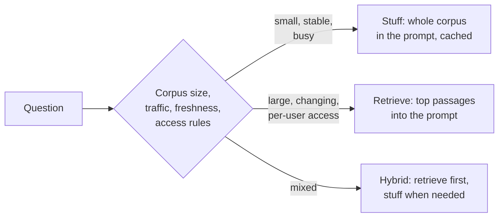

# 2.3 Context stuffing vs retrieval

You can give a model your knowledge in two ways. **Stuffing** puts the whole corpus in the prompt and
lets the model find what it needs. **Retrieval** (RAG, [3.4](../3-components/3.4-retrieval-pipeline.md))
searches the corpus first and sends only the most relevant passages.

Context windows of hundreds of thousands to a million tokens made stuffing practical, and prompt
caching made it cheaper. Retrieval is still the default once the corpus is large, changes often, or has
per-user access rules. Anthropic's rule of thumb: if the knowledge base is under about 200,000 tokens
(about 500 pages), consider just putting it in the prompt.

## How they compare

- **Quality.** With a strong model and enough budget, stuffing often answers better on average: it
  sees everything and can connect facts across documents. Retrieval can only answer from what it found.
- **Cost.** Stuffing pays for the whole corpus on every call; caching cuts that to roughly a tenth while
  the cache stays warm. Retrieval pays for a few thousand tokens plus a search index.
- **Latency.** Prefill grows with prompt length. Even cached, a very long prompt is slow to start.
- **Freshness.** Retrieval reads the current index; a stuffed prompt is a snapshot, and changing it
  breaks the cache.
- **Access control.** Retrieval can filter by user before anything reaches the model. Stuffing sends
  everything, so every user must be allowed to see all of it.
- **Citations.** Retrieval knows which passage supported an answer; stuffing needs the model to cite.
- **Context rot.** More tokens means more distractors. Models use the start and end of a long prompt
  better than the middle ([3.3](../3-components/3.3-context-engineering.md)).

## When to stuff

- The corpus fits comfortably in the window and changes rarely.
- Questions need the whole thing: summaries, comparisons across documents, "what's missing".
- Enough traffic keeps the cache warm, or the job is a one-off.
- You're prototyping: stuff first, then measure whether retrieval is worth building.

## When to retrieve

- The corpus is far larger than the window, or grows.
- Different users may see different documents.
- Answers need citations an auditor can check.
- Latency matters and questions need only a small part of the corpus.

## Use both

- **Retrieve, then read generously.** Retrieve whole documents or sections, not tiny chunks, and let a
  long-context model read them.
- **Route.** Send each question to retrieval or to the full context; one study had the model decide
  and got close to full-context quality at much lower cost.
- **Agentic retrieval.** Let the agent search, then open whole files ([3.5](../3-components/3.5-agentic-retrieval.md)).

## Disadvantages

- **Stuffing:** cost and latency grow with the corpus; no per-user filtering; a cache that expires
  between questions *raises* cost.
- **Retrieval:** a pipeline to build, tune and monitor; missed passages mean wrong or partial answers.

## Go deeper

[Deep dive](../deep-dives/2.3-context-vs-retrieval.md): provider guidance, the research comparing
the two, risk and controls, and cloud mappings.
[Lab 2.3](../../labs/2.3-context-vs-retrieval/README.md): on token cost alone, retrieval was cheaper
than a cached prompt from about 30–60k tokens; at 50 questions a day, caching raised cost.

## Flashcards

Q: What is context stuffing?
A: Putting the whole knowledge base in the prompt and letting the model find what it needs, instead of retrieving passages first.

Q: Up to roughly what size does Anthropic suggest just putting a knowledge base in the prompt?
A: About 200,000 tokens (around 500 pages).

Q: Name two reasons to retrieve even when the corpus fits in the window.
A: Per-user access control, and the need for citations. Also freshness and latency.

Q: Why can prompt caching make stuffing more expensive?
A: If questions arrive further apart than the cache lifetime, every call pays the cache-write premium and never gets the discounted read.

Q: When does stuffing tend to answer better than retrieval?
A: With a strong model, when the corpus fits and the question needs facts from across many documents.

Q: What hybrid approach gets close to full-context quality at lower cost?
A: Route each question: answer from retrieval when it suffices, fall back to the full context when it doesn't.

## Sources and further reading

- [Introducing contextual retrieval](https://www.anthropic.com/engineering/contextual-retrieval) (Anthropic, 2024), "a note on simply using a longer prompt".
- [Long context](https://ai.google.dev/gemini-api/docs/long-context) (Google Gemini API docs).
- [RAG or long-context LLMs?](https://arxiv.org/abs/2407.16833) (Li et al., Google DeepMind, EMNLP 2024).
- [RAG in Azure AI Search](https://learn.microsoft.com/azure/search/retrieval-augmented-generation-overview) (Microsoft).
