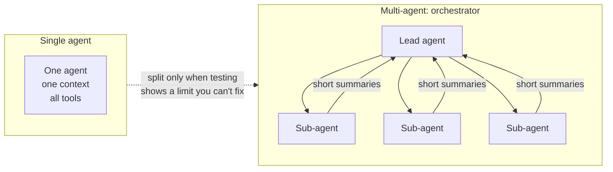

# 2.5 Single-agent vs multi-agent

A **single agent** runs one loop with one context and all the tools it needs. A **multi-agent**
system splits the work across several agents, each with its own instructions, tools and context.
Usually a lead agent hands out work and combines the results ([3.10](../3-components/3.10-multi-agent-and-protocols.md)).

Every provider gives the same advice: start with one agent, and split only when testing shows a
limit you can't fix inside one agent. Splitting buys parallelism and clean contexts. It costs
coordination, hand-offs and tokens.

## How it plays out

- **Breadth tasks (many independent parts) favour multi-agent.** Sub-agents explore in parallel, each
  in a fresh context, and return short summaries. Anthropic's research system with sub-agents beat a
  single agent by 90% on its internal research eval.
- **Chain tasks (each step depends on the last) favour one agent.** Each hand-off can drop a decision
  the next step needed. A Google study found every multi-agent design it tested made sequential
  planning tasks worse.
- **Tokens explain much of the gain.** Anthropic found token use explained 80% of performance
  differences on a browsing benchmark. Multi-agent systems used about 15× the tokens of a chat; a
  single agent used about 4×.
- **Unchecked agents amplify errors.** In Google's study, independent parallel agents amplified errors
  17×; a central orchestrator that checks results held that to about 4×.
- **Gains shrink as models improve.** The same study saw negative returns once a single agent already
  succeeded about 45% of the time.

## When to use multi-agent

- The task splits into independent parts that can run in parallel.
- One context can't hold everything, even with good context engineering ([3.3](../3-components/3.3-context-engineering.md)).
- Hard boundaries: different security or compliance zones, different owning teams, or different data
  permissions. Microsoft lists these as reasons to start multi-agent.
- Read-only helpers: sub-agents that search or review, while one agent makes the decisions and writes.

## When to stay single

- Steps depend on each other, or the work shares state that must stay consistent.
- Distinct "roles" (planner, reviewer, executor) on their own. One agent can play several roles.
- You haven't yet tried a better prompt, better tools or compaction on the single agent.

## Disadvantages of multi-agent

- **Lost context at hand-offs.** Sub-agents misread their brief or make conflicting choices.
- **Cost.** More agents, more briefs, more summaries, more tokens.
- **Harder to debug and evaluate.** Failures spread across agents. One study traced most failures to
  system design (roles, hand-offs, checks), not the model.
- **More security surface.** Each agent has tools and permissions to govern ([3.17](../3-components/3.17-security.md)).

## Go deeper

[Deep dive](../deep-dives/2.5-single-vs-multi-agent.md): provider guidance, the research,
risk and controls, and cloud mappings.
[Lab 2.5](../../labs/2.5-single-vs-multi-agent/README.md): an orchestrator with sub-agents finished a
ten-part breadth task in a quarter of the time at 96% quality; on a six-step chain, one agent with
compaction beat it, 67% to 52%.

## Flashcards

Q: What does every major provider advise about single vs multi-agent?
A: Start with a single agent; move to multiple agents only when testing shows a limit you can't fix in one agent.

Q: Which kind of task favours multi-agent, and which favours one agent?
A: Breadth tasks with independent parts favour multi-agent (parallel, clean contexts); chains of dependent steps favour one agent (no lossy hand-offs).

Q: What did Anthropic find explains most of its multi-agent system's performance?
A: Token usage, about 80% of the variance on a browsing benchmark; multi-agent runs used about 15× the tokens of a chat.

Q: Why do unchecked parallel agents do badly?
A: Errors pass through with no one checking; a Google study found independent agents amplified errors 17×, an orchestrator about 4×.

Q: Name two good reasons to start with multiple agents.
A: Hard security or compliance boundaries, and separate owning teams (also planned modular growth).

Q: What should a multi-agent design be compared against?
A: A well-built single agent with good tools and context engineering, not a naive one.

## Sources and further reading

- [How we built our multi-agent research system](https://www.anthropic.com/engineering/multi-agent-research-system) (Anthropic, 2025).
- [Single agent or multiple agents](https://learn.microsoft.com/azure/cloud-adoption-framework/ai-agents/single-agent-multiple-agents) (Microsoft Cloud Adoption Framework).
- [Towards a science of scaling agent systems](https://research.google/blog/towards-a-science-of-scaling-agent-systems-when-and-why-agent-systems-work/) (Google Research, 2026).
- [Don't build multi-agents](https://cognition.ai/blog/dont-build-multi-agents) (Cognition, 2025) and its [2026 follow-up](https://cognition.ai/blog/multi-agents-working).
- [Why do multi-agent LLM systems fail?](https://arxiv.org/abs/2503.13657) (Cemri et al., NeurIPS 2025).
