# 2.6 Prompting vs RAG vs fine-tuning

<!-- source: images/src/2.6-prompt-rag-finetune.mmd; render with scripts/diagrams.py -->

When a model's output isn't good enough you have three levers. **Prompting** changes the instructions
and examples you send. **Retrieval (RAG)** adds the right information to the prompt at request time
([3.4](../3-components/3.4-retrieval-pipeline.md)). **Fine-tuning** trains the model further on your
examples, changing its weights ([3.18](../3-components/3.18-model-adaptation.md)).

They trade speed of change against depth of change. A prompt changes in minutes. A retrieval pipeline
takes days to build, then updates as fast as you re-index. A fine-tune takes hours to days per run and
becomes a new model you must version, evaluate and retrain.

## Key terms

- **Prompting:** changing the instructions and examples sent with each request.
- **Few-shot examples:** a handful of example inputs and outputs in the prompt that show the model what you want.
- **RAG (retrieval-augmented generation):** searching your documents at request time and adding the relevant passages to the prompt.
- **Fine-tuning:** training a model further on your own examples, which changes its weights and makes a new model version.
- **Knowledge vs behaviour problem:** the model doesn't know something (fix with retrieval) versus it knows but responds in the wrong way (fix with prompting, then fine-tuning).

More in the [glossary](../5-appendix/5.6-glossary.md).

## Two questions, not a ladder

Ask what is actually wrong:

- **Does the model lack knowledge?** The facts are private, recent or not in its training data. That is
  a context problem: use **retrieval**.
- **Does the model behave wrongly?** Wrong format, tone or steps. That is a behaviour problem:
  **prompt** first, then **fine-tune** if prompting plateaus.

Many systems need both. All the major providers agree on the order: prompt first, RAG for knowledge,
fine-tune only for behaviour prompting can't pin down.

## Why fine-tuning is a poor way to add facts

- **It learns new facts slowly**, and only when shown many paraphrases of each. In a direct comparison,
  RAG beat fine-tuning at injecting knowledge.
- **It can raise hallucination.** Once a model has been trained on facts it didn't already know, it
  becomes more prone to make things up.
- **It can't cite** where an answer came from, and it **goes stale** the day a policy changes.

## Example

A bank's assistant answers questions about fees but gets two things wrong.

It quotes last year's overdraft fee. That's a **knowledge** problem: the fee changed after the model was
trained. Fine-tuning would bake in this year's fee until it changes again, and can't cite where it came
from. Retrieval from the current fee schedule fixes it the day the schedule is updated.

It also writes long, chatty answers when the channel needs two sentences and a link. That's a
**behaviour** problem. A clearer instruction and three short examples fix most of it in an afternoon.
Only if an eval still fails on format after that, at high volume, is fine-tuning a small model worth
the training data, the evals and the retraining it brings.

## When to fine-tune

- **Behaviour prompting can't make consistent**: fixed classification labels, strict output
  conventions, a house style.
- **Cost at volume**: training a smaller model to do one narrow task as well as a larger one, which
  cuts cost and latency per call ([2.1](2.1-cost-quality-latency.md)).
- **Only against a failing eval** that prompting and retrieval couldn't fix
  ([3.15](../3-components/3.15-evals.md)), so you can prove it helped.

The levers stack: a fine-tuned model can still use retrieval.

## Disadvantages of each

- **Prompting:** prompts grow long and brittle; every token costs on every call.
- **RAG:** answers are only as good as retrieval; a missed passage becomes a wrong answer.
- **Fine-tuning:** needs a labelled dataset that matches production; may lose general ability; must be
  retrained and re-validated on every base-model upgrade; training data can leak back out.

## Go deeper

[Deep dive](../deep-dives/2.6-prompt-rag-finetune.md): what each provider recommends, the two 2024
studies on knowledge injection, a side-by-side comparison, and risk and controls for training data.

## Flashcards

Q: How should you decide between RAG and fine-tuning?
A: Ask what is wrong. Missing knowledge is a context problem: use retrieval. Wrong behaviour is a behaviour problem: prompt, then fine-tune. They can stack.

Q: Why is fine-tuning a poor way to add facts?
A: New facts are learned slowly, need many paraphrases, can raise hallucination, can't be cited and go stale. RAG beat fine-tuning for knowledge injection.

Q: What should you try first when output quality is poor, and why?
A: Prompting: it's fastest to iterate, cheapest, needs few examples and doesn't risk degrading the model's general abilities.

Q: Name two good reasons to fine-tune.
A: Behaviour that prompting can't make consistent (fixed labels, strict formats, house conventions), and running a narrow task on a smaller, cheaper, faster model at volume.

Q: What must exist before you fine-tune?
A: An eval baseline showing a failure that prompting and retrieval can't fix, so you can prove the fine-tune helps.

## Sources and further reading

- [Optimizing LLM accuracy](https://developers.openai.com/api/docs/guides/optimizing-llm-accuracy) (OpenAI): the context-vs-behaviour framing.
- [Comparing RAG and fine-tuning](https://docs.aws.amazon.com/prescriptive-guidance/latest/retrieval-augmented-generation-options/rag-vs-fine-tuning.html) (AWS Prescriptive Guidance).
- [Fine-Tuning or Retrieval?](https://aclanthology.org/2024.emnlp-main.15/) (Ovadia et al., EMNLP 2024): RAG wins for knowledge injection.
- [Does Fine-Tuning LLMs on New Knowledge Encourage Hallucinations?](https://aclanthology.org/2024.emnlp-main.444) (Gekhman et al., EMNLP 2024).
