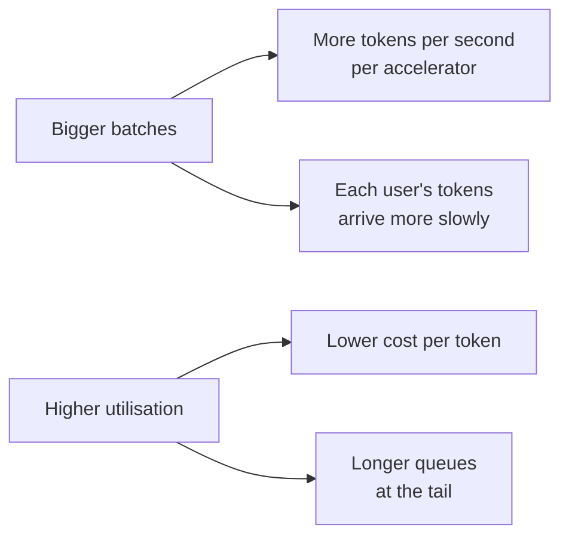

# 2.7 Throughput vs per-request latency in serving

The classic primer contrasts latency (time to do one thing) with throughput (things done per unit of
time). Model serving makes the tension sharp, because one accelerator serves many requests at once.
Packing more requests together raises the tokens per second the hardware produces and lowers the cost
per token. It also makes each user's answer arrive more slowly, and a busier server makes requests
wait longer to start.

You meet this trade-off whether you run models yourself or buy them: providers sell it back to you as
price tiers.

## Why batching helps, then hurts

- **Two phases.** *Prefill* reads the whole prompt at once and produces the first token; it keeps the
  hardware's arithmetic busy. *Decode* produces one token at a time and is limited by how fast weights
  can be read from memory.
- **Batching is nearly free at first.** In decode, one read of the weights serves every sequence in the
  batch, so throughput rises almost linearly while each user barely slows.
- **Then each user pays.** Every sequence keeps an attention cache that must also be read each step.
  As the batch grows, step time grows, and each user's tokens per second fall.
- **Continuous batching** lets requests join and leave the batch at every step instead of waiting for
  the slowest one to finish. Every modern serving engine does it
  ([3.8](../3-components/3.8-serving-internals.md)).

## The metrics that matter

- **Time to first token (TTFT):** queueing plus prefill. What makes an interface feel responsive.
- **Time per output token (TPOT)**, or its inverse, output tokens per second: how fast the answer
  streams. It only needs to beat reading speed for chat, but agents and batch jobs feel all of it.
- **Total latency** ≈ TTFT + TPOT × output tokens.
- **Goodput:** requests per second served *within* your TTFT and TPOT targets. Maximise this, not raw
  throughput.

## How it shows up when you buy

- **Pay-as-you-go** shares capacity with other customers: cheapest to start, but latency varies and
  you may be throttled at peaks.
- **Provisioned or reserved capacity** gives dedicated throughput and steadier latency for an hourly
  or monthly fee, whether you use it or not.
- **Flex or batch tiers** are cheaper because you accept waiting.
- **Priority or fast tiers** cost more to jump the queue or stream faster.

## When to favour latency

- Interactive chat and voice: optimise time to first token, stream the rest.
- Agents that chain many calls: per-token speed compounds across steps.

## When to favour throughput

- Overnight document processing, evaluation runs, back-fills: batch tiers at about half price.
- Steady, predictable volume: provisioned capacity can be cheaper per token *if* utilisation stays high.

## Disadvantages and failure modes

- **Optimising throughput alone.** A server can post record tokens per second while most users miss
  the latency target.
- **Running at high utilisation.** Queues grow non-linearly: above roughly 80% busy, tail waits balloon.
- **Buying provisioned capacity for spiky traffic.** At 20% utilisation you pay for the idle 80%.
- **Long prompts block short ones.** A huge prefill stalls everyone's decode unless the engine splits
  it into chunks.

## Go deeper

[Deep dive](../deep-dives/2.7-throughput-vs-latency.md): continuous batching and disaggregation
results, the providers' capacity options compared, and cloud mappings.
[Lab 2.7](../../labs/2.7-throughput-vs-latency/README.md): batch 1 → 32 gave 21× throughput for a 33%
per-user slowdown; mean queueing delay rose more than fivefold from 50% to 85% utilisation.

## Flashcards

Q: Why does batching raise LLM serving throughput almost for free at first?
A: Decode is limited by reading weights from memory, and one read serves every sequence in the batch.

Q: What eventually limits batch size?
A: Memory for each sequence's attention (KV) cache, or the per-token latency target, whichever binds first.

Q: What is goodput?
A: The request rate a system can serve while meeting its latency targets (TTFT and TPOT), as opposed to raw throughput.

Q: Total latency of a streamed answer, in terms of TTFT and TPOT?
A: About TTFT + TPOT × number of output tokens.

Q: When does provisioned capacity lose money compared with pay-as-you-go?
A: When utilisation is low or traffic is spiky: you pay for reserved capacity whether you use it or not.

Q: Why keep headroom instead of running servers near 100% busy?
A: Queueing delay grows non-linearly with utilisation; tail latency explodes above roughly 80%.

## Sources and further reading

- [Orca: a distributed serving system for transformer-based generative models](https://www.usenix.org/conference/osdi22/presentation/yu) (Yu et al., OSDI 2022).
- [How continuous batching enables 23x throughput in LLM inference](https://anyscale.com/blog/continuous-batching-llm-inference) (Anyscale, 2023).
- [DistServe: goodput-optimized LLM serving](https://arxiv.org/abs/2401.09670) (Zhong et al., OSDI 2024).
- [Provisioned throughput](https://learn.microsoft.com/azure/foundry-classic/openai/concepts/provisioned-throughput) (Microsoft Foundry).
