# 3.1 AI gateway and router

<!-- source: images/src/3.1-ai-gateway-and-router.mmd; render with scripts/diagrams.py -->

An AI gateway is a reverse proxy that every model call in an organisation passes through. Apps call
one endpoint with one credential. The gateway decides which model serves the request, enforces who may
use what and how much, and records what happened.

The need appears with the second team or the second provider. Without a gateway every app holds its
own provider keys, writes its own retries and reports its own usage, and nobody can say what the
organisation spends, on what. A gateway moves those concerns into one shared layer, as API gateways
did for web services. Microsoft, AWS, Google and Anthropic all describe the same set of
responsibilities.

## Key terms

- **Reverse proxy:** a server that sits in front of other services and forwards requests to them; callers see only the proxy.
- **Token quota:** a limit on how many tokens a team or app may use per minute or per month.
- **Fallback:** sending a request to another model, deployment, region or provider when the first fails.
- **Circuit breaker:** stops sending traffic to a failing backend for a while, so it can recover and callers fail fast.
- **Chargeback:** billing each team for the model usage it caused.

More in the [glossary](../5-appendix/5.6-glossary.md).

## What it does

- **One interface.** One API format for every model and provider; apps don't change when you swap one.
- **Authentication.** Apps authenticate to the gateway; only the gateway holds provider credentials.
- **Token quotas and budgets.** Limits per team or app in tokens per minute and spend per month.
  Count tokens, not requests: one request can be ten tokens or two hundred thousand.
- **Routing.** By model name, by rule (caller, task, data classification), or by a learned router
  that predicts the cheapest adequate model ([2.1](../2-trade-offs/2.1-cost-quality-latency.md)).
- **Resilience.** Timeouts, retries with back-off, fallback to another deployment, region or provider,
  and circuit breakers that respect the provider's "retry after" signal.
- **Policy hooks.** One place to call input and output guardrails and masking for every app
  ([3.2](3.2-input-guardrails.md), [3.12](3.12-output-guardrails.md)).
- **Telemetry.** Tokens, cost, latency and errors per caller, for chargeback, capacity and audit.

## Example

Three teams at a bank each call models directly: two use one provider, one uses another, each with its
own keys and retry code. One month the bill doubles and nobody can say which team caused it; a
provider outage takes down one team while another region sat idle.

With a gateway, all three call one endpoint with their own gateway credential. Each team gets a token
quota and a monthly budget, so the spike shows up as one team hitting its limit on day 12. Routing rules
send confidential traffic only to approved regions. When the primary deployment returns errors, the
circuit breaker opens and requests fail over to a second region that was evaluated in advance. Finance
gets a chargeback report from the gateway's usage records instead of guessing.

## When to use

- More than one team, app or provider shares model access.
- You need chargeback, budgets, or a record of who called which model.
- Policy, such as guardrails or data residency, must apply to every app the same way.
- You need failover across deployments, regions or providers.

## When to avoid

- One app calls one model deployment. Set limits on the deployment itself.
- It would add a hop to a latency-critical path without a control you need.

## Disadvantages

- **It is a new critical dependency.** The gateway caps the availability of everything behind it: a
  99.9% gateway in front of two providers still gives at most 99.9%. Run it redundantly.
- **Untested fallbacks.** Failing over to a model nobody evaluated swaps an outage for a quality
  incident; failing over to the wrong region can break data residency.
- **Retry storms.** Retries without back-off amplify a provider's overload.
- **Logs become sensitive data.** Stored prompts and responses inherit the sensitivity of what's in
  them.
- **Central bottleneck.** Without self-service onboarding, every AI feature waits on the platform team.

## Go deeper

[Deep dive](../deep-dives/3.1-ai-gateway-and-router.md): how each provider frames the gateway,
routing modes in detail, availability arithmetic, risk and controls, and cloud mappings.

## Flashcards

Q: What problem does an AI gateway solve?
A: It moves credentials, quotas, routing, resilience, policy and usage tracking out of every application into one shared layer, so you can answer who used which model, how much, at what cost.

Q: Why should an AI gateway limit tokens rather than requests?
A: Cost and capacity scale with tokens; one request can be a few tokens or hundreds of thousands.

Q: What is the risk in an untested fallback chain?
A: It can silently route to a weaker model (a quality incident instead of an outage) or to a provider or region your data may not go to.

Q: When is a gateway unnecessary?
A: When one application calls one model deployment; set limits on the deployment itself.

Q: Which OWASP LLM risk does a gateway mainly mitigate?
A: LLM10:2025 Unbounded Consumption (including denial of wallet), through size limits, token quotas, budgets, timeouts and anomaly detection.

## Sources and further reading

- [AI gateway capabilities in Azure API Management](https://learn.microsoft.com/azure/api-management/genai-gateway-capabilities) (Microsoft).
- [Guidance for Multi-Provider Generative AI Gateway on AWS](https://docs.aws.amazon.com/solutions/multi-provider-generative-ai-gateway-on-aws/) (AWS).
- [Build an AI gateway](https://docs.cloud.google.com/apigee/docs/api-platform/fundamentals/build-ai-gateway) (Google Cloud).
- [LLM10:2025 Unbounded Consumption](https://genai.owasp.org/llmrisk/llm102025-unbounded-consumption/) (OWASP).
