# 3.11 Agent memory

<!-- source: images/src/3.11-memory.mmd; render with scripts/diagrams.py -->

A model forgets everything between calls. *Memory* is what an agent keeps beyond one context window
so it can pick up where it left off, personalise, and stop asking the same questions. The context
window is the agent's **working memory** ([3.3](3.3-context-engineering.md)). Everything else is
**long-term memory**: stored outside, written selectively, and loaded back when relevant.

The hard part isn't storage. It's deciding what to write, keeping it current, and not loading the
wrong thing back.

## Key terms

- **Working memory:** the current context window.
- **Long-term memory:** facts kept outside the context window and loaded back when relevant.
- **Semantic, episodic and procedural memory:** facts ("prefers British English"), past events ("chose plan B last week"), and how to do things.
- **Memory consolidation:** merging a new memory with old ones: updating, deduplicating, or deleting what it contradicts.
- **Memory poisoning:** untrusted content planting a false memory that steers later sessions.

More in the [glossary](../5-appendix/5.6-glossary.md).

## Types

Researchers borrow four memory types from cognitive science (the CoALA framework):

- **Working memory.** The current context: instructions, recent turns, tool results.
- **Semantic memory.** Facts: "prefers British English", "account is in Cape Town".
- **Episodic memory.** Past events: "last week we compared plan A and B; chose B for latency".
- **Procedural memory.** How to do things: rules, routines, skills, learned from experience or written
  by people.

Managed services map onto these. Typical built-ins are *user profile* or *preferences* (semantic),
*session summaries* (episodic), and in some, *procedural* routines.

## How it works

- **Short-term (session) memory.** The raw conversation for the current session, managed by trimming or
  compaction.
- **Extraction.** After a turn or session, a model pulls out facts worth keeping, usually in the
  background so the user doesn't wait.
- **Consolidation.** New facts are merged with old ones: update, deduplicate, or delete on
  contradiction ("now vegetarian" replaces "eats meat").
- **Scope.** Memories belong to a user, a team or an agent, and must never leak across scopes.
- **Retrieval.** Load stable profile facts at the start; search for relevant summaries each turn. Or
  let the agent read and write memory itself as a tool (a memory file directory, for example).

## Example

A banking assistant serves the same customer over 50 sessions. The customer says they're moving to
Cape Town, later changes their contact preference to email, and once pastes in an email that contains
a planted "fact".

Replaying every past transcript costs about 73,500 tokens a session by session 50 and still answered
with an outdated fact 22% of the time. Extracting facts and updating old ones in place recalled the
current fact 88% of the time at about 270 tokens a session. Writing only facts the customer stated
themselves, not ones found in pasted content, stopped the planted fact being recalled at all
([Lab 3.11](../../labs/3.11-memory/README.md)).

## When to use

- Users come back across sessions and expect continuity.
- Personalisation matters: preferences, defaults, history.
- Long-running agents that must survive context resets: notes and progress files.

## When to avoid

- One-off tasks, or anonymous users.
- When memory would be the only record of something important. Keep the system of record; memory holds
  a summary.
- Sensitive data you have no lawful or necessary reason to keep.

## Disadvantages

- **Stale and conflicting memories.** Without consolidation, old facts compete with new ones.
- **Memory poisoning.** Untrusted content (an email, a web page) can plant a "fact" that steers later
  sessions. Check where a memory came from before writing it.
- **Privacy.** Memory is personal data: needs scoping, retention limits, user visibility and deletion.
- **Extraction is lossy and costs model calls** on every write.
- **Hard to test.** Bugs show up sessions later; you need multi-session evals ([3.15](3.15-evals.md)).

## Go deeper

[Deep dive](../deep-dives/3.11-memory.md): each provider's memory service, the research, risk and
controls, and cloud mappings.
[Lab 3.11](../../labs/3.11-memory/README.md): over 50 sessions, extracting and consolidating facts
recalled the current fact 88% of the time at 270 tokens a session; replaying every transcript recalled
76% at 73,500 tokens.

## Flashcards

Q: What is the difference between working memory and long-term memory in an agent?
A: Working memory is the current context window; long-term memory is stored outside it, written selectively and loaded back when relevant.

Q: Name the four memory types in the CoALA framework.
A: Working, semantic (facts), episodic (past events) and procedural (how to do things).

Q: What is memory consolidation?
A: Merging new memories with existing ones: updating, deduplicating, or deleting old facts that new ones contradict.

Q: What is memory poisoning, and one control for it?
A: Untrusted content planting false memories that steer later sessions; only write memories from trusted sources, such as what the user said, and record provenance.

Q: Why is replaying full transcripts a poor memory strategy?
A: It costs more every session and keeps old versions of facts, so the model can answer with stale information.

Q: Name two privacy controls for agent memory.
A: Per-user scoping and retention limits; also letting users see and delete their memories, and filtering sensitive data before writing.

## Sources and further reading

- [Cognitive architectures for language agents (CoALA)](https://arxiv.org/abs/2309.02427) (Sumers et al., 2023).
- [AgentCore long-term memory](https://docs.aws.amazon.com/bedrock-agentcore/latest/devguide/long-term-memory.html) (AWS).
- [Memory in Foundry Agent Service](https://learn.microsoft.com/azure/foundry/agents/concepts/what-is-memory) (Microsoft).
- [Memory tool](https://platform.claude.com/docs/en/agents-and-tools/tool-use/memory-tool) (Anthropic).
