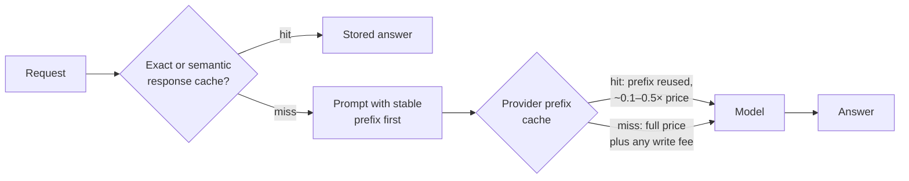

# 3.13 Caching

Caching in AI systems happens at two levels, and they carry very different risks.

**Prompt (prefix) caching** reuses the model's work on the *start* of a prompt. If many requests
begin with the same instructions, documents or tool definitions, the provider keeps the processed
prefix and charges a fraction of the input price when the next request starts the same way. The model
still generates a fresh answer. All five major providers offer it.

**Response caching** reuses a previous *answer*. An exact cache returns it for an identical request; a
*semantic* cache returns it for a request whose meaning looks similar. No model runs at all, which is
the saving and the danger.

## How prompt caching works

- **Only an exact prefix matches.** Put stable content first (system prompt, tools, reference
  documents) and anything that varies (user question, timestamps) last. One changed character early in
  the prompt breaks every hit after it.
- **There is a minimum length**, typically around a thousand tokens or more.
- **Entries expire.** Lifetimes run from minutes to a day depending on provider and setting; a hit
  usually refreshes them.
- **Pricing differs.** Reads cost roughly 0.1–0.5× the input price. Some providers charge extra to
  write, or charge for storage.
- **It also cuts time to first token**, because the prefix isn't processed again.

Self-hosted engines do the same thing with prefix caching ([3.8](3.8-serving-internals.md)).

## When to use

- **Prompt caching:** long, stable prefixes reused often: system prompts, RAG instructions, agent tool
  definitions, a document asked about many times, multi-turn conversations.
- **Exact response caching:** deterministic, repeated calls such as classification or extraction of the
  same input.
- **Semantic caching:** only for low-stakes, general answers that don't depend on who is asking.

## When to avoid

- Prompt caching for prefixes reused less often than the cache lifetime: you pay any write fee and
  never collect.
- Semantic caching for anything personal, numeric, regulated, or time-sensitive.

## Disadvantages

- **Prefix order is now a design constraint.** Inserting today's date at the top of the prompt silently
  destroys the hit rate.
- **Hits aren't guaranteed.** Routing and eviction mean you must measure the hit rate, not assume it.
- **Semantic caches serve wrong answers confidently.** A question that differs by one word ("cheque"
  instead of "savings") can look more similar than a genuine paraphrase. Nothing checks the reused
  answer.
- **Cross-user leakage.** A response cache shared across users can serve one user's answer, built from
  their data, to another. Partition by user or tenant.
- **Retention.** Cached prompts are stored customer content; longer retention options can affect
  zero-data-retention commitments.

## Go deeper

[Deep dive](../deep-dives/3.13-caching.md): each provider's pricing, minimums and lifetimes, semantic
cache safeguards, risk and controls, and cloud mappings.
[Lab 3.13](../../labs/3.13-caching/README.md): caching paid only once a prefix recurred every few
minutes; no similarity threshold separated paraphrases from one-word changes.

## Flashcards

Q: What is the difference between prompt caching and response caching?
A: Prompt caching reuses the model's processing of a shared prompt prefix; the model still generates a fresh answer. Response caching returns a stored answer and skips the model entirely.

Q: How should you order a prompt to get prompt-cache hits?
A: Stable content first (system prompt, tools, reference documents), varying content (user question, timestamps) last. Only an exact prefix matches.

Q: When does prompt caching cost more than it saves?
A: When the prefix isn't reused within the cache lifetime, so you pay any write premium without collecting cheap reads.

Q: Why is semantic caching risky for a bank assistant?
A: A question that differs by one important word can look similar enough to reuse a wrong answer, and a shared cache can serve one user's answer to another.

Q: Besides cost, what does prompt caching improve?
A: Time to first token, because the cached prefix isn't processed again.

## Sources and further reading

- [Prompt caching](https://docs.claude.com/en/docs/build-with-claude/prompt-caching) (Anthropic).
- [Prompt caching](https://developers.openai.com/api/docs/guides/prompt-caching) (OpenAI).
- [Context caching overview](https://docs.cloud.google.com/vertex-ai/generative-ai/docs/context-cache/context-cache-overview) (Google Cloud).
- [Semantic cache lookup policy](https://learn.microsoft.com/azure/api-management/llm-semantic-cache-lookup-policy) (Microsoft): includes its own warning about similarity-based reuse.
