# 3.14 Asynchronism: batch, durable execution, back-pressure

<!-- source: images/src/3.14-asynchronism.mmd; render with scripts/diagrams.py -->

The classic primer's advice holds: don't make a user wait for work that can happen in the background.
Model calls make it more pressing. They take seconds to minutes, agents chain dozens of them, providers
throttle at peak, and every repeated call costs tokens. Asynchronism decouples *accepting* work from
*doing* it.

## Key terms

- **Queue:** a buffer that accepts work now and lets workers process it at a sustainable pace.
- **Batch API:** sending many requests to be processed within hours, at about half price.
- **Durable execution:** a workflow engine records each completed step, so a failed run resumes from its last checkpoint.
- **Exponential backoff with jitter:** waiting longer after each failure, by a random amount, so callers don't retry in lock-step.
- **Idempotency key:** a unique ID sent with an action so that repeating the request doesn't repeat the effect.
- **Back-pressure:** slowing or refusing new work when the system can't keep up, instead of letting queues grow without limit.

More in the [glossary](../5-appendix/5.6-glossary.md).

## The patterns

- **Queues and workers.** Accept the request, return a job ID, process it with workers that respect
  the provider's rate limits. The queue absorbs bursts; workers draw it down at a sustainable pace.
- **Batch APIs.** For work nobody is waiting for, every major provider offers asynchronous batch
  processing at about half price, with results within hours (a 24-hour window is typical).
- **Background mode.** Some APIs let a single long request run server-side while you poll or reconnect,
  so a dropped connection doesn't lose a ten-minute reasoning task.
- **Durable execution.** A workflow engine records each completed step (each model call, each tool
  result). If the process crashes or a step fails, it resumes from the last checkpoint instead of
  starting over, and doesn't repeat side effects or pay for the same tokens twice. Long agent runs and
  waits for human approval need this.
- **Back-pressure.** When the queue grows faster than workers can drain it, slow down or refuse new
  work rather than letting latency grow without limit ([2.7](../2-trade-offs/2.7-throughput-vs-latency.md)).

## Retrying well

- **Retry only what's transient:** rate limits, overload, timeouts and server errors. Don't retry
  bad requests, or a "model not found" error ([3.7](3.7-model-layer.md)).
- **Back off exponentially, with jitter.** Randomise each wait so callers don't retry in lock-step.
  Honour any "retry after" hint.
- **Cap retries and total time.** Set a timeout on every call.
- **Make side effects idempotent.** A timeout doesn't mean the action didn't happen. Pass a unique
  request ID so a repeated "send payment" happens once.
- **Fail over** to another deployment or provider when one is overloaded ([3.1](3.1-ai-gateway-and-router.md)).

## Example

A provider throttles briefly at peak, and a thousand callers fail at once. If they retry
immediately, each successful call takes hundreds of attempts and the storm prolongs the outage. With
backoff but no jitter, they all retry together in waves. With randomised waits, the same recovery used
the fewest attempts and finished in about 45 seconds ([Lab 3.14](../../labs/3.14-asynchronism/README.md)).

The same team runs a 12-step overnight agent. Restarting from scratch on any failure cost 42% extra
model calls at a 5% failure rate per step; resuming from a checkpoint cost 5%. The step that sends
the summary email carries an idempotency key, so a retry after a timeout never sends it twice.

## When to use

- Document processing, evaluation runs, back-fills and nightly jobs: batch APIs.
- Any user action that takes more than a few seconds: queue it and notify on completion.
- Agent runs with many steps, long waits or human approvals: durable execution.

## When to avoid

- Interactive chat that can stream: keep it synchronous and stream the answer.
- Durable workflow engines for single short calls: plain retries are enough.

## Disadvantages

- **More moving parts:** queues, workers, state stores and notifications to run and monitor.
- **Harder to reason about:** results arrive later; callers must handle partial failure and expiry.
- **Large payloads in workflow history.** Prompts and outputs can bloat a workflow engine's records;
  store them separately and keep references.
- **Data retention.** Batch inputs, background responses and checkpoints are stored customer data,
  sometimes outside zero-retention arrangements.

## Go deeper

[Deep dive](../deep-dives/3.14-asynchronism.md): provider batch and background limits, durable
execution options, retry guidance, risk and controls, and cloud mappings.
[Lab 3.14](../../labs/3.14-asynchronism/README.md): immediate retries made 234 attempts per call;
backoff without jitter finished last; checkpoints cut a 12-step run's overhead from 42% to 5%.

## Flashcards

Q: Why add jitter to exponential backoff?
A: Without it, callers that failed together retry together, and each wave overloads the server again. Random waits spread retries out.

Q: Which errors should a client retry?
A: Transient ones: rate limits, overload, timeouts and server errors. Not invalid requests or "model not found".

Q: Why must retried actions be idempotent?
A: A timeout doesn't prove the action failed; without a unique request ID a retry can perform it twice (for example, a double payment).

Q: What does durable execution give a long agent run?
A: Each completed step is recorded, so after a crash or failure the run resumes from the last checkpoint, without repeating side effects or paying for tokens again.

Q: When should you use a batch API?
A: For work nobody is waiting for: about half price, with results within hours.

## Sources and further reading

- [Timeouts, retries, and backoff with jitter](https://aws.amazon.com/builders-library/timeouts-retries-and-backoff-with-jitter) (Amazon Builders' Library).
- [Making retries safe with idempotent APIs](https://aws.amazon.com/builders-library/making-retries-safe-with-idempotent-APIs/) (Amazon Builders' Library).
- [Batch processing](https://docs.anthropic.com/en/docs/build-with-claude/batch-processing) (Anthropic).
- [Background mode](https://developers.openai.com/api/docs/guides/background) (OpenAI).
