# 3.15 Evals

<!-- source: images/src/3.15-evals.mmd; render with scripts/diagrams.py -->

An eval is a test for an AI system: give it an input, grade the output, and measure how often it
succeeds. Unit tests assume the same input always gives the same output. Model-backed systems don't, so
you ask "how often does it pass, on which kinds of case, and is that better than before?"

Evals turn the quality bar from [the Method](../1-method/1-method.md) into a number. Without them,
changes are judged by trying a few examples and deciding it "seems better", which OpenAI calls
*vibe-based evals*. Anthropic, OpenAI, Google, Microsoft and AWS all describe the same parts.

## Key terms

- **Eval:** a repeatable test of a model-backed system: inputs, a grader, and a pass rate.
- **Grader:** what scores an output: code, a model judge, or a person.
- **LLM-as-judge:** a model scoring outputs against a rubric; it must be checked against human labels.
- **Confidence interval:** the range a measured pass rate is likely to fall in; it shrinks as the eval set grows.
- **Regression eval:** cases the system already passes, run on every change to catch breakage.
- **pass@k and pass^k:** at least one of k tries succeeds, versus all k tries succeed.

More in the [glossary](../5-appendix/5.6-glossary.md).

## The parts

- **Cases.** Inputs plus expected answers or grading criteria. The best come from real use: logs,
  tickets, failures you've seen. Add edge cases and requests the system must refuse.
- **Graders.** Logic that scores an output (below).
- **Scores with uncertainty.** A pass rate is an estimate from a sample; report it with an error bar.
- **A decision rule.** What score, or change in score, blocks a release.

## Three kinds of grader

- **Code.** Exact match, schema checks, unit tests, "did it cite a source?" Fast, cheap, repeatable;
  only works when correctness can be checked mechanically.
- **Model (LLM-as-judge).** A second model scores against a rubric or picks the better of two answers.
  Handles open-ended output, but has biases: it favours the first answer shown, longer answers, and its
  own style. Check it against human labels before trusting it.
- **Human.** Experts label a sample. The reference standard, used to calibrate judges and spot-check.

Use the cheapest grader that is valid for the criterion.

## What to measure

- **Each stage separately**, so a failure points at its cause. For RAG: did the right passages come
  back (retrieval), and is the answer supported by them, correct and on topic (generation)?
- **Safety** (harmful content, correct refusals) and **operations** (latency, cost).
- **Agents:** grade the outcome, not a fixed sequence of tool calls, and read transcripts to learn why
  runs fail. Track *pass^k*, success in all of k tries, because users expect consistency
  ([2.2](../2-trade-offs/2.2-determinism-vs-autonomy.md)).

Keep two suites. **Capability evals** are hard tasks that show where to improve. **Regression evals**
cover what already works, sit near 100%, and block changes that break them.

## Reading the results

- **Report an interval.** 100 cases at an 80% pass rate is only good to about ±8 points.
- **Compare on the same cases** and look at per-case differences (paired analysis).
- **Size the set to the change you care about.** Catching a drop from 80% to 75% reliably needs
  roughly 1,000–2,000 cases, not 100.
- **Run on every change, and after launch on sampled production traffic.** Production failures become
  new cases.

## Example

A team changes its prompt, and the pass rate on their 100-case golden set moves from 81% to 79%. Is
that a regression? With 100 cases, each score is only known to within about ±8 points, so it could be
noise. In [Lab 3.15](../../labs/3.15-evals/README.md), a real five-point drop was missed about nine
times in ten at that size.

They grow the set to 1,000 cases drawn from real tickets. They run both prompt versions on the same
cases and compare them case by case (a paired comparison). A code grader checks "cites a source"; a
model judge scores helpfulness, checked first against 200 human-labelled answers. The release rule: block if the paired
difference is significantly negative, or if any regression case fails.

## When to use

- From the first prototype: a small set of real cases beats none.
- Before every prompt, model, retrieval or tool change, and every model upgrade.

## When to avoid

- A model judge where a code check would do.
- Public benchmarks as a stand-in for your own task.

## Disadvantages

- **Cost and time.** Human grading is slow; model judges cost calls; large suites run slowly. Run a
  fast subset on every change and the full suite before release.
- **Judges drift.** A new judge model or rubric changes every score; version it like code.
- **Criteria drift.** You only discover some criteria by reading outputs; the suite is never finished.
- **Tuning to the test.** Prompts tweaked until the eval passes, with no held-out cases to show the gain
  is real.

## Go deeper

[Deep dive](../deep-dives/3.15-evals.md): judge biases and calibration, RAG metrics by provider,
statistics for small samples, online evaluation, risk and controls, and cloud mappings.
[Lab 3.15](../../labs/3.15-evals/README.md): 100 cases caught a real five-point drop only 8% of the
time; about 2,000 were needed.

## Flashcards

Q: What are the three kinds of grader, and when do you use each?
A: Code (when correctness can be checked mechanically), model/LLM-as-judge (open-ended output, after calibration), human (reference standard, used to calibrate and spot-check).

Q: Name three biases of LLM judges.
A: Position bias (favours the first answer), verbosity bias (favours longer answers), self-enhancement (favours its own style or outputs).

Q: Why measure retrieval and generation separately in a RAG system?
A: So a failure points at its cause: missing passages (retrieval) versus an answer not supported by the passages it had (generation).

Q: What is the difference between pass@k and pass^k?
A: pass@k: at least one of k attempts succeeds (retry acceptable). pass^k: all k succeed (consistency users expect).

Q: Capability evals vs regression evals?
A: Capability evals are hard tasks that show where to improve; regression evals cover what already works and gate releases near 100%.

Q: Roughly how precise is a pass rate measured on 100 cases?
A: About ±8 percentage points (95% CI at an 80% pass rate), too coarse to detect a 5-point regression reliably.

## Sources and further reading

- [Demystifying evals for AI agents](https://www.anthropic.com/engineering/demystifying-evals-for-ai-agents) (Anthropic, 2026).
- [Evaluation best practices](https://developers.openai.com/api/docs/guides/evaluation-best-practices) (OpenAI).
- [Judging LLM-as-a-Judge](https://arxiv.org/abs/2306.05685) (Zheng et al., NeurIPS 2023).
- [A statistical approach to model evaluations](https://www.anthropic.com/research/statistical-approach-to-model-evals) (Anthropic, 2024).
