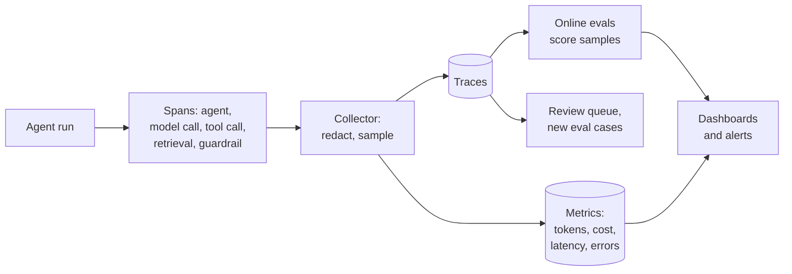

# 3.16 Observability

Observability is being able to answer "what did the system do, and why?" from the data it emits. For
ordinary services that means logs, metrics and traces. AI systems need more. The same input can give
different outputs, a run may take dozens of steps, and the worst failures, a confident wrong answer,
raise no error at all.

The common answer is **tracing**. Every agent run becomes a tree of *spans*: the agent invocation, each
model call, each tool call, each retrieval. Each span records what went in, what came out, how long it
took and what it cost. OpenTelemetry's *GenAI semantic conventions* name these spans the same way across
vendors, though they are still marked as in development.

## What to capture

- **Per model call:** model and version, tokens in and out, cached tokens, latency, time to first
  token, finish reason, cost.
- **Per tool call:** tool name, arguments, result or error, duration.
- **Per agent run:** steps, tool calls, total cost and time, outcome.
- **Context:** user, session, prompt version, model version, feature flags. Link to the eval run
  that approved this version ([4.7](../4-solved-designs/4.7-eval-and-release-pipeline.md)).
- **Quality signals:** user feedback, guardrail triggers, online eval scores.
- **Content (prompts and outputs):** most useful for debugging, most sensitive. Capture deliberately.

## How it works

- **Instrument once, export anywhere.** Use OpenTelemetry so traces can go to any backend.
- **Propagate trace context** across services, tools, MCP servers and other agents, so one user request
  is one trace ([3.10](3.10-multi-agent-and-protocols.md)).
- **Sample at the tail.** Decide after the run: keep every error, slow run and flagged run, plus a
  random share of the rest.
- **Score in production.** Run cheap checks on every run and a model judge on a sample; send flagged
  runs to review and turn them into eval cases ([3.15](3.15-evals.md)).
- **Watch drift.** Track scores, refusal rates, cost and tool-error rates over time and across model
  versions.

## When to use

- Always, from the first prototype. Traces are how you debug agents at all.
- Regulated settings: traces are the evidence of what the system did.

## When to avoid

- Capturing full content by default where it holds personal or confidential data. Capture metadata
  everywhere; capture content only where it's allowed, redacted, access-controlled and retained for a
  set period.
- Sending traces to a vendor backend you haven't approved. Some SDKs export traces to their provider
  by default.

## Disadvantages

- **Traces are big and sensitive.** Content makes them about 15× larger and full of personal data.
- **Errors are the easy part.** Silent failures need evaluators, which cost money and raise false flags.
- **Standards are young.** Span names and attributes are still changing.
- **Long agent runs are hard to read.** A 200-span tree needs summaries and search, not just a timeline.

## Go deeper

[Deep dive](../deep-dives/3.16-observability.md): OpenTelemetry GenAI conventions, each provider's
tracing, metrics to alert on, risk and controls, and cloud mappings.
[Lab 3.16](../../labs/3.16-observability/README.md): tail sampling kept every error for 2.5% of the
traces; no error-based policy caught silent failures, and a judge on a 10% sample found 7% of them.

## Flashcards

Q: What is a span in an agent trace?
A: One timed unit of work, such as a model call, tool call or retrieval, with inputs, outputs, duration and cost, nested under the agent run.

Q: Head sampling vs tail sampling?
A: Head sampling decides at the start, at random, so it drops most errors; tail sampling decides after the run, so it can keep every error, slow run and flagged run.

Q: Why aren't errors and latency enough to monitor an AI system?
A: The worst failures, wrong or unsafe answers, raise no error; you need evaluators or feedback to find them.

Q: What do OpenTelemetry's GenAI semantic conventions provide?
A: Standard names for spans, attributes and metrics for model calls, agents, tools and retrieval, so traces work across backends; still in development status.

Q: Name two controls for sensitive content in traces.
A: Capture content only where allowed and redact it; restrict access and set retention. Also check where your SDK exports traces by default.

Q: Which metrics matter most per model call?
A: Tokens in and out (including cached), latency and time to first token, cost, finish reason and model version.

## Sources and further reading

- [GenAI semantic conventions](https://opentelemetry.io/docs/specs/semconv/gen-ai/) (OpenTelemetry).
- [Trace agents in Microsoft Foundry](https://learn.microsoft.com/azure/foundry/observability/concepts/trace-agent-concept) (Microsoft).
- [AgentCore Observability](https://docs.aws.amazon.com/bedrock-agentcore/latest/devguide/observability-get-started.html) (AWS).
- [Agents SDK tracing](https://openai.github.io/openai-agents-python/tracing/) (OpenAI).
