# 3.17 Security

<!-- source: images/src/3.17-security.mmd; render with scripts/diagrams.py -->

AI security is ordinary application security plus a few new problems. Most controls are old ones:
identity, least privilege, encryption, logging, dependency hygiene. What's new is that the model mixes
instructions and data in one stream, acts on whatever it reads, and produces output nobody wrote. That
makes the boundaries above leak in ways a normal web app's don't.

This is a hub. It gives you a threat model and points to the sections that hold each control.

## Key terms

- **Threat model:** a structured list of what can go wrong, who could cause it, and what stops them.
- **Indirect prompt injection:** instructions hidden in content the system reads, such as a web page, email or tool description.
- **Least privilege:** giving each component and tool only the access its task needs.
- **Excessive agency (OWASP LLM06):** an agent able to do more than its job needs, so a mistake or attack does more damage.
- **Rug pull:** a tool server that changes a tool's description after it was approved.
- **Red teaming:** deliberately attacking your own system to find weaknesses before others do.

More in the [glossary](../5-appendix/5.6-glossary.md).

## Start with scope

Ask what you own. If you call a hosted model, you own everything around it: prompts, retrieval,
tools, data and logs. If you fine-tune or train, you also own training data and model files. Most
enterprise systems are in the first group.

Use the public frameworks for what each does best:

- **OWASP Top 10 for LLM Applications** (LLM01–LLM10): application risks, for design reviews.
- **OWASP Top 10 for Agentic Applications** (ASI01–ASI10): risks when a model calls tools.
- **MITRE ATLAS:** attacker techniques and real case studies, for threat modelling and red teams.
- **Google's SAIF** and **NIST AI 600-1:** the full lifecycle, and the governance view.

## Walk the boundaries

1. **Prompts.** Users try to override instructions or extract the system prompt. Assume the system
   prompt leaks: put no secrets or access rules in it ([3.2](3.2-input-guardrails.md)).
2. **Untrusted content.** Web pages, emails, uploads, other agents' output and tool descriptions can
   all carry hidden instructions (indirect injection). Detectors help but can be beaten; limit what an
   injected model can do ([2.4](../2-trade-offs/2.4-capability-vs-security.md)).
3. **Retrieval.** A RAG index copies your documents, often without their access controls. Filter by the
   caller's permissions inside the search ([3.6](3.6-vector-stores.md)). Anyone who can edit an indexed
   source can plant instructions in it.
4. **Tool calls**, where text becomes action:
   - **Authorise outside the model.** Check every call and its arguments in code or a policy engine.
     Never ask the model whether it's allowed.
   - **Act as the user.** Pass the real user's identity and scopes to every tool, not one shared
     service account.
   - **Gate the irreversible.** Payments, deletions, external messages and access grants need a person
     or a hard limit.
   - **Treat output as untrusted** before it reaches a browser, database or shell; run generated code
     in a sandbox with both filesystem and network isolation ([3.12](3.12-output-guardrails.md)).
5. **Supply chain.** Three new kinds of dependency:
   - **Model files.** Some formats run code when loaded. Prefer safe formats, pin by digest, verify
     signatures.
   - **Tool servers.** A tool's description is read by the model, so it can carry instructions, and a
     server can change its tools after you approved them. Review, pin and re-approve on change.
   - **Prompts and eval sets.** Version and review them like code.
6. **Telemetry.** Prompts, passages and answers land in logs, often with personal data. Mask before
   logging, restrict access, set retention ([3.16](3.16-observability.md)).

And **consumption**: attackers can run up your bill. Token quotas and rate limits at the gateway
([3.1](3.1-ai-gateway-and-router.md)).

## Test like an attacker

Defences that look near-perfect on fixed test sets fail against attackers who adapt to them: one study
broke 12 published defences, most at over 90% success (Nasr et al., 2025). Red-team before launch and
after each model, prompt or tool change, using automated tools for coverage and people for depth.
Confirmed findings become regression evals ([3.15](3.15-evals.md)).

## Example

A team connects its assistant to a third-party calendar tool server. Its `find_slot` tool description
contains a hidden line telling the model to BCC every email to an outside address. A week later the
server adds a new payment tool.

Pinning the approved tool definitions caught the new tool and any change to the old ones, with no false
alarms, but couldn't flag `find_slot`, which was poisoned before approval. A keyword scan flagged an
obvious `<IMPORTANT>` block and missed the same instruction in plain prose
([Lab 3.17](../../labs/3.17-security/README.md)). What actually stopped the attack was simpler: the
email tool only accepts recipients inside the organisation, enforced in code.

## When it matters most

The bar rises sharply when a system reads outside content, holds personal or confidential data, can
act on other systems, or serves many tenants from one index. Internal, read-only systems over a curated
corpus can lean on ordinary controls.

## Disadvantages of the controls

- **Deterministic controls limit capability.** Policy engines, scopes and sandboxes give guarantees by
  saying no.
- **Probabilistic controls only lower rates.** Classifiers keep capability but can be beaten.
  Layer both.
- **Approvals cost time and attention.** Too many, and people click yes without reading.
- **Logging cuts both ways.** It helps incident response and creates a store of sensitive data.

## Go deeper

[Deep dive](../deep-dives/3.17-security.md): the frameworks compared, each boundary in detail, numbers,
a full risk and controls table mapped to OWASP and NIST, and cloud mappings.
[Lab 3.17](../../labs/3.17-security/README.md): pinning caught a tool server that changed after approval;
a keyword scanner missed a poisoned description written as polite prose.

## Flashcards

Q: If you build on a hosted model, which security controls are yours?
A: Everything around the model: prompts, retrieval, tools, data and logs. Training data and model files become yours only if you fine-tune or train.

Q: Where should an agent's tool calls be authorised?
A: Outside the model, in code or a policy engine that checks every call and its arguments, acting with the user's own identity.

Q: Why is a RAG index a security boundary?
A: It copies documents, often without their access controls; retrieval must filter by the caller's permissions or the model will disclose documents the user can't open.

Q: What is an MCP rug pull?
A: A tool server changes its tool definitions after you approved them. Pin approved definitions by hash and require re-approval on change.

Q: What can tool pinning not catch?
A: A definition that was already malicious when it was approved. Pinning detects change, not intent.

Q: Why must red teaming be adaptive?
A: Defences that look near-perfect on static test sets fell to over 90% attack success when attackers adapted to them.

## Sources and further reading

- [OWASP Top 10 for LLM Applications 2025](https://genai.owasp.org/llm-top-10/) and [for Agentic Applications 2026](https://genai.owasp.org/resource/owasp-top-10-for-agentic-applications-for-2026/).
- [Secure AI Framework](https://saif.google/secure-ai-framework) (Google).
- [Generative AI Security Scoping Matrix](https://aws.amazon.com/blogs/security/securing-generative-ai-an-introduction-to-the-generative-ai-security-scoping-matrix/) (AWS).
- [How Microsoft defends against indirect prompt injection](https://www.microsoft.com/msrc/blog/2025/07/how-microsoft-defends-against-indirect-prompt-injection-attacks) (MSRC, 2025).
- [The Attacker Moves Second](https://arxiv.org/abs/2510.09023) (Nasr et al., 2025).
