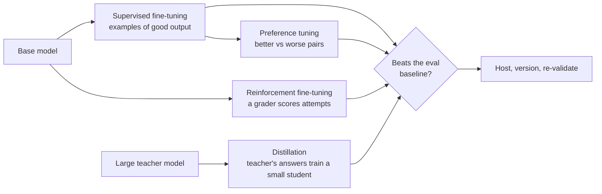

# 3.18 Model adaptation

Model adaptation changes a model's weights by training it further on your data. It is the third lever
after prompting and retrieval ([2.6](../2-trade-offs/2.6-prompt-rag-finetune.md)), and the most
expensive to own: the result is a new model to evaluate, host, version and rebuild whenever its base
model retires.

## The methods

- **Supervised fine-tuning (SFT).** Train on input-output examples of exactly what you want. Good for
  format, tone, fixed labels and narrow tasks.
- **Preference tuning (DPO).** Train on pairs of better and worse answers. Useful when you can rank
  answers more easily than write the perfect one; usually applied after SFT.
- **Reinforcement fine-tuning (RFT).** The model attempts tasks and a *grader* (code or a judge model)
  scores each attempt. Suits tasks with checkable answers. It only strengthens behaviour the model
  sometimes already shows, and a sloppy grader gets gamed.
- **Distillation.** A large *teacher* model answers your prompts, and its answers train a small
  *student*. The usual route to a cheaper, faster model for one task.
- **Continued pre-training.** Train on raw domain text. Rarely worth it for applications; retrieval
  adds knowledge more cheaply ([2.6](../2-trade-offs/2.6-prompt-rag-finetune.md)).

## How it's done

- **Hosted fine-tuning:** upload data to a provider's tuning service; the provider trains and serves
  the result.
- **Parameter-efficient tuning (LoRA)** for open models: freeze the base and train small adapter
  matrices, typically well under 1% of the parameters. Many adapters can share one base model.
  QLoRA trains adapters on a 4-bit base so large models fit on one accelerator.

## When to use

- A failing eval that prompting and retrieval couldn't fix.
- High-volume narrow tasks where a small tuned model can match a large one.
- Long few-shot prompts you send on every call, if the volume pays for training and upkeep.

## When to avoid

- To add or update facts: use retrieval.
- Without an eval baseline and a held-out test set.
- When the base model is near retirement, or your volume is low.

## Disadvantages

- **The dataset is the cost.** Good labelled data takes people-time; it usually dominates the bill.
- **Maintenance.** Each base-model upgrade means retraining and re-validating; when the base model
  retires, the fine-tune goes with it.
- **Hosting.** Some platforms require dedicated capacity for custom models, which needs high volume
  to pay back.
- **Lost general ability and new hallucinations** if trained on narrow data or on facts.
- **Training data can leak.** A model can reproduce what it was trained on; govern the dataset.

## Go deeper

[Deep dive](../deep-dives/3.18-model-adaptation.md): each provider's methods and constraints, LoRA and
QLoRA results, risk and controls, and cloud mappings.
[Lab 3.18](../../labs/3.18-model-adaptation/README.md): a rank-16 adapter is 0.2% of an 8B model; a
tuned small model 23× cheaper per call still only broke even at about 90,000 calls a month.

## Flashcards

Q: What do SFT, preference tuning and reinforcement fine-tuning each learn from?
A: SFT from input-output examples; preference tuning (DPO) from better-vs-worse answer pairs; RFT from a grader's scores on the model's own attempts.

Q: What is distillation?
A: Using a large teacher model's answers to train a small student model to do one task nearly as well, more cheaply.

Q: How does LoRA make fine-tuning cheap?
A: It freezes the base model and trains small low-rank adapter matrices, typically well under 1% of the parameters.

Q: Why does a fine-tune carry ongoing cost?
A: It must be re-validated or retrained when the base model changes, may need dedicated hosting, and dies when its base model retires.

Q: When does reinforcement fine-tuning not help?
A: When the model never gets the task right (there's nothing to reinforce) or when the grader can be gamed.

## Sources and further reading

- [Fine-tuning techniques: choosing between SFT, DPO and RFT](https://developers.openai.com/cookbook/examples/fine_tuning_direct_preference_optimization_guide) (OpenAI).
- [Customize your model](https://docs.aws.amazon.com/bedrock/latest/userguide/custom-models.html) (AWS Bedrock).
- [LoRA](https://arxiv.org/abs/2106.09685) (Hu et al., ICLR 2022) and [QLoRA](https://arxiv.org/abs/2305.14314) (Dettmers et al., NeurIPS 2023).
