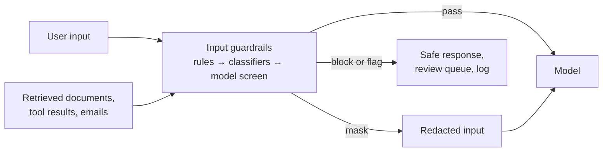

# 3.2 Input guardrails

Input guardrails are checks that run on everything going into a model, before the model acts on it.
Each check classifies the input, and the application decides: let it through, mask part of it, block
it with a safe response, or flag it for review. Every major cloud now offers a managed version, and
they cover the same categories.

## What they catch

- **Prompt attacks.** *Direct* attacks (jailbreaks) come from the user. *Indirect* attacks hide
  instructions in content the system reads for the user: a document, an email, a web page, a tool
  result. Here the user is trusted but the content is not.
- **Sensitive data.** Personal or confidential data that shouldn't reach the model, a provider or the
  logs. Mask it before the call.
- **Harmful or off-limits content.** Hate, violence and similar categories, plus topics your app must
  not engage with.
- **Capacity abuse.** Oversized or repeated inputs that burn tokens ([3.1](3.1-ai-gateway-and-router.md)).

## How they work

- **Rules.** Size limits, formats, regular expressions, word lists. Cheap and predictable; easy to
  evade by rephrasing.
- **Classifiers.** Trained detectors for attacks, harmful content and personal data, each returning a
  category and a confidence you set thresholds on. This is what managed services sell.
- **A small model as a screen.** A narrow prompt with a constrained answer ("safe" or "unsafe", plus a
  category). Easy to adapt to your domain, but it costs a call and can itself be attacked.

Layer them, cheapest first. Run them on *every* untrusted input, not just the user's message: retrieved
passages and tool results are where indirect attacks arrive. Run them before the model, or in parallel
only when the model call has no side effects.

## When to use

- Any system that takes input from people or content it doesn't control.
- Before personal data could reach a provider, region or log it mustn't.
- On retrieved documents and tool outputs in RAG and agents.

## When to avoid

- As the only defence against prompt injection. OWASP says it is unclear any method fully prevents it.
  Limit what a successful attack can do instead ([2.4](../2-trade-offs/2.4-capability-vs-security.md)).
- Hard blocks on borderline scores in high-volume, low-risk flows. Flag or reroute.

## Disadvantages

- **False alarms dominate when attacks are rare.** A detector that catches 95% of attacks and wrongly
  flags 1% of normal requests, at a 0.1% attack rate, blocks ten real users for every attacker.
  Cutting false alarms matters more than raising the catch rate.
- **Novel attacks get through.** Detectors learn known patterns.
- **Latency and cost.** Each layer is another check, and a model screen is another call.
- **Gaps.** Inputs longer than a detector's limit, or in languages it wasn't tested on, may pass
  unscreened.
- **Failure behaviour.** Decide in advance whether a failed check fails open or closed, per category.

## Go deeper

[Deep dive](../deep-dives/3.2-input-guardrails.md): what each provider's service covers, where checks
run, detector limits, risk and controls, and cloud mappings.
[Lab 3.2](../../labs/3.2-input-guardrails/README.md): base rates and false alarms at a million requests
a day.

## Flashcards

Q: What is the difference between direct and indirect prompt injection?
A: Direct: the user writes the attack. Indirect: the attack is hidden in content the system reads for the user (documents, emails, web pages, tool results).

Q: Name three ways to implement an input guardrail.
A: Rules (limits, regex, word lists), trained classifiers (managed services), and a small model used as a screen with constrained output.

Q: Why can't input guardrails be the only defence against prompt injection?
A: Detection is probabilistic and OWASP says no fool-proof prevention is known; architecture must limit what a successful attack can do.

Q: With attacks at 0.1% of traffic and a 1% false-alarm rate, what share of blocks are real attacks?
A: About 9%: most blocked requests are legitimate users, so false-alarm rate matters more than catch rate.

Q: When is it unsafe to run guardrails in parallel with the model call?
A: When the call has side effects (tools, writes); the action may happen before the check fires.

## Sources and further reading

- [Mitigate jailbreaks and prompt injections](https://platform.claude.com/docs/en/test-and-evaluate/strengthen-guardrails/mitigate-jailbreaks) (Anthropic).
- [Amazon Bedrock Guardrails](https://docs.aws.amazon.com/bedrock/latest/userguide/guardrails.html) (AWS).
- [Prompt Shields](https://learn.microsoft.com/azure/ai-services/content-safety/concepts/jailbreak-detection) (Microsoft).
- [LLM01:2025 Prompt Injection](https://genai.owasp.org/llmrisk/llm01-prompt-injection/) (OWASP).
