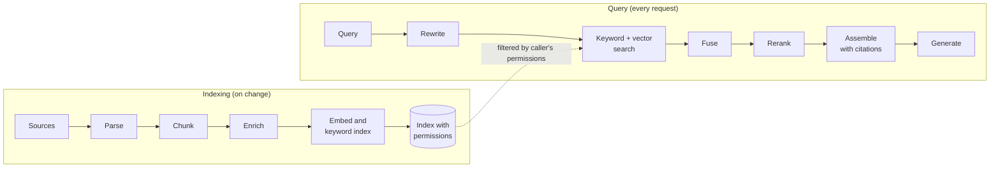

# 3.4 Retrieval pipeline

A retrieval pipeline finds the passages a model needs and puts them in its prompt, so the model
answers from them rather than only from what it learned in training. This is *retrieval-augmented
generation* (RAG). The idea dates from Lewis et al. (2020), and their two reasons for it still hold:
answers can cite their sources, and knowledge updates by re-indexing instead of retraining.

It is two pipelines sharing one index. **Indexing** runs whenever sources change. **Querying** runs on
every request. Designs moved from *naive* RAG (embed, take the top few, generate) to *advanced* RAG,
which adds steps before and after the search. The stable baseline in 2026, recommended or shipped by
every major provider, is **hybrid search with a reranker**.

## Indexing

- **Parse.** Turn files into clean text that keeps headings and tables. Images and tables often need a
  model to describe them.
- **Chunk.** Split into passages small enough to rank precisely but whole enough to make sense alone.
  Split prose by sentences or size; split structured documents on their own headings; keep tables
  whole; for long nested documents, match on small chunks and return their larger parent.
- **Enrich.** Add title, section path, dates, owner and, above all, **who may read it**. *Contextual
  retrieval* goes further: a model writes a sentence or two placing each chunk in its document
  ("from the 2025 credit policy, section 4") before indexing.
- **Embed and index.** Store vectors, text for keyword search, and filterable metadata together
  ([3.6](3.6-vector-stores.md)). Keep the index in step with the sources, **deletions included**.

## Querying

- **Rewrite (optional).** Turn a follow-up into a standalone question, or split a compound one.
  Simple factual questions don't need it.
- **Search two ways.** Keyword search (BM25) finds exact strings such as error codes and policy
  numbers. Vector search finds passages that say the same thing in different words. Both are filtered
  by the caller's permissions.
- **Fuse.** *Reciprocal Rank Fusion* scores each document by summing 1 / (60 + rank) across the lists.
  It uses positions only, so it doesn't matter that the two searches score on different scales.
- **Rerank.** A model reads the query and each candidate together and re-orders them. Search is tuned
  to find everything relevant (recall); reranking puts the best few first (precision).
- **Assemble.** Send the fewest passages that answer the question, each with an ID the model must
  cite. Models use the middle of a long context worst, and accuracy falls as context grows.
- **Generate and check.** Answer only from the passages, cite them, and say so when they don't contain
  the answer ([3.12](3.12-output-guardrails.md)).

## When to use

- The answer depends on knowledge the model lacks: private, recent or changing.
- Answers must cite sources a reviewer can check.
- Different users may see different documents.

## When to avoid

- The corpus fits in the prompt. Under roughly 200,000 tokens (about 500 pages), including it all can
  be simpler and, with prompt caching, cheap ([2.3](../2-trade-offs/2.3-context-vs-retrieval.md)).
- The problem is behaviour, not knowledge ([2.6](../2-trade-offs/2.6-prompt-rag-finetune.md)).
- The question needs several dependent searches: use agentic retrieval
  ([3.5](3.5-agentic-retrieval.md)).
- The question is an aggregate over tables ("total exposure by desk"): query the database instead.

## Disadvantages

- **A miss becomes a wrong answer.** If no search finds the passage, nothing downstream recovers it;
  fusion only re-orders what was found.
- **Every query-time stage adds latency and cost.** Push quality work into indexing where it's paid once.
- **Evaluating only final answers hides the cause.** Measure retrieval separately (did the right passage
  make the top 20?).
- **Stale indexes.** Withdrawn policies keep answering, and erasure requests aren't honoured, until
  deletions propagate.
- **Permissions in the prompt don't work.** Enforce them as a filter in the search.
- **Retrieved text is untrusted input.** A document can carry instructions ([3.17](3.17-security.md)).

## Go deeper

[Deep dive](../deep-dives/3.4-retrieval-pipeline.md): chunking by document type, query translation
options, what each provider ships, contextual-retrieval numbers, risk and controls, and cloud mappings.
[Lab 3.4](../../labs/3.4-retrieval-pipeline/README.md): keyword search nailed every identifier query;
fusion couldn't rescue queries both searches missed, and demoted one correct answer.

## Flashcards

Q: What are the two pipelines in a RAG system?
A: Indexing (offline: parse, chunk, enrich, embed, store) and querying (online: rewrite, search, fuse, rerank, assemble, generate). They share an index.

Q: Why combine keyword (BM25) and vector search?
A: They fail differently: keyword search finds exact strings such as error codes that embeddings blur; vector search finds passages that use different words for the same idea.

Q: How does Reciprocal Rank Fusion score a document?
A: Sum of 1 / (c + rank) over every result list it appears in, with c commonly 60. It uses ranks, not raw scores, so different scoring scales don't matter.

Q: What is the division of labour between retrieval and reranking?
A: Retrieval optimises recall (get a broad candidate set); reranking optimises precision (put the best few first), at some latency cost.

Q: What does contextual retrieval do, and what did Anthropic report?
A: A model prepends 50–100 tokens of document context to each chunk before embedding and keyword indexing. Combined with keyword search, top-20 retrieval failures fell 49%; adding reranking, 67%.

Q: Where must document permissions be enforced in RAG?
A: In the search query, as a server-side filter on permission metadata stored with each chunk, never by instructions in the prompt.

Q: When should you skip RAG and put the corpus in the prompt?
A: When it is small enough. Anthropic suggests below about 200k tokens (≈500 pages), especially with prompt caching.

## Sources and further reading

- [Retrieval-Augmented Generation for Knowledge-Intensive NLP Tasks](https://papers.nips.cc/paper/2020/hash/6b493230205f780e1bc26945df7481e5-Abstract.html) (Lewis et al., NeurIPS 2020).
- [Contextual retrieval](https://www.anthropic.com/news/contextual-retrieval) (Anthropic, 2024).
- [RAG solution design and evaluation guide](https://learn.microsoft.com/azure/architecture/ai-ml/guide/rag/rag-solution-design-and-evaluation-guide) (Microsoft).
- [RAG reference architectures](https://docs.cloud.google.com/architecture/rag-reference-architectures) (Google Cloud).
- [Reciprocal Rank Fusion](https://plg.uwaterloo.ca/~gvcormac/cormacksigir09-rrf.pdf) (Cormack et al., SIGIR 2009).
