# 3.5 Agentic retrieval and the long-context boundary

<!-- source: images/src/3.5-agentic-retrieval.mmd; render with scripts/diagrams.py -->

Classic retrieval runs one search and hands the results to the model ([3.4](3.4-retrieval-pipeline.md)).
**Agentic retrieval** gives the model search tools and lets it decide what to look up, read the
results, and search again until it has enough. Retrieval becomes a loop the agent controls, not a step
before it ([3.9](3.9-workflows-and-agents.md)).

It sits between retrieval and long context ([2.3](../2-trade-offs/2.3-context-vs-retrieval.md)): the
agent searches to find the right place, then reads whole documents or files rather than small chunks.

## Key terms

- **Agentic retrieval:** the model decides what to search for, reads the results, and searches again until it has enough.
- **Query fan-out:** rewriting one question into several sub-queries that run in parallel and are merged.
- **Multi-hop question:** a question where a later search depends on the answer to an earlier one.
- **Corrective retrieval:** grading retrieved results before answering, and searching again or elsewhere when they're weak.
- **Just-in-time loading:** keeping references (file paths, IDs) and fetching the content only when needed.

More in the [glossary](../5-appendix/5.6-glossary.md).

## Types

- **Query planning (fan-out).** A model rewrites the question into several focused sub-queries, runs
  them in parallel and merges the results. One planning step, no loop. Managed search services now
  offer this.
- **Iterative search (agent loop).** Search, read, refine, repeat. Needed when the next question
  depends on the last answer (multi-hop).
- **Corrective retrieval.** Grade the results before answering; if they're weak, rewrite the query or
  try another source.
- **Tool choice.** The agent picks between a vector index, keyword search, a database query, web
  search, or plain file tools like grep and "open file".
- **Search in a sub-agent.** A sub-agent explores in its own context and returns only what it found,
  keeping the main context clean ([3.3](3.3-context-engineering.md)).

## Example

"Which supplier handles our card printing, and what's in their latest audit finding?" is two hops: the
second search needs the supplier's name, which only the first search reveals.

One search with the whole question returns general passages about card printing and audits, but not
this supplier's audit. Fan-out plans both sub-queries up front, but can't name the supplier in the
second one. An agent searches, reads "Acme Cards", then searches "Acme Cards audit 2026". In
[Lab 3.5](../../labs/3.5-agentic-retrieval/README.md), three-hop questions were answered fully 3% of the
time by single-shot and fan-out retrieval and 72% by an agent loop, at about four times the model calls.
For "what's our travel policy?", one search is enough.

## When to use

- Questions with several parts, or chains where each answer shapes the next search.
- Several sources, where choosing the right one matters.
- Content that changes too fast to keep an index fresh, such as a code repository. Several coding
  agents use grep and file reads instead of embeddings.
- When "not found" is a valid answer and the system must look hard before saying it.

## When to avoid

- Simple lookups: one search is cheaper, faster and nearly as good.
- Strict latency targets: each round adds a model call.
- When you need the same result every time: an agent may search differently on each run.

## Disadvantages

- **Cost and latency.** Several model calls and sequential rounds per question.
- **Agents stop too early.** They can end on a fluent, confident and wrong answer. One study of code
  questions found single-shot semantic search more accurate than agentic search, at under half the cost.
- **More to secure.** Every retrieved page is untrusted input to an agent that can act
  ([2.4](../2-trade-offs/2.4-capability-vs-security.md)); permissions must apply to every tool.
- **Harder to evaluate.** You must evaluate the search path, not just the answer ([3.15](3.15-evals.md)).

## Go deeper

[Deep dive](../deep-dives/3.5-agentic-retrieval.md): each provider's agentic retrieval features, the
grep-vs-embeddings debate in coding agents, research, risk and controls, and cloud mappings.
[Lab 3.5](../../labs/3.5-agentic-retrieval/README.md): on three-hop questions, single-shot and fan-out
retrieval found everything 3% of the time, an agent loop 72%, at about four times the model calls.

## Flashcards

Q: What makes retrieval "agentic"?
A: The model decides what to search for, reads the results and searches again until it has enough, instead of one fixed search before answering.

Q: Query fan-out vs an agent loop?
A: Fan-out plans sub-queries up front and runs them in parallel; a loop searches, reads and refines, so later searches can use earlier answers.

Q: Why does fan-out fail on multi-hop questions?
A: The query for a later hop needs the answer to an earlier one, which isn't known when the sub-queries are planned.

Q: What is corrective retrieval?
A: Grading retrieved results before answering and, if they're weak, rewriting the query or searching another source.

Q: Why do some coding agents use grep instead of a vector index?
A: The code changes constantly, so an index goes stale; grep and file reads are always current, exact and easy to inspect.

Q: What is the main failure mode of agentic retrieval?
A: Stopping too early with a fluent, confident answer built on incomplete evidence.

## Sources and further reading

- [Effective context engineering for AI agents](https://www.anthropic.com/engineering/effective-context-engineering-for-ai-agents) (Anthropic, 2025): just-in-time retrieval.
- [Agentic retrieval in Azure AI Search](https://learn.microsoft.com/azure/search/agentic-retrieval-overview) (Microsoft).
- [Agentic retrieval with Amazon Bedrock Knowledge Bases](https://aws.amazon.com/blogs/machine-learning/agentic-retrieval-with-langchain-and-amazon-bedrock-knowledge-bases/) (AWS).
- [Corrective retrieval augmented generation](https://arxiv.org/abs/2401.15884) (Yan et al., 2024).
