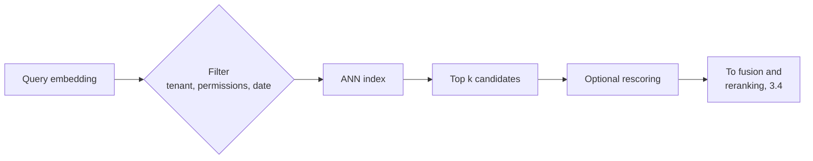

# 3.6 Vector stores

A vector store holds embeddings and answers one question fast: *which stored vectors are closest to
this one?* An embedding is a list of numbers a model produces so that texts with similar meaning land
close together. Comparing a query with every stored vector gets slow as the collection grows, so vector
stores use **approximate nearest neighbour (ANN)** indexes. They skip most of the collection and
accept occasionally missing a true neighbour. The share of true neighbours found is called **recall**.

The concept is stable; the products are not. The real question is where the vectors should live.
Microsoft advises using a database you already run if it supports vectors, and Google expects vector
search to become a standard feature of every database.

## Where vectors can live

- **Your operational database.** Vectors sit next to the data, filters and permissions you already
  have. One system to run; fewer search features.
- **A search service.** Keyword, vector and hybrid search with ranking in one place, at the cost of a
  second copy of the data to keep in sync.
- **A dedicated vector database.** Tuned for very large collections and query rates; another system to
  secure, back up and sync.
- **A managed RAG service.** Chunking, embedding and storage done for you; less control.

## How ANN indexes work

- **Graphs (HNSW).** Each vector links to near neighbours, in layers from sparse to dense, so a search
  takes long jumps then short ones. The common default: fast and high recall, but memory-hungry and slow
  to build. Disk-based graphs (DiskANN) serve a billion vectors from one machine.
- **Partitions (IVF).** Cluster the vectors and search only the clusters nearest the query. Smaller and
  faster to build, with a worse speed-for-recall curve.
- **Compression (quantization).** Store each number in fewer bits: 8-bit integers make the index about
  4× smaller. Keep full-precision vectors to rescore the top candidates.

Every index has a speed-for-recall dial. Tune it against a labelled set of queries, not by feel.

## Filtering

Most queries carry a filter: tenant, permissions, document type, date.

- **Post-filtering** finds the top *k*, then drops what fails the filter. With a selective filter you
  get fewer than *k* results, sometimes none, and no error.
- **Pre-filtering** searches only vectors that pass the filter. It keeps recall, at some extra cost for
  very selective filters. Engines have converged on filtering *during* the search; for tiny filtered
  subsets, exact search is often fastest.

## When to use

- Similarity search over more than a few thousand items: retrieval ([3.4](3.4-retrieval-pipeline.md)),
  recommendations, deduplication.

## When to avoid

- The whole corpus fits in the prompt ([2.3](../2-trade-offs/2.3-context-vs-retrieval.md)).
- Exact lookups and aggregates: use ordinary database indexes.

## Disadvantages

- **Approximate by design.** Recall drops with aggressive settings and compression.
- **Vectors miss exact terms** like product codes; pair with keyword search.
- **Changing embedding model means re-embedding everything.** Vectors from different models can't be
  compared.
- **Embeddings aren't anonymous.** Text can be partly reconstructed from them; protect the store like
  the source documents.
- **Sync lag.** A separate index serves deleted or outdated content until it catches up.

## Go deeper

[Deep dive](../deep-dives/3.6-vector-stores.md): each provider's decision guidance, index internals,
distance metrics and embedding models, numbers, risk and controls, and cloud mappings.
[Lab 3.6](../../labs/3.6-vector-stores/README.md): recall against search width, and a 1% filter that
post-filtering turned into 0.1 results out of 10.

## Flashcards

Q: What does an approximate nearest neighbour (ANN) index trade, and for what?
A: It gives up a little recall (occasionally missing a true neighbour) for much faster search than comparing against every vector.

Q: How do HNSW and IVF differ?
A: HNSW walks a layered graph of neighbours: high recall and speed, but memory-hungry and slow to build. IVF searches only the nearest clusters: faster to build and smaller, with a worse speed–recall trade-off.

Q: Why is post-filtering dangerous with selective filters?
A: It filters the top-k results after the search, so it can return far fewer than k results, or none, without any error.

Q: What must happen when you change embedding model?
A: Re-embed the whole corpus into a new index and switch over. Vectors from different models can't be compared.

Q: What is the first question to ask before choosing a vector database?
A: Where the vectors should live: next to the operational data you already run, in a search service, in a dedicated store, or inside a managed RAG service.

## Sources and further reading

- [Choose an Azure service for vector search](https://learn.microsoft.com/azure/architecture/guide/technology-choices/vector-search) (Microsoft): the clearest decision flow.
- [Choosing an AWS vector database for RAG](https://docs.aws.amazon.com/prescriptive-guidance/latest/choosing-an-aws-vector-database-for-rag-use-cases/introduction.html) (AWS).
- [HNSW](https://arxiv.org/abs/1603.09320) (Malkov & Yashunin, TPAMI 2018).
- [pgvector](https://github.com/pgvector/pgvector): index types, filtering and iterative scans in one README.
