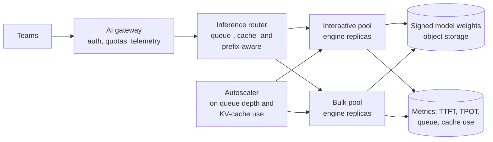

# 4.1 Design an LLM inference API

Follows the method in [Part 1](../1-method/1-method.md). The classic primer designs a URL shortener to
teach the basics; this is the AI equivalent: serve one model to many callers, fast and cheaply.

## Step 1: Use cases, constraints and the quality bar

**The ask.** A bank must keep some workloads inside its own cloud tenancy and wants an open-weight
model served as an internal API, so teams stop running their own copies.

### Use cases

- Teams call an OpenAI-compatible chat endpoint and stream responses.
- Interactive traffic (assistants) and bulk traffic (document processing) share the platform.
- Platform owners see usage and cost per team.

### Out of scope

- Training or fine-tuning (see [3.18](../3-components/3.18-model-adaptation.md)). Hosting several
  different models (one model now; the design should allow more).

### Constraints and assumptions

- **Model:** a 70B-parameter open model, 8-bit weights.
- **Traffic:** 10 interactive requests/s at peak, plus bulk jobs overnight.
- **Request shape:** about 3,000 input and 300 output tokens (mostly RAG).
- **Latency:** first token within 1.5 s at p95; then at least 20 tokens/s (50 ms per token).
- **Hardware:** pairs of 80 GB accelerators.
- **Data:** stays in the bank's region; prompts are confidential.

### Quality bar

The model is fixed, so "quality" here means *the served model behaves like the evaluated one*: any
change of precision, engine version or settings re-runs the model's eval suite
([3.15](../3-components/3.15-evals.md)). Operationally: p95 time to first token, p95 per-token time,
availability 99.9%.

## Step 2: Back-of-the-envelope

[Lab 4.1](../../labs/4.1-inference-api/README.md) estimates one replica (two accelerators):

- **Weights:** 70 GB, split across two accelerators.
- **Concurrency:** about 136 requests' attention caches fit in the remaining memory.
- **Throughput:** about 1.9 requests/s per replica. Prefill of the 3,000-token prompt takes most of
  the time (≈ 82%); decode is shared across the batch.
- **Capacity:** 10 requests/s at a 60% utilisation target needs 9 replicas, plus one spare: **20
  accelerators.** At 100% it would be 5–6 replicas, but tail latency would collapse
  ([2.7](../2-trade-offs/2.7-throughput-vs-latency.md)).

Two lessons before any boxes: the workload is **prefill-bound**, so reusing shared prompt prefixes and
trimming retrieved context are the biggest levers; and running at high utilisation saves accelerators
but breaks the latency target.

## Step 3: High-level design



The model is the same everywhere, so this is a serving problem, not a workflow or agent design.

## Step 4: Core components

### The API

The original primer's solutions start with the API; so does this one. Expose the shape callers already
know, an OpenAI-compatible chat endpoint, so existing SDKs and the gateway work unchanged.

```
POST /v1/chat/completions
{ "model": "bank-70b-2026-10", "messages": [...], "max_tokens": 600,
  "stream": true, "user": "<end-user id>" }

200  text/event-stream   data: {"choices":[{"delta":{"content":"..."}}]}  ...  data: [DONE]
     final chunk carries usage: prompt_tokens, cached_tokens, completion_tokens
429  rate limit (team quota)        Retry-After: <seconds>
503  overloaded (no capacity)       Retry-After: <seconds>
```

- **Model names are versioned.** `bank-70b-2026-10` names weights, precision and engine settings
  together, so a change is a new name callers opt into ([3.7](../3-components/3.7-model-layer.md)).
- **`max_tokens` is required** and capped per team; it bounds latency, cost and cache memory.
- **Usage in every response**, including cached tokens, so teams can see the effect of prefix reuse.
- **Two distinct overload signals:** 429 means *your* quota, 503 means *our* capacity; both carry
  Retry-After so well-behaved clients back off with jitter ([3.14](../3-components/3.14-asynchronism.md)).
- **A batch endpoint** (`POST /v1/batches` with a file of requests and a results file) for bulk work,
  served from the bulk pool at lower priority.

### Serving engine ([3.8](../3-components/3.8-serving-internals.md))

Use an established open-source engine; don't build one. Configure:

- **Continuous batching** with a batch limit set from the per-token target, not the maximum memory.
- **Paged KV cache**, with an 8-bit cache if evals allow.
- **Prefix caching**, because many callers share system prompts and retrieved documents.
- **Chunked prefill**, so a 3,000-token prompt doesn't stall everyone's streaming.
- **Tensor parallelism across the two accelerators** in each replica.

### Router

A plain round-robin load balancer defeats prefix caching. Route requests that share a prefix to the
replica that already holds it, and steer away from replicas with long queues or full caches. The
Kubernetes Gateway API Inference Extension and similar routers do this ([3.8 deep dive](../deep-dives/3.8-serving-internals.md)).

### Pools and priorities

Separate the **interactive** pool from the **bulk** pool so an overnight back-fill can't wreck chat
latency. Bulk jobs go through a queue with workers that respect a concurrency limit
([3.14](../3-components/3.14-asynchronism.md)); spare interactive capacity can absorb bulk work at
night.

### Autoscaling

Scale on serving signals (queue depth, KV-cache utilisation, p95 time to first token), not CPU.
Replica start-up is slow (tens of gigabytes of weights to load), so keep warm spares and scale ahead of
known peaks.

### AI gateway ([3.1](../3-components/3.1-ai-gateway-and-router.md))

The platform sits behind the bank's gateway: authentication, per-team token quotas, usage reporting
and an OpenAI-compatible interface. It also gives failover to a hosted model for workloads allowed to
leave the tenancy.

## Step 5: Harden

- **Supply chain** ([3.17](../3-components/3.17-security.md)): load weights only from internal storage,
  in a safe format, verified by digest or signature; pin and scan engine images.
- **Isolation:** prompt caches can hold one team's data; scope prefix caching per tenant where prompts
  contain confidential content.
- **Logging:** record tokens, latency and errors per team, not prompt text, unless a team opts in with
  masking.
- **Change control:** treat engine upgrades, quantization changes and setting changes as model
  changes: re-run evals, canary, then roll out.
- **Capacity governance:** quotas per team at the gateway; refuse or queue new bulk work when the
  queue grows faster than it drains (back-pressure).

## Step 6: Scale and optimise

1. **Prefill first.** Prefix caching and shorter retrieved context cut the dominant cost
   ([Lab 4.1](../../labs/4.1-inference-api/README.md) exercise 3).
2. **Disaggregate prefill and decode** once you run many replicas, so each phase scales and tunes
   separately ([2.7](../2-trade-offs/2.7-throughput-vs-latency.md)).
3. **Speculative decoding** for latency-sensitive, low-concurrency traffic.
4. **Lower precision** where evals allow; it frees memory for more concurrent requests.
5. **Right-size the model.** A smaller or distilled model for narrow tasks may cut accelerators by an
   order of magnitude ([3.18](../3-components/3.18-model-adaptation.md)).
6. **Re-check build vs buy.** Below steady high utilisation, a hosted API or provisioned capacity may
   be cheaper than idle accelerators.

## Trade-offs made

| Decision | Alternative | Why |
|---|---|---|
| Established open-source engine | Custom serving code | Batching, paging and caching come built in and improve monthly |
| Prefix-aware routing | Round-robin | Shared prefixes are most of the work; routing preserves cache hits |
| Separate interactive and bulk pools | One shared pool | Bulk work would wreck interactive latency |
| 60% utilisation target | Run hot | Queueing delay explodes above ~80% busy |
| 8-bit weights | 16-bit | Half the memory, near-identical quality on benchmarks; confirm on own evals |
| Self-host for resident workloads only | Self-host everything | Self-hosting pays only at steady, high utilisation |

## Flashcards

Q: Why is a RAG-style inference workload often prefill-bound?
A: Long prompts (retrieved context) take most of each request's compute; output tokens are few and shared across a large decode batch.

Q: Why use prefix-aware routing instead of round-robin?
A: Requests that share a prefix reuse its cached computation only if they reach the replica that holds it.

Q: What should an inference platform autoscale on?
A: Serving signals: queue depth, KV-cache utilisation and latency percentiles, not CPU.

Q: Why separate interactive and bulk pools?
A: So large batch jobs can't consume capacity and wreck interactive latency.

Q: What counts as a model change on a self-hosted platform?
A: Any change to weights, precision, engine version or serving settings; each re-runs the eval suite.

## Sources and further reading

- [3.8 Serving internals](../3-components/3.8-serving-internals.md) and its [deep dive](../deep-dives/3.8-serving-internals.md).
- [2.7 Throughput vs per-request latency](../2-trade-offs/2.7-throughput-vs-latency.md).
- [GKE Inference Gateway walkthrough](https://cloud.google.com/blog/topics/developers-practitioners/implementing-high-performance-llm-serving-on-gke-an-inference-gateway-walkthrough/) (Google Cloud).
- [NVIDIA Dynamo](https://github.com/ai-dynamo/dynamo).
- [Lab 4.1](../../labs/4.1-inference-api/README.md): the capacity estimate.
