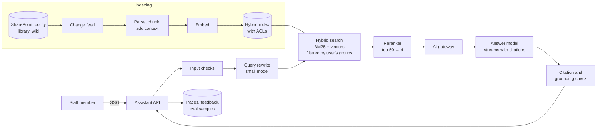

# 4.2 Design an enterprise RAG assistant

Follows the method in [Part 1](../1-method/1-method.md) and uses every Phase 1 section. Read it as
a worked answer: the reasoning matters more than the boxes.

## Step 1: Use cases, constraints and the quality bar

**The ask.** A bank wants an assistant that answers staff questions about its policies, procedures and
product rules, with citations, so branch and operations staff stop searching the intranet and asking
colleagues.

### Use cases

- Staff ask a question in natural language and get a short answer with links to the exact passages.
- Follow-up questions in the same conversation.
- The assistant says "I can't find this" rather than guessing, and offers the closest documents.
- Owners of documents can see which questions their documents failed to answer.

### Out of scope

- Customer-facing use. Actions (opening tickets, changing records). Uploading personal files.
  Each would change the risk profile ([2.4](../2-trade-offs/2.4-capability-vs-security.md)) and
  deserves its own review.

### Constraints and assumptions

- **Users:** 5,000 staff, 20 questions each per working day, 10-hour day, 3× peak.
- **Corpus:** 40,000 documents, about 60 M tokens; 2% change each week.
- **Access:** some documents are restricted to teams (credit, financial crime, HR).
- **Latency:** first visible token within 2 s; full answer within 10 s at p95.
- **Data:** internal and confidential; must stay in the bank's chosen region.
- **Cost:** agree a monthly ceiling with finance before building; we estimate below.

### Quality bar and eval criteria

Write these before the design ([1 Method](../1-method/1-method.md)):

- **Answer correctness** on a golden set of 500 real questions with reference answers, written with
  document owners. Target ≥ 85%, judged by a calibrated LLM judge with human spot checks
  ([3.15](../3-components/3.15-evals.md)). At 500 cases the 95% interval is about ±3 points, enough
  to tell 85% from 80%.
- **Citation support**: every cited passage supports its sentence. Target ≥ 95%.
- **Correct refusals** on 100 questions the corpus can't answer. Target ≥ 90%.
- **Retrieval recall@20** for the golden chunk, measured separately so failures can be localised.
- **Zero** answers drawn from documents the asker cannot open, on a permission test suite.

## Step 2: Back-of-the-envelope

The Method's worked example is this system: 100,000 requests a day, about 8 per second at peak,
7,000 input and 400 output tokens per request, and $2,700 a day at illustrative prices. Two lessons
carry over: the system is **input-bound** (78% of the bill), and at roughly 80 output tokens per
second a 400-token answer takes about 5 seconds, so the 2-second target is only reachable for the
first token. **We must stream.**

[Lab 4.2](../../labs/4.2-enterprise-rag/README.md) applies the levers in order:

| Design step | Cost/day | vs baseline |
|---|---|---|
| Baseline | $2,700 | 100% |
| Rerank 50 candidates, send 4 chunks instead of 8 | $2,100 | 78% |
| Cache the system prefix | $1,695 | 63% |
| Summarise history to 500 tokens | $1,395 | 52% |
| Route 40% of questions to a small model | $949 | 35% |
| Add two small-model checks per answer | $1,189 | 44% |

**Indexing** is small by comparison: 60 M tokens is a one-off embedding job, plus about 1.2 M tokens a
week of changes. Adding Anthropic-style chunk context with prompt caching was about $1 per million
document tokens at 2024 small-model prices ([3.4](../3-components/3.4-retrieval-pipeline.md)), so
roughly $60 once. **Storage**: 60 M tokens in 500-token chunks is 120,000 chunks; at 1,024 dimensions
in float32 that is under 0.5 GB of vectors. This fits in one node of almost any vector store
([3.6](../3-components/3.6-vector-stores.md)); scale is not the hard part, permissions are.

## Step 3: High-level design

Climb the ladder only as far as needed ([2.2](../2-trade-offs/2.2-determinism-vs-autonomy.md)).
The corpus is far beyond the ~200k tokens that could simply go in the prompt, so we need retrieval.
The steps are known in advance (rewrite, retrieve, answer, check), so this is a **workflow**, not an
agent. That keeps cost flat, paths testable, and the assistant with no tools to misuse.

## Step 4: Core components

### Indexing pipeline ([3.4](../3-components/3.4-retrieval-pipeline.md))

- **Change-driven.** Re-index from a change feed, not a nightly full rebuild, so withdrawn policies
  disappear within minutes. Record each chunk's source version and effective date.
- **Structure-aware chunking.** Split on headings, keep tables whole, about 500 tokens per chunk, and
  prefix each chunk with its document title and section path. Add a short generated context per chunk
  (contextual retrieval); Anthropic reported it roughly halves retrieval failures together with hybrid
  search.
- **Carry permissions.** Store each document's access groups on every chunk. This is the most
  important field in the index.

### Retrieval ([3.4](../3-components/3.4-retrieval-pipeline.md), [3.6](../3-components/3.6-vector-stores.md))

- **Hybrid search**: BM25 for product codes, form numbers and policy IDs; vectors for paraphrase;
  fused with reciprocal rank fusion.
- **Pre-filter by permission.** Pass the user's groups as a filter *inside* the search, not after it.
  Post-filtering can return almost nothing when a user can see a small slice of the corpus
  ([Lab 3.6](../../labs/3.6-vector-stores/README.md) returned 0.1 of 10 results at 1% selectivity).
- **Rerank** the top 50 down to 4. This buys back the quality that sending fewer chunks would lose,
  and is the biggest cost lever in Step 2.
- **Query rewrite** with a small model turns a follow-up ("and for joint accounts?") into a
  standalone query.

### Generation

- Instructions: answer only from the passages, cite each claim with a passage ID, say so when the
  passages don't contain the answer, and quote the document's own wording for limits and thresholds.
- **Structured output** ([3.12](../3-components/3.12-output-guardrails.md)): the model returns
  sentences with passage IDs, which the app renders as links. Stream it.
- The stable instructions come first so the provider can cache them.

### AI gateway ([3.1](../3-components/3.1-ai-gateway-and-router.md))

Every model call goes through the bank's gateway: authentication, per-team token quotas, routing
between a small and a large model, fallback to a second region or provider, masking, and one place
for telemetry. Routing starts conservative (rewrites and checks on the small model; answers on the
large one) and moves answer traffic only as evals show it is safe ([2.1](../2-trade-offs/2.1-cost-quality-latency.md)).

### Evals and feedback ([3.15](../3-components/3.15-evals.md))

- Run the golden set, refusal set and permission suite on every change to prompts, models, chunking
  or the reranker. Compare paired, on the same cases.
- In production, sample answers for judge scoring, collect thumbs up and down with a reason, and route
  "can't find this" questions to document owners. Confirmed failures join the golden set.

## Step 5: Harden

### Count to three ([2.4](../2-trade-offs/2.4-capability-vs-security.md))

- **[A] Untrusted input: partly.** Thousands of staff can edit intranet pages; any of them could plant
  instructions.
- **[B] Sensitive data: yes.** Restricted policies, and the user's own questions.
- **[C] Change state or communicate out: no, by design.** No tools; links only to the bank's own
  document hosts; no remote images.

Two of three, so injected text can at worst produce a wrong or misleading answer to the person who
asked, not leak data or act. Keeping it that way is a design constraint: adding a "create ticket" tool
or rendering external images would complete the trifecta and needs a fresh review.

### Controls ([3.17](../3-components/3.17-security.md))

- **Permissions**: pre-filtered retrieval; a permission test suite in CI; separate indexes for the
  most sensitive collections (financial crime, HR) so a filter bug can't expose them.
- **Input checks** ([3.2](../3-components/3.2-input-guardrails.md)): prompt-attack detection on the
  question *and* on retrieved chunks; flag rather than block borderline scores, since at low attack
  rates most blocks are false alarms ([Lab 3.2](../../labs/3.2-input-guardrails/README.md)).
- **Output checks** ([3.12](../3-components/3.12-output-guardrails.md)): every cited passage must
  exist and contain any quoted text; a small-model grounding check on the rest. Treat a grounding
  failure as "show the passages, not an answer". Remember the deterministic check misses real quotes
  used for the wrong claim ([Lab 3.12](../../labs/3.12-output-guardrails/README.md)).
- **Rendering**: escape model output; allow links only to approved hosts.
- **Logging**: mask personal data before traces leave the app; restrict access to conversation logs;
  set retention with the records team.
- **Ingestion**: only approved sources; record who last edited each document so a planted instruction
  can be traced.

### Governance

The model-risk team will treat the assistant as a model in its own right: an inventory entry, an
owner, documented limitations, and monitoring. The risks, controls and audit evidence are tabled in the
[deep dive](../deep-dives/4.2-enterprise-rag-assistant.md#governance).

## Step 6: Scale and optimise

Bottlenecks, in the order they usually bite:

1. **Retrieval quality**, not throughput. Most bad answers are retrieval misses; check recall@20
   before touching prompts. Fixes: better chunking, contextual retrieval, reranking, query rewrite.
2. **Document quality.** Contradictory or outdated documents produce confident wrong answers. Feed
   unanswerable and conflicting questions back to owners; this improves the intranet too.
3. **Latency.** Stream; run input checks in parallel with retrieval; keep the reranker close to the
   index; cache embeddings of frequent queries.
4. **Cost**, with the levers from Step 2: fewer chunks, prefix caching, shorter history, routing.
   Re-run evals after each.
5. **Provider capacity** at peak: quotas and fallback at the gateway.

**When to climb the ladder.** If questions start needing several look-ups ("compare the overdraft
rules for students and graduates, then the fee schedule"), add a bounded agentic retrieval step:
the model may issue up to three searches, nothing else ([3.5](../3-components/3.5-agentic-retrieval.md)).
Measure the gain against the roughly 4× token cost before shipping it.

## Building it on each platform

Every major cloud offers managed pieces for this design (index, reranker, gateway, grounding check).
Check permission-aware retrieval first, because it decides whether a managed index is usable at all.
The [deep dive](../deep-dives/4.2-enterprise-rag-assistant.md#building-it-on-each-platform) maps each
piece to Azure, AWS, Google Cloud, OpenAI, Anthropic and open source.

## Trade-offs made

| Decision | Alternative | Why |
|---|---|---|
| Workflow | Agent with a search tool | Steps are known; flat cost; testable paths; no tools to misuse |
| Hybrid search + reranker | Vectors only | Policy IDs and product codes need exact match; reranker lets us send fewer chunks |
| Pre-filter by permission | Post-filter, or one index per team | Post-filter starves results; per-team indexes multiply cost and still need the filter |
| No tools, no external links | Ticket creation, web search | Keeps the system at two of three Rule-of-Two properties |
| Small model for rewrite and checks | One model for everything | Cheap, fast steps; large model only where quality needs it |
| Show sources on grounding failure | Block silently | Staff still get something useful; failures are visible and logged |
| RAG | Fine-tuning on policies | Knowledge changes weekly and needs citations; RAG wins for knowledge ([2.6](../2-trade-offs/2.6-prompt-rag-finetune.md)) |

## Flashcards

Q: Why is the enterprise RAG assistant a workflow, not an agent?
A: Its steps are known in advance (rewrite, retrieve, answer, check), so a workflow gives flat cost, testable paths and no tools to misuse.

Q: In this design, which Rule-of-Two properties are present?
A: Untrusted input (partly: editable intranet pages) and sensitive data. It has no tools and no external links, so it can't change state or send data out.

Q: Why filter by permission inside the search rather than after it?
A: Post-filtering can leave too few results when a user can see a small slice of the corpus, and it risks leaks if the filter is skipped.

Q: What was the biggest cost lever in this system, and why?
A: Sending fewer chunks after reranking, because the system is input-bound: retrieved context is most of every request.

Q: What should the assistant do when the grounding check fails?
A: Show the retrieved passages instead of a generated answer, and log the failure for review.

Q: What usually limits answer quality in enterprise RAG first?
A: Retrieval misses and poor or conflicting source documents, not model capability or throughput.

## Sources and further reading

- The Phase 1 sections linked throughout, especially [3.4](../3-components/3.4-retrieval-pipeline.md),
  [3.6](../3-components/3.6-vector-stores.md), [3.15](../3-components/3.15-evals.md) and
  [2.4](../2-trade-offs/2.4-capability-vs-security.md).
- [RAG solution design and evaluation guide](https://learn.microsoft.com/en-us/azure/architecture/ai-ml/guide/rag/rag-solution-design-and-evaluation-guide) (Microsoft Azure Architecture Center).
- [Contextual retrieval](https://www.anthropic.com/news/contextual-retrieval) (Anthropic, 2024).
- [Building effective agents](https://www.anthropic.com/engineering/building-effective-agents) (Anthropic, 2024).
- [Lab 4.2](../../labs/4.2-enterprise-rag/README.md): the cost model, lever by lever.
