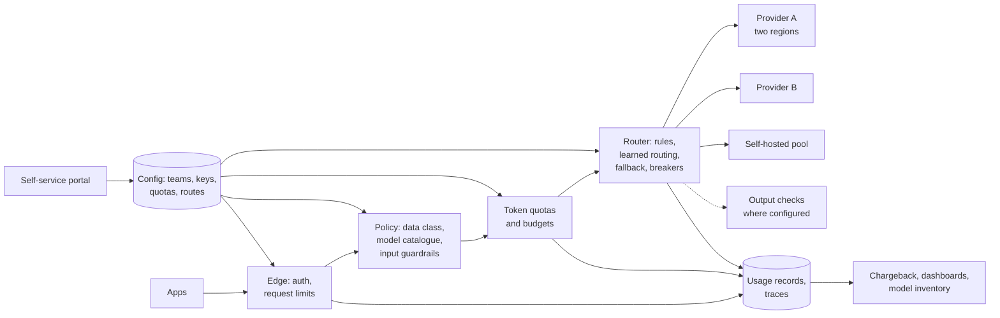

# 4.3 Design an enterprise AI gateway

Follows the method in [Part 1](../1-method/1-method.md) and expands [3.1](../3-components/3.1-ai-gateway-and-router.md)
into a full design.

## Step 1: Use cases, constraints and the quality bar

**The ask.** Fifty applications across a bank's business lines call models from three providers, plus
a self-hosted model ([4.1](4.1-llm-inference-api.md)). Each team holds its own keys and nobody can say
what is spent, on what, or whether policy is applied. Build one gateway every model call goes through.

### Use cases

- Teams onboard themselves: get a credential, choose approved models, see their usage.
- Every call is authenticated, metered in tokens, checked against policy and logged.
- Requests route to the right model and region, and fail over when a provider is down.
- Finance gets chargeback by team; risk gets an inventory of who uses which model.

### Out of scope

- Agent tool authorisation (a separate policy layer; [3.17](../3-components/3.17-security.md)).
  Response caching by similarity (rejected below).

### Constraints and assumptions

- **Volume:** 50 apps; 2 M calls a day; peak 100 calls/s; average 2,500 input and 400 output tokens.
- **Latency:** the gateway may add at most 50 ms at p95 before the first token; streaming must pass
  through untouched.
- **Availability:** 99.95%, higher than any single provider deployment.
- **Data:** classification decides which providers and regions a request may reach.
- **Audit:** usage records kept per the bank's retention policy; prompt text logged only where approved.

### Quality bar

The gateway mustn't change answers. Its own bar is operational: added latency, availability, metering
accuracy (gateway token counts reconcile with provider bills within 1%), and zero requests routed
outside their allowed regions on a routing test suite.

## Step 2: Back-of-the-envelope

- **Tokens:** 2 M calls × 2,900 tokens ≈ 5.8 B tokens a day, about 5 B of them input.
- **Rate:** peak 100 calls/s × 2,500 input tokens = 250 k input tokens/s through quota checks.
- **Concurrency:** streamed answers last seconds, so at 100 calls/s and ~8 s each, ~800 open streams.
  The gateway is a long-lived-connection proxy, not a quick request router; size for connections.
- **Usage records:** one record of a few hundred bytes per call ≈ 1 GB a day. Logging full prompts
  instead would be ~20 GB a day of confidential text.
- **Availability arithmetic:** two independent provider deployments at 99.5% each give ≈ 99.997% for
  the model layer, but the gateway caps the whole: to reach 99.95% overall the gateway itself needs
  better than 99.95%, so run it across zones and regions ([3.1](../3-components/3.1-ai-gateway-and-router.md)).
- **Savings in reach:** with 5 B input tokens a day, prompt caching on shared prefixes, routing easy
  calls to small models, and moving overnight work to batch are each worth more than the gateway costs
  to run ([2.1](../2-trade-offs/2.1-cost-quality-latency.md), [3.13](../3-components/3.13-caching.md)).

## Step 3: High-level design

The gateway is shared infrastructure, configured per team from a self-service portal so the platform
team isn't a bottleneck.

## Step 4: Core components

### Edge and identity

Teams authenticate with workload identity (managed identities, service accounts) rather than shared
keys; the gateway alone holds provider credentials. Each call carries a team, an application, and, for
user-facing apps, the end user's identifier so usage and audit trace back to a person.

### Policy and model catalogue

- **Approved models** per data classification: confidential data only to providers and regions the
  bank has approved; deny by default.
- **Input guardrails** for prompt attacks and personal data, applied by policy per route, with masking
  before calls leave the tenancy ([3.2](../3-components/3.2-input-guardrails.md)). Apps add their own
  context-specific checks.

### Quotas and budgets

Limit **tokens**, not requests: tokens per minute per team and app, and monthly budgets with alerts at
50/80/100% and a hard stop or downgrade at the limit. Estimate input tokens before forwarding so an
oversized request is refused without calling the model.

### Routing and resilience

- **Rules first:** data class → allowed providers and regions; task type → model tier.
- **Learned routing** only on routes with an eval showing it holds quality ([Lab 2.1](../../labs/2.1-cost-quality-latency/README.md)).
- **Fallback** to evaluated alternatives only, never across a residency boundary.
- **Retries with backoff and jitter**, honouring the provider's retry-after; circuit breakers per
  deployment ([3.14](../3-components/3.14-asynchronism.md)).
- **Capacity tiers:** steady interactive traffic on reserved capacity, overflow to pay-as-you-go, bulk
  work to batch ([2.7](../2-trade-offs/2.7-throughput-vs-latency.md)).

### Streaming

Pass streamed tokens through without buffering. Output checks that need the whole response run only on
routes that opt in and accept the latency ([3.12](../3-components/3.12-output-guardrails.md)).

### Caching

Pass through provider prompt caching and keep prompts cache-friendly (stable prefixes first); report
cache hit rates per team. **No similarity-based response caching:** it can serve a wrong or another
user's answer ([3.13](../3-components/3.13-caching.md)).

### Onboarding and change

A team onboards in the portal: it registers an application, states the data classification it will
send, picks models from the catalogue allowed for that class, and receives a workload identity and a
starting quota. Routes, quotas and catalogue entries are configuration, versioned and reviewed like
code, with every change logged. When a model is added or retired ([3.7](../3-components/3.7-model-layer.md)),
the catalogue changes once and every team sees the same lifecycle dates; teams on a retiring model are
notified from the usage records, which show exactly who still calls it.

### Telemetry

One usage record per call: team, app, user, model and version, tokens (input, cached, output), cost,
latency (time to first token and total), outcome, policy decisions. Traces follow OpenTelemetry
conventions so app and gateway spans join up ([3.16](../3-components/3.16-observability.md)).

## Step 5: Harden

- **Single point of failure:** active-active across zones and at least two regions; health checks;
  the gateway's availability target is higher than any provider's.
- **Single point of compromise:** the gateway holds every provider credential. Store them in a
  secrets manager with rotation, restrict administrative access, and log every configuration change.
- **Data in logs:** usage records by default; prompt and response text only on approved routes, masked,
  access-controlled and retained per policy.
- **Abuse and cost:** token quotas, size limits and anomaly alerts per team (OWASP LLM10).
- **Governance evidence:** the gateway is where the model inventory, routing rules, quota history and
  guardrail decisions live, which is most of what an AI risk review asks for.

| Risk | Control | Evidence |
|---|---|---|
| Data sent to an unapproved provider or region | Classification-keyed routing; deny by default; routing test suite | Routing config; test results |
| Unapproved model in use | Model catalogue at the gateway | Catalogue; blocked-request log |
| Runaway spend | Token quotas, budgets, alerts | Quota config; alert history |
| Gateway outage takes down all AI | Multi-zone, multi-region, tested failover | Availability reports; failover drills |
| Leaked provider credentials | Gateway-only credentials, rotation | Secret inventory; rotation records |

## Step 6: Scale and optimise

1. **Connection capacity** before request rate: long streams dominate.
2. **Quota checks without a hot spot:** token buckets in a fast shared store, with local
   approximation per gateway instance.
3. **Cost levers per team:** publish each team's cache hit rate, model mix and batch share, and offer
   help to the biggest spenders.
4. **Latency:** keep guardrail models close to the gateway; run independent checks in parallel.
5. **Add providers by configuration**, not code: the OpenAI-compatible interface plus per-provider
   adapters.

## Trade-offs made

| Decision | Alternative | Why |
|---|---|---|
| One shared gateway | Per-team integrations | Policy, quotas and audit in one place; teams stop holding keys |
| Token quotas | Request rate limits | Cost and capacity scale with tokens |
| Rule-based routing first | Learned routing everywhere | Rules are testable; learned routing only where evals back it |
| Pass-through streaming | Buffer for output checks | Latency; output checks opt-in per route |
| No semantic response cache | Similarity cache | Wrong or cross-user answers are unacceptable in a bank |
| Usage records, not prompt text, by default | Log everything | Avoid building a store of confidential prompts |
| Self-service onboarding | Ticket-based | Keeps the platform team from becoming the bottleneck |

## Flashcards

Q: Why should a gateway's availability target exceed any single provider's?
A: Every model call passes through it, so its availability caps the whole system; fallback across providers can't compensate for a gateway outage.

Q: Why size an AI gateway for concurrent connections rather than request rate?
A: Streamed answers keep connections open for seconds; at 100 calls/s that is hundreds of open streams.

Q: What must fallback rules respect besides model quality?
A: Data classification and residency: never fail over to a provider or region the data may not reach.

Q: Why log usage records rather than prompt text by default?
A: Usage records give cost, audit and capacity data without creating a large store of confidential prompts.

Q: Which caching should an enterprise gateway allow, and which not?
A: Allow provider prompt (prefix) caching; avoid similarity-based response caching, which can serve wrong or cross-user answers.

## Sources and further reading

- [3.1 AI gateway and router](../3-components/3.1-ai-gateway-and-router.md) and its [deep dive](../deep-dives/3.1-ai-gateway-and-router.md).
- [AI gateway capabilities in Azure API Management](https://learn.microsoft.com/azure/api-management/genai-gateway-capabilities) (Microsoft).
- [Guidance for Multi-Provider Generative AI Gateway on AWS](https://docs.aws.amazon.com/solutions/multi-provider-generative-ai-gateway-on-aws/) (AWS).
- [Build an AI gateway](https://docs.cloud.google.com/apigee/docs/api-platform/fundamentals/build-ai-gateway) (Google Cloud).
