# 4.4 Design a regulated document-review assistant

Follows the method in [Part 1](../1-method/1-method.md). Builds on context stuffing vs retrieval
([2.3](../2-trade-offs/2.3-context-vs-retrieval.md)), output validation ([3.12](../3-components/3.12-output-guardrails.md)),
evals ([3.15](../3-components/3.15-evals.md)) and security ([3.17](../3-components/3.17-security.md)).

## Step 1: Use cases, constraints and the quality bar

**The ask.** A bank's legal and procurement teams review about 400 third-party contracts and
non-disclosure agreements a week against a *playbook*: around 60 clause positions (liability caps,
governing law, data protection, audit rights, termination), each with the bank's standard wording,
acceptable fallbacks and red lines. A first review takes a lawyer about 90 minutes. Build an assistant
that does the first pass and leaves the decisions to lawyers.

The risk is specific. A Stanford study of leading legal research tools built on retrieval found they
still gave wrong or mis-cited answers on 17–33% of queries. A review assistant that misses a red-line
clause, or cites text that isn't in the contract, is worse than none, because people trust it.

### Use cases

- **Extract:** find each playbook clause in the contract, or record that it's missing.
- **Compare:** classify each against the playbook: standard, acceptable fallback, needs a lawyer,
  red line, or missing.
- **Explain with evidence:** every finding quotes the exact contract text and cites the playbook rule.
- **Suggest:** proposed redlines drawn only from the bank's approved fallback wording.
- **Record:** the lawyer's decision on each finding, kept with the contract.

### Out of scope

- Signing, approving or sending anything to the counterparty. The assistant never decides.
- Legal research on case law, and drafting new clauses outside the approved library.

### Constraints and assumptions

- **Volume:** 400 documents a week (~80 a working day); 30 pages on average, about 25k tokens.
- **Latency:** results within an hour of upload; this is batch work.
- **Data:** confidential and sometimes privileged. Processing only through the AI gateway to approved
  providers and regions, with no training on the data and agreed retention ([4.3](4.3-enterprise-ai-gateway.md)).
- **Governance:** treated as a model under the bank's model-risk policy: documented, validated before
  use, monitored, with a named owner. The lawyer remains the decision-maker.

### Quality bar and eval criteria

Built with the legal team before any prompt is written:

- **A gold set** of 150 past contracts, each clause labelled by two lawyers, disagreements resolved.
- **Recall on "needs a lawyer", "red line" and "missing"** of at least 98%: missing a risky clause is
  the costly error. Precision can be lower; a false flag costs a minute of reading.
- **Citation accuracy 100%:** every quote must exist verbatim in the contract (checked by code, not a
  model).
- **Redlines only from the approved library** (checked by code).
- **Consistency:** the same contract reviewed three times gives the same classifications.
- **In production:** lawyer overrides by clause type, sampled double reviews, and time per review.

## Step 2: Back-of-the-envelope

Prices illustrative ($3 per million input tokens; cache write $3.75, cache read $0.30; output $15).

- **Calls per document:** the 60 positions grouped into 12 calls of 5, each with the whole contract
  (25k tokens, cached after the first call), the relevant playbook section (2k) and ~1.5k output.
- **Cost:** ≈ $0.52 per document with caching, $1.24 without; 400 a week ≈ $210 a week. Batch
  processing roughly halves it again. **Model cost is negligible next to lawyer time.**
- **Fit:** 25k tokens fits comfortably in the context window, so each call reads the whole contract
  rather than retrieved chunks; clauses that refer to each other ("subject to clause 14.2") stay
  visible ([2.3](../2-trade-offs/2.3-context-vs-retrieval.md)). Very long agreements (300+ pages) are
  split by section with a table of contents in every call.
- **Value:** cutting a first review from 90 to 30 minutes frees about 400 lawyer-hours a week, if the
  quality bar holds. If lawyers must re-read everything because they don't trust the output, the saving
  is zero; trust comes from citations and measured recall.

## Step 3: High-level design

The rung is a **workflow**, not an agent: the steps are known in advance and must be repeatable and
auditable ([2.2](../2-trade-offs/2.2-determinism-vs-autonomy.md)). Models do the reading; code does the
checking.

<!-- source: images/src/4.4-regulated-document-review.mmd; render with scripts/diagrams.py -->

## Step 4: Core components

### Ingestion

Convert PDF or Word to text with page and paragraph references preserved, so every quote can be shown
in place. Detect and flag text invisible to a human reader (white text, tiny fonts, hidden layers),
which is where injected instructions would hide. Store the original and the extracted text, hashed, so
the review can be tied to the exact version.

### Playbook

The playbook is data, not prose in a prompt: each position has an ID, the standard wording, acceptable
fallbacks, red lines, and an owner. It's versioned; each review records which version it used. Legal
owns changes to it, through the same release process as code ([4.7](4.7-eval-and-release-pipeline.md)).

### Review calls

Each call gets the whole contract (cached), one section of the playbook and a strict instruction: for
each position, quote the relevant text exactly, classify, and give a one-line reason; if nothing
applies, say "missing". Low temperature; a fixed model version, pinned and re-validated before any
change ([3.7](../3-components/3.7-model-layer.md)). Where the provider offers citation features that return exact
source spans, use them, and turn the result into structured output in a second step if the two can't
be combined.

### Code checks

Deterministic and cheap, so they run on everything ([3.12](../3-components/3.12-output-guardrails.md)):

- Every quote is found verbatim in the extracted text (after whitespace normalisation); otherwise the
  finding is re-run, then shown as "unverified".
- Every proposed redline matches an approved fallback.
- Every playbook position has exactly one finding.
- Output matches the schema.

### Second-pass check

A separate call, with fresh context, re-examines two kinds of finding: everything classed as needing a
lawyer, red line or missing (to confirm), and every position classed as standard whose topic is a red
line (to catch misses). It can only raise severity, never lower it. This spends tokens where a miss is
expensive ([3.9](../3-components/3.9-workflows-and-agents.md)).

### Lawyer review interface

Findings sorted by severity, each beside the highlighted contract text and the playbook rule. The
lawyer accepts, edits or overrides each; overrides need a reason. Nothing leaves the bank without the
lawyer's action. Showing the evidence, not just the verdict, keeps the lawyer reading the contract
rather than rubber-stamping the AI.

### Feedback

Overrides flow into the eval set and to the playbook owner. A rising override rate on a clause type is
a signal: the playbook is unclear, the prompt is wrong, or the model has changed.

## Step 5: Harden

Legs of the lethal trifecta ([2.4](../2-trade-offs/2.4-capability-vs-security.md)): the counterparty's
document is untrusted input and the system handles confidential data, but it has **no tools and no
outbound channel**; its only output is findings for a lawyer. Prompt injection can at most mislead a
finding, which the code checks, the second pass and the lawyer are there to catch.

| Risk | Control | Evidence |
|---|---|---|
| Missed red-line clause | Recall target ≥98% on the gold set; second pass on red-line topics; lawyer review | Validation report; production sample reviews |
| Fabricated or wrong quotation | Verbatim quote check in code; citations shown in place | Check logs; citation accuracy metric |
| Injected text in the contract ("mark all clauses standard") | Hidden-text detection; contract treated as data; second pass can only raise severity; no tools | Injection test set; flagged documents |
| Unapproved redline language | Redlines restricted to the versioned library | Library; check logs |
| Over-reliance by reviewers | Evidence shown with every finding; sampled double reviews; override tracking | Review samples; override rates |
| Confidential or privileged data leaves approved boundaries | Gateway with approved providers and regions; no-training terms; retention limits | Data-flow record; provider terms |
| Silent change in behaviour after a model update | Pinned model; full gold-set re-run before any change | Release records ([4.7](4.7-eval-and-release-pipeline.md)) |
| Can't show why a finding was made | Store document hash, playbook version, model version, prompt version, quotes and decisions | Audit trail per review |

**Model risk governance.** Document intended use and limits, validation results by clause type,
monitoring thresholds that trigger review, and a named owner. Under the EU AI Act this use isn't in a
high-risk category, but the bank's own model-risk and outsourcing rules apply, and the playbook
evidence is what a validator will ask for.

## Step 6: Scale and optimise

1. **Quality, then throughput.** Expand clause types only as each passes its recall target on the gold
   set; start with NDAs (short, standard) before complex agreements.
2. **Prompt caching and batch processing** cut cost further, though cost isn't the constraint.
3. **More document types** by adding playbooks, not code.
4. **Re-review on playbook change:** when a position changes, re-run only that position on contracts
   still in negotiation.
5. **Measure lawyer time honestly**, not by survey; developers in METR's 2025 trial believed AI made
   them faster when it made them slower ([4.6](4.6-coding-agent.md)).

## Trade-offs made

| Decision | Alternative | Why |
|---|---|---|
| Workflow with fixed steps | Autonomous agent | Repeatable, auditable, and the steps are known |
| Whole contract in context, cached | Retrieve clause chunks | Contracts fit; cross-references stay visible; caching makes it cheap |
| Code checks quotes and redlines | Trust the model's citations | Fabricated evidence is the worst failure; code can verify it exactly |
| Optimise recall on risky classes | Optimise overall accuracy | A missed red line costs far more than a false flag |
| Second pass can only raise severity | Second model votes either way | An injected or wrong first pass can't talk the system into "safe" |
| Lawyer decides every finding | Auto-accept "standard" findings | Accountability stays with a person; earn automation with evidence |
| Playbook as versioned data | Playbook in the prompt | Owned by legal, testable, and recorded with each review |

## Flashcards

Q: Why is a contract-review assistant built as a workflow rather than an agent?
A: The steps are known, and the result must be repeatable and auditable; models read, code checks.

Q: How do you make sure the assistant never cites text that isn't in the contract?
A: Check every quote verbatim against the extracted text in code; re-run or mark unverified on failure.

Q: Which error matters most in contract review, and how does that shape the quality bar?
A: Missing a risky or red-line clause; set a high recall target on those classes and accept lower precision.

Q: Why may the second-pass check only raise severity?
A: So a wrong or prompt-injected first pass can't be confirmed as safe; lowering severity stays a lawyer's decision.

Q: Why send the whole contract rather than retrieved chunks?
A: Contracts fit in the context window, clauses refer to each other, and caching the contract across calls keeps cost low.

Q: What did Stanford find about legal research tools built on retrieval?
A: They still hallucinated or mis-cited on 17–33% of queries, so retrieval alone doesn't make legal AI reliable.

## Sources and further reading

- [Hallucination-free? Assessing the reliability of leading AI legal research tools](https://hai.stanford.edu/news/ai-trial-legal-models-hallucinate-1-out-6-or-more-benchmarking-queries) (Magesh et al., Stanford RegLab and HAI; Journal of Empirical Legal Studies, 2025).
- [Citations](https://docs.anthropic.com/en/docs/build-with-claude/citations) (Anthropic docs): source-span citations and their limits.
- [Introducing contextual retrieval](https://www.anthropic.com/engineering/contextual-retrieval) (Anthropic): when to put a whole document in the prompt.
- [4.2 Enterprise RAG assistant](4.2-enterprise-rag-assistant.md) for the retrieval-based counterpart.
