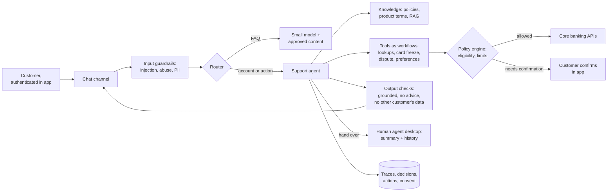

# 4.5 Design a customer-support agent

Follows the method in [Part 1](../1-method/1-method.md). Builds on workflows and agents
([3.9](../3-components/3.9-workflows-and-agents.md)), guardrails ([3.2](../3-components/3.2-input-guardrails.md),
[3.12](../3-components/3.12-output-guardrails.md)), memory ([3.11](../3-components/3.11-memory.md)) and
evals ([3.15](../3-components/3.15-evals.md)).

## Step 1: Use cases, constraints and the quality bar

**The ask.** A retail bank's chat channel takes 50,000 conversations a day. Most are routine: card
lost, payment not showing, how do I dispute this, what's my limit. The bank wants an AI agent to
resolve what it safely can and hand the rest to people with the case already written up.

Two public lessons shape the brief. In 2024 a Canadian tribunal held Air Canada liable for a refund
policy its chatbot made up (*Moffatt v. Air Canada*): the company owns what its agent says. And
Klarna, after reporting in 2024 that its assistant handled two-thirds of chats, said in 2025 that a
cost-first push had lowered quality and began hiring human agents again. The bar is resolution
quality, not containment.

### Use cases

- **Answer:** product and policy questions, grounded in approved content, with sources.
- **Look up:** balances, recent transactions, card and payment status, for the authenticated customer.
- **Act:** freeze or unfreeze a card, order a replacement, open a dispute, update contact preferences,
  each within limits.
- **Hand over:** to a human with a summary, the customer's verified identity, and what has been tried.
- **Assist staff:** the same tools in the agent desktop, suggesting replies human agents edit.

### Out of scope

- Financial advice, credit decisions, and complaints that regulation says a person must handle.
- Voice (a later phase; latency and speech add their own design).
- Anything the customer hasn't authenticated for.

### Constraints and assumptions

- **Volume:** 50,000 conversations a day, about 8 turns each; 12% of a day's volume in the peak hour.
- **Latency:** first token under 2 s for answers; actions confirm within 5 s.
- **Identity:** the channel authenticates the customer (app session or step-up); the agent never
  authenticates anyone itself.
- **Data:** personal and account data under data-protection law (POPIA here, GDPR elsewhere);
  processing only in approved regions through the AI gateway ([4.3](4.3-enterprise-ai-gateway.md)).
- **Conduct:** answers must match published terms; customers must always be able to reach a person.

### Quality bar and eval criteria

- **Task success on a simulated-customer test set** of 500 scenarios built from real (anonymised)
  conversations, scored on the final account state, not the wording, as τ-bench does.
- **Consistency (pass^k).** The same scenario must succeed across repeated runs. τ-bench found a strong
  2024 model solved about 61% of retail tasks once but under 25% on all of 8 tries. A scenario solved
  90% of the time per attempt passes all 8 attempts only about 43% of the time if failures are
  independent.
- **Policy adherence:** zero actions outside policy on the red-team set; zero invented policies.
- **Correct hand-over:** escalates every case it should, measured on cases labelled by supervisors.
- **In production:** resolution confirmed by no repeat contact within 7 days, customer satisfaction,
  and complaint rates, compared with human-handled chats.

## Step 2: Back-of-the-envelope

Prices are illustrative ($3 per million input tokens, $0.30 cached, $15 output).

- **Tokens:** about 2 model calls per turn (tool call, then answer) × 8 turns = 16 calls; ~6k input
  tokens each (instructions and tool definitions ~3.5k, history, retrieved policy, tool results) ≈ 96k
  input tokens per conversation, 60% cacheable; ~3k output tokens.
- **Model cost:** ≈ $0.18 per conversation, ≈ $9,000 a day, ≈ $270,000 a month on one strong model.
  Routing the 70% of simple turns to a model at a fifth of the price brings it to ≈ $120,000
  ([2.1](../2-trade-offs/2.1-cost-quality-latency.md)).
- **Concurrency:** 6,000 conversations in the peak hour × 6 minutes ≈ 600 open at once.
- **Hand-overs:** if 40% go to people at 11 minutes each, that's ~3,700 agent-hours a day, about 560
  human agents. The AI changes the human team's work; it doesn't remove it.
- **Comparison:** a human-handled chat at an illustrative $0.50 per minute costs about $5.50. The model
  cost is small; the risk is in wrong answers and wrong actions.

## Step 3: High-level design

The rung is a **single agent with a constrained toolset**, wrapped in **deterministic workflows for
every action that moves money or changes the account**. The agent converses, understands and gathers
details; code checks eligibility and executes. A router sends simple FAQ turns to a cheaper model.

## Step 4: Core components

### Router and FAQ path

A classifier sends general questions ("what are your fees?") to a small model answering only from
approved content with citations, and anything touching the customer's account to the agent. Unsure
cases go to the agent ([3.1](../3-components/3.1-ai-gateway-and-router.md)).

### Support agent

- **Instructions:** role, tone, what it may and may not do, when to hand over. Policies live in the
  knowledge base and the policy engine, not only in the prompt; τ-bench found removing the policy
  document cut a strong model's airline score by 22%.
- **Context:** the customer's verified profile and recent interactions (scoped memory,
  [3.11](../3-components/3.11-memory.md)); conversation history with compaction.
- **Few, clear tools:** about a dozen, each a narrow business operation, not raw API access.

### Tools as workflows, and the policy engine

Each action tool is a small deterministic workflow: validate inputs, check eligibility and limits in
the policy engine, ask the customer to confirm in the app for anything irreversible, execute, and
return the result. The model chooses *which* tool and fills the parameters; it never decides
*whether* the customer is eligible ([2.2](../2-trade-offs/2.2-determinism-vs-autonomy.md)). Tools act
with the customer's session identity, so the agent can't see or change another account.

### Knowledge

Product terms, fees and procedures through the retrieval pipeline ([3.4](../3-components/3.4-retrieval-pipeline.md)),
versioned with effective dates, so the agent quotes the policy in force and cites it.

### Hand-over

Triggers: the customer asks, the topic is out of scope, the agent's confidence or the guardrails say
so, a complaint or vulnerability signal, or two failed attempts. The human gets a summary, verified
identity, actions taken and the transcript, so the customer doesn't repeat themselves.

### Guardrails

- **In:** prompt-injection and abuse detection; PII handling ([3.2](../3-components/3.2-input-guardrails.md)).
- **Out:** grounding check against retrieved policy; block financial advice and promises of outcomes;
  check no other customer's data appears ([3.12](../3-components/3.12-output-guardrails.md)).
- **Disclosure:** customers know they're talking to an AI and how to reach a person.

## Step 5: Harden

Legs of the lethal trifecta ([2.4](../2-trade-offs/2.4-capability-vs-security.md)): the agent reads
untrusted input (the customer's messages, and pasted content), holds private data (the customer's own
account), and can change state (actions). Exfiltration is limited because the only data it can reach
belongs to the person already authenticated, and there is no outbound channel except the reply.
State change is limited by the policy engine and in-app confirmation.

| Risk | Control | Evidence |
|---|---|---|
| Agent invents a policy or promise (the Air Canada case) | Answers grounded in versioned policy with citations; output check; promises only via tools | Grounding eval results; sampled transcript reviews |
| Unauthorised action | Policy engine decides eligibility; in-app confirmation for irreversible actions; session-scoped tools | Policy rules; action audit log |
| Data from another customer disclosed | Tools bound to session identity; output check | Access tests; red-team results |
| Social engineering ("I'm the account holder's husband") | Agent can't change authentication or contact details without step-up in the app | Test cases; step-up logs |
| Customer can't reach a human | Always-available hand-over; monitored hand-over failures | Hand-over metrics |
| Vulnerable customer or complaint mishandled | Detection triggers hand-over; complaints routed to the regulated process | Supervisor reviews; complaint logs |
| Inconsistent outcomes | pass^k on simulated scenarios before each release ([4.7](4.7-eval-and-release-pipeline.md)) | Eval reports |
| Personal data retained in traces and memory | Redaction; retention limits; memory scoped and deletable | Data-flow record; retention config |

## Step 6: Scale and optimise

1. **Quality before containment.** Track repeat contacts and complaints alongside resolution rate.
   Containment bought by blocking hand-overs is the Klarna failure.
2. **Prompt caching** of instructions and tool definitions; it's most of the input
   ([3.13](../3-components/3.13-caching.md)).
3. **Route by difficulty:** small model for FAQ turns, strong model for account work; measure both.
4. **Grow the toolset from hand-over data:** the most common hand-over reasons are the next workflows
   to build.
5. **Reuse for staff:** the same agent suggesting replies to human agents gives value where autonomy
   isn't allowed yet.

## Trade-offs made

| Decision | Alternative | Why |
|---|---|---|
| Single agent; actions as deterministic workflows | Agent calling core APIs directly | Eligibility and limits must be exact and auditable |
| Policy engine decides eligibility | Policy only in the prompt | Prompts are followed inconsistently; code isn't |
| In-app confirmation for irreversible actions | Confirm in chat | Ties consent to the authenticated session |
| Measure resolution and repeat contacts | Measure containment | Containment rewards blocking hand-overs |
| Router with a small FAQ model | One strong model for everything | Halves model cost; FAQ answers come from approved content |
| pass^k on simulated customers | Single-run accuracy | Customers meet the agent millions of times; consistency matters |

## Flashcards

Q: What did Moffatt v. Air Canada establish for customer-facing AI?
A: A company is liable for what its chatbot tells customers; Air Canada had to honour the refund policy its chatbot invented.

Q: What does pass^k measure, and why does it matter for support agents?
A: The chance an agent succeeds on all k repeated runs of the same task; customers see the agent many times, so consistency matters more than a single good run.

Q: Why put eligibility checks in a policy engine rather than the prompt?
A: The model chooses the tool and fills the parameters; code decides eligibility exactly and leaves an audit trail.

Q: Why measure resolution and repeat contacts rather than containment?
A: Containment can be raised by blocking hand-overs; resolution and repeat contacts show whether customers were actually helped.

Q: What should a hand-over to a human include?
A: A summary, the customer's verified identity, actions already taken and the transcript.

Q: Which leg of the lethal trifecta is limited by binding tools to the customer's session?
A: Access to private data: the agent can reach only the authenticated customer's own data.

## Sources and further reading

- [τ-bench](https://arxiv.org/abs/2406.12045) (Yao et al., Sierra, 2024).
- [Moffatt v. Air Canada, 2024 BCCRT 149](https://canlii.ca/t/k2spq) and [ABA summary](https://www.americanbar.org/groups/business_law/resources/business-law-today/2024-february/bc-tribunal-confirms-companies-remain-liable-information-provided-ai-chatbot/).
- [Klarna reinvests in human customer service](https://www.customerexperiencedive.com/news/klarna-reinvests-human-talent-customer-service-AI-chatbot/747586/) (CX Dive, 2025).
- [A practical guide to building agents](https://cdn.openai.com/business-guides-and-resources/a-practical-guide-to-building-agents.pdf) (OpenAI): guardrails and human intervention.
