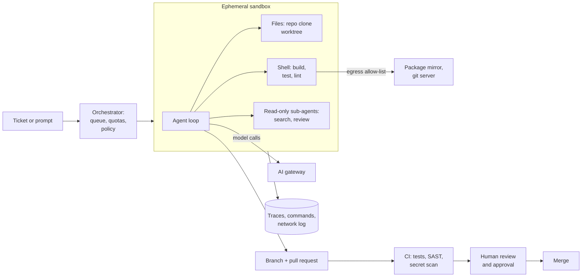

# 4.6 Design a coding agent platform

Follows the method in [Part 1](../1-method/1-method.md). Builds on agents ([3.9](../3-components/3.9-workflows-and-agents.md)),
context engineering ([3.3](../3-components/3.3-context-engineering.md)), agentic retrieval
([3.5](../3-components/3.5-agentic-retrieval.md)) and security ([3.17](../3-components/3.17-security.md)).

## Step 1: Use cases, constraints and the quality bar

**The ask.** A bank's 1,500 engineers want coding agents: in the terminal while they work, and in the
background, where an agent takes a ticket and comes back with a pull request. Security wants the
bank's code to stay inside approved boundaries, nothing to reach production without human review, and
a record of what every agent did. Build one platform for both.

### Use cases

- **Interactive:** an engineer works with an agent in their terminal or IDE on their own branch.
- **Background:** an engineer (or a workflow) assigns a ticket; the agent works in a sandbox, runs the
  tests and opens a pull request for review.
- **Routine maintenance at scale:** dependency upgrades, vulnerability fixes, migrations across many
  repositories, each as reviewable pull requests.
- **Review assist:** an agent reviews pull requests (human or agent-written) and comments.

### Out of scope

- Agents deploying to production or merging their own work.
- Access to production data. Agents work on code and test data only.

### Constraints and assumptions

- **Volume:** 1,500 engineers; about 2 background tasks per engineer per working day ≈ 3,000 tasks/day,
  concentrated in 8 working hours. Interactive use on top.
- **Per task:** about 40 model calls, context averaging 40k tokens (with clearing and compaction), 20k
  output tokens, 30 minutes of sandbox time.
- **Data:** source code is confidential. Model calls go only to approved providers and regions through
  the AI gateway ([4.3](4.3-enterprise-ai-gateway.md)); the sandbox reaches only an internal package
  mirror and the git server.
- **Controls:** branch protection; at least one human approval that isn't the requester; CI must pass;
  every agent action logged.

### Quality bar and eval criteria

- **Task success** on an internal benchmark: 200 past tickets from the bank's own repositories with
  their real tests, rerun on every model or prompt change ([4.7](4.7-eval-and-release-pipeline.md)).
  Public benchmarks are a guide, not the bar.
- **Merge rate** of agent pull requests, and **rework**: how many review rounds before merge.
- **Escaped defects:** incidents traced to agent-written changes, compared with human-written ones.
- **Developer time**, measured, not self-reported. In a randomised trial (METR, 2025), experienced
  developers on their own large repositories were 19% *slower* with early-2025 AI tools while believing
  they were 20% faster.

## Step 2: Back-of-the-envelope

Prices are illustrative ($3 per million input tokens, $0.30 cached, $15 output).

- **Tokens per task:** 40 calls × 40k context = 1.6 M input tokens, 20k output.
- **Cost per task:** with 90% of input served from the prompt cache ≈ $1.21; without caching ≈ $5.10.
  Caching is the biggest cost lever ([3.13](../3-components/3.13-caching.md)).
- **Model cost:** 3,000 tasks × $1.21 ≈ $3,600 a day, about $80,000 a month.
- **Sandboxes:** 3,000 × 0.5 hours = 1,500 container-hours a day; at an illustrative $0.20 an hour,
  about $300 a day. Compute is cheap next to tokens.
- **Concurrency:** 375 tasks an hour × 0.5 hours ≈ 190 sandboxes running on average; plan for about
  600 at peak.
- **Review:** 3,000 pull requests × 15 minutes = 750 reviewer-hours a day, roughly 125 engineers doing
  nothing else. **Human review, not compute or tokens, is the bottleneck.** The design has to produce
  fewer, better pull requests, not more.

## Step 3: High-level design

The rung on the complexity ladder is **a single agent per task** with read-only sub-agents for search
and review. Coding is a chain of dependent decisions, where hand-offs lose context
([2.5](../2-trade-offs/2.5-single-vs-multi-agent.md)); parallelism comes from running many independent
tasks, not many agents per task.

## Step 4: Core components

### Orchestrator

Accepts tasks from the ticketing system, chat or CLI; checks the requester's access to the repository;
applies per-team quotas and budgets; queues work and starts a sandbox. Each task carries the
requester's identity end to end, so the agent never has more access than the person who asked.

### Sandbox

- **Ephemeral:** a fresh container or micro-VM per task, destroyed afterwards. No state carries over.
- **Two phases:** a setup phase installs dependencies from the internal mirror with any needed
  credentials, which are then removed; the agent phase runs with no secrets and a narrow egress
  allow-list (the gateway, the mirror, the git server). OpenAI's cloud agent uses the same split.
- **Filesystem and network isolation together.** Without network isolation a compromised agent can
  exfiltrate; without filesystem isolation it can escape. Anthropic reports that sandboxing cut
  permission prompts by 84% in its internal use while improving safety.
- **Git:** short-lived, repository-scoped token that can push only to the agent's own branch prefix.

### Agent loop and context

- **Tools:** read, search (grep, file listing, code navigation), edit, run commands, run tests.
  Agentic search over the live working tree, with a code index as an optional second route
  ([3.5](../3-components/3.5-agentic-retrieval.md)).
- **Repository instructions:** an `AGENTS.md`-style file per repository (build steps, conventions,
  no-go areas), loaded at the start.
- **Ground truth:** tests, type checks and linters after every change. The agent isn't done until they
  pass ([3.9](../3-components/3.9-workflows-and-agents.md)).
- **Context:** clear old tool results, compact long sessions, keep a progress notes file
  ([3.3](../3-components/3.3-context-engineering.md)).
- **Stopping:** step, token and time caps; on hitting a cap, open a draft pull request with notes rather
  than nothing.

### Review gate

- The agent opens a pull request with a summary, the plan it followed, test evidence and open
  questions. It cannot approve or merge, and the requester cannot be the sole approver.
- CI runs before human time is spent: tests, static analysis, secret scanning, dependency checks.
- An AI review pass comments first, using a fresh context (more reliable than self-review); humans
  decide.
- CI workflows on agent branches need human approval to run if they touch pipelines or secrets
  (GitHub's coding agent applies the same rule).

### Model access

All model calls through the AI gateway: approved providers and regions, token quotas, prompt caching,
usage records ([4.3](4.3-enterprise-ai-gateway.md)). A strong model for the main loop; a smaller one for
search sub-agents and summaries ([3.7](../3-components/3.7-model-layer.md)).

### Telemetry

One trace per task: every model call, command, file change and network request, linked to the ticket,
requester, repository, model and prompt versions ([3.16](../3-components/3.16-observability.md)).
Commands and network decisions are kept; file contents follow the code's own retention rules.

## Step 5: Harden

The agent reads untrusted content (issues, comments, dependency code, web pages), has access to
confidential source, and can change state (push code). That is all three legs of the lethal trifecta
([2.4](../2-trade-offs/2.4-capability-vs-security.md)). The design breaks the *exfiltration* leg with the
egress allow-list and the *state-change* leg with the review gate.

| Risk | Control | Evidence |
|---|---|---|
| Prompt injection in an issue or file makes the agent leak code | No secrets in the agent phase; egress allow-list; network log | Sandbox policy; blocked-egress log |
| Malicious dependency runs in the sandbox | Internal mirror only; ephemeral sandbox; dependency scanning in CI | Mirror policy; scan results |
| Agent change reaches production unreviewed | Branch protection; independent approval; CI required | Repository rules; approval records |
| Agent changes CI or deployment pipelines | Pipeline files protected; CI on agent branches needs approval | CODEOWNERS; workflow approval log |
| Secrets committed or exposed | Secret scanning pre-push and in CI; no secrets in agent phase | Scan results |
| Agent acts beyond the requester's rights | Requester identity propagated; repository-scoped tokens | Token scope; access logs |
| Poisoned MCP server or tool | Approved tool registry only ([3.10](../3-components/3.10-multi-agent-and-protocols.md)) | Registry; change log |
| Cost runaway | Per-task caps; per-team budgets | Cost per task dashboard |

**Separation of duties** holds because the agent writes, CI checks, and a different human approves.
Treat agent-authored changes as the requester's changes for accountability.

## Step 6: Scale and optimise

1. **Review capacity first.** Cap background tasks per team to what reviewers can absorb; route
   low-risk changes (dependency bumps with green tests) to lighter review, risky areas to code owners.
   Measure merge rate and rework, and stop task types that rarely merge.
2. **Prompt caching.** Stable system prompt, tools and repository instructions first; it cuts token cost
   about fourfold here.
3. **Warm sandboxes:** pre-built images per repository with dependencies cached, so setup takes seconds.
4. **Right-size the model:** small models for search and summaries; strong models for the main loop.
5. **Batch maintenance work** across repositories overnight, where latency doesn't matter.

## Trade-offs made

| Decision | Alternative | Why |
|---|---|---|
| Single agent per task, read-only sub-agents | Multi-agent teams writing in parallel | Coding is a dependent chain; parallel writers conflict |
| Ephemeral sandbox, egress allow-list | Agent on the developer's machine with full network | Breaks the exfiltration path; consistent and auditable |
| Pull request as the only output | Direct commits or auto-merge | Keeps human review and separation of duties |
| Internal benchmark from the bank's own tickets | Public benchmark scores | Measures the bank's code, tests and conventions |
| Cap tasks to review capacity | Run as many tasks as budget allows | Review is the bottleneck; unreviewed pull requests are waste |
| Agentic search first, index optional | Vector index only | Code changes constantly; exact search stays current |

## Flashcards

Q: What is usually the bottleneck of a background coding agent platform?
A: Human review of the pull requests it produces, not compute or tokens.

Q: Why run coding agents in two phases (setup, then agent)?
A: Dependencies are installed with network access and credentials first; the agent then runs with secrets removed and egress restricted, so injected instructions can't exfiltrate.

Q: Why do coding agents need both filesystem and network isolation?
A: Without network isolation a compromised agent can leak files; without filesystem isolation it can escape the sandbox and gain network access.

Q: What preserves separation of duties when an agent writes code?
A: The agent can't approve or merge; CI must pass; a human other than the requester approves.

Q: Which legs of the lethal trifecta does a coding agent have, and which does this design break?
A: All three: untrusted input, confidential code, and state change. The egress allow-list breaks exfiltration; the review gate breaks unreviewed state change.

Q: What did METR's 2025 trial find about experienced developers using AI tools?
A: They were 19% slower on their own large repositories while believing they were 20% faster, so measure, don't survey.

## Sources and further reading

- [Beyond permission prompts: Claude Code sandboxing](https://www.anthropic.com/engineering/claude-code-sandboxing) (Anthropic, 2025).
- [Codex agent approvals and security](https://developers.openai.com/codex/agent-approvals-security) (OpenAI).
- [Application card: GitHub Copilot agents](https://docs.github.com/en/copilot/responsible-use/agents) (GitHub).
- [Measuring the impact of early-2025 AI on experienced open-source developer productivity](https://metr.org/blog/2025-07-10-early-2025-ai-experienced-os-dev-study/) (METR, 2025).
