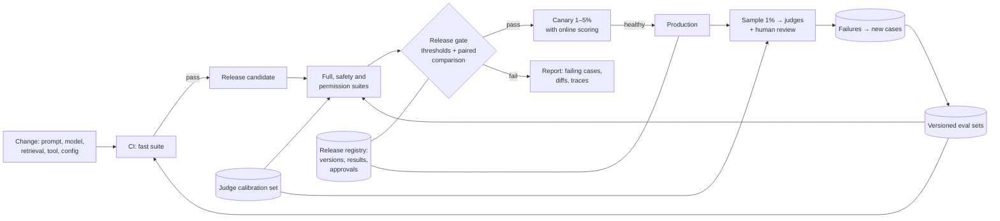

# 4.7 Design an eval and release pipeline

Follows the method in [Part 1](../1-method/1-method.md). Every other design in this primer says "re-run
the evals before you change anything". This one designs the machinery that makes that true.

## Step 1: Use cases, constraints and the quality bar

**The ask.** A bank runs a dozen AI features, including the RAG assistant from [4.2](4.2-enterprise-rag-assistant.md).
Changes to prompts, models, retrieval and tools ship weekly, judged by a few people trying examples.
Model-risk management wants evidence that each release was tested. Build a pipeline that tests every
change and gates every release.

### Use cases

- A developer changes a prompt and sees, within minutes, whether quality moved.
- A release is blocked automatically if it regresses, and the report explains why.
- Model upgrades and retirements ([3.7](../3-components/3.7-model-layer.md)) go through the same gate.
- Production quality is sampled continuously; failures become new test cases.
- An auditor can see, for any release, what was tested, the results and who approved it.

### Out of scope

- Training models. Product analytics unrelated to quality.

### Constraints and assumptions

- **Suites:** per feature, a 300-case fast suite and a 2,000-case full suite, plus safety and
  permission suites ([4.2](4.2-enterprise-rag-assistant.md)).
- **Grading:** code checks where possible, an LLM judge for open-ended criteria (about two judge calls
  per case), and human review of samples.
- **Cadence:** fast suite on every change; full suite before every release and every model change.
- **Production:** 1% of traffic sampled for scoring.
- **Data:** eval cases and production samples can contain customer data; they inherit its
  classification.

### Quality bar for the pipeline itself

- **Sensitivity:** able to detect a 5-point drop on the full suite (needs about 1,000–2,000 cases;
  [Lab 3.15](../../labs/3.15-evals/README.md)).
- **Judge validity:** each judge agrees with human labels on a calibration set at a threshold set per
  criterion before it can gate anything.
- **Speed:** fast suite under 15 minutes; full suite overnight at worst.
- **Traceability:** every release links to its eval run.

## Step 2: Back-of-the-envelope

For one feature like the RAG assistant (7,000 input and 400 output tokens per case, two judge calls of
about 2,000 tokens each), at illustrative prices of $3/M input and $15/M output for the system and
$0.40/M for a small judge:

- **Full suite run:** 2,000 cases × ($0.027 system + $0.002 judging) ≈ **$57**. At batch prices
  ([3.14](../3-components/3.14-asynchronism.md)) ≈ $29. Cheap next to a bad release.
- **Fast suite on every change:** 300 cases ≈ $9; 50 changes a week ≈ $450 a week, so cache shared
  prompt prefixes and skip unchanged suites.
- **Production sampling:** 1% of 100,000 requests a day = 1,000 scored a day, ≈ $2 a day in judge calls.
- **Runtime:** 2,000 cases at a 20-way concurrency and ~6 s per case ≈ 10 minutes; respect rate limits
  or use the batch API overnight.
- **Human review:** 50 sampled outputs a week per feature at ~2 minutes each ≈ 2 hours. The scarcest
  resource is people, not tokens.

## Step 3: High-level design

## Step 4: Core components

### Versioned eval sets ([3.15](../3-components/3.15-evals.md))

Eval sets live in version control like code, with an owner per feature. Each case records its source
(production sample, incident, edge case, synthetic), its criteria and, where possible, a reference
answer. A held-out slice is never used while tuning prompts, so gains can be checked honestly.
**Capability suites** hold hard cases that show where to improve; **regression suites** hold what
already works and should stay near 100%.

### Graders

- **Code first:** schema validity, citation checks ([3.12](../3-components/3.12-output-guardrails.md)),
  exact answers, refusals on must-refuse cases, permission tests.
- **LLM judges** for open-ended criteria, one judge per criterion with a specific rubric, pinned to a
  model version, run in both orders for pairwise comparisons.
- **Calibration:** each judge is scored against human labels before it can gate; recalibrate when the
  judge model or rubric changes, and version both.

### The release gate

A release passes when:

1. Regression and safety suites meet their absolute thresholds.
2. The paired comparison with the current release shows no drop larger than the agreed margin, using
   confidence intervals rather than point scores.
3. Operational checks hold: latency, cost per request and token counts within budget (new models can
   tokenise differently).
4. A named owner approves, with the report attached.

Choosing a cheaper model goes through the same gate, using the lower confidence bound, not the raw
score ([Lab 3.7](../../labs/3.7-model-layer/README.md)).

### Canary and online scoring

New releases take 1–5% of traffic first. The same graders score sampled canary and production
responses, alongside operational signals and user feedback. Pre-agreed thresholds roll back
automatically: schema failures, refusal rate, judge scores, p95 latency, cost per request.

### Feedback loop

Thumbs-down with reasons, judge failures and incident reviews feed a triage queue. Confirmed failures
become cases in the regression or capability suite, with any customer data masked or replaced.

### Registry

Each release records the versions of prompt, model, retrieval configuration, tools and eval sets; the
eval run and its results; and the approver. This is the evidence an AI model-risk review asks for.

## Step 5: Harden

- **Eval data is production data.** Apply the same classification, access control and retention;
  mask personal data in cases drawn from logs.
- **Red teaming as a suite:** adaptive attack findings from security testing become regression cases
  ([3.17](../3-components/3.17-security.md)).
- **Guard the gate:** changes to thresholds, judges or eval sets need review, so nobody can pass a
  release by quietly weakening the test.
- **Avoid overfitting:** rotate held-out cases; watch for prompts that score well only on the suite.

| Risk | Control | Evidence |
|---|---|---|
| Untested change reaches customers | Mandatory gate in the deployment pipeline | Pipeline config; release registry |
| Eval misses a real regression | Suite sized for the decision; paired analysis; canary | Power analysis; canary reports |
| Judge drifts or is biased | Calibration against humans; pinned versions | Calibration reports; judge change log |
| Customer data in eval sets | Masking; classification; access control | Data handling review |

## Step 6: Scale and optimise

1. **Test only what changed:** map suites to components so a retrieval change runs retrieval and
   end-to-end suites, not everything.
2. **Batch overnight runs** at half price; cache shared prompt prefixes in eval runs.
3. **Cheaper judges** once calibrated; escalate disagreements to a stronger judge or a person.
4. **Shared infrastructure, local ownership:** one pipeline and judge library for all features; each
   feature team owns its cases and thresholds.
5. **Agents:** add repeated trials and track success across all tries (pass^k), because single runs
   hide inconsistency ([2.2](../2-trade-offs/2.2-determinism-vs-autonomy.md)).

## Trade-offs made

| Decision | Alternative | Why |
|---|---|---|
| Fast suite per change, full suite per release | Full suite on every change | Developers get answers in minutes; the full suite still guards releases |
| Paired comparison with intervals | Absolute thresholds only | Detects regressions smaller than run-to-run noise would hide |
| Code graders first | Judges for everything | Cheaper, repeatable, no calibration needed |
| Calibrated, pinned judges | Any convenient judge | An uncalibrated judge measures its own taste |
| Canary with automatic rollback | Big-bang release | Offline suites can't anticipate every production input |
| Failures become cases | Static suites | The suite stays representative of real use |

## Flashcards

Q: What must a release gate compare, besides absolute thresholds?
A: The candidate against the current release on the same cases (paired), using confidence intervals, plus latency, cost and token counts.

Q: Why must a judge be calibrated before it can gate a release?
A: Otherwise the score reflects the judge's biases, not your quality bar; calibration against human labels shows whether it agrees.

Q: Why keep a held-out slice of the eval set?
A: To check that a prompt change improves real quality rather than overfitting to the cases it was tuned on.

Q: What is usually the scarcest resource in an eval pipeline?
A: People's time for labelling and review, not model calls.

Q: Why must changes to thresholds and eval sets themselves be reviewed?
A: Otherwise a release can pass by quietly weakening the test.

## Sources and further reading

- [3.15 Evals](../3-components/3.15-evals.md) and its [deep dive](../deep-dives/3.15-evals.md).
- [Demystifying evals for AI agents](https://www.anthropic.com/engineering/demystifying-evals-for-ai-agents) (Anthropic, 2026).
- [Evaluation best practices](https://developers.openai.com/api/docs/guides/evaluation-best-practices) (OpenAI).
- [A statistical approach to model evaluations](https://www.anthropic.com/research/statistical-approach-to-model-evals) (Anthropic, 2024).
