# 2.2 Determinism vs autonomy: deep dive

Reference material for [2.2 Determinism vs autonomy](../2-trade-offs/2.2-determinism-vs-autonomy.md). Read that first.
This page keeps the full treatment: provider survey, numbers, risk and controls, cloud mapping
and the complete source list.

<!-- source: images/src/dd-2.2-determinism-vs-autonomy.mmd; render with scripts/diagrams.py -->

Move right only when the step to your left demonstrably can't do the job.

## The trade-off

Who decides what happens next: your code or the model? In a **workflow**, code fixes the steps and the
model fills them in. In an **agent**, the model chooses which tool to call, in a loop, until it decides
it is done ([3.9](../3-components/3.9-workflows-and-agents.md)). Autonomy buys flexibility for tasks
whose steps you can't predict. It costs predictability: of the path, the cost, the latency and the
result.

The providers agree on the default, almost word for word:

- **Anthropic:** find the simplest solution possible and add complexity only when needed. Workflows
  give predictability and consistency for well-defined tasks; agents fit when flexibility and
  model-driven decisions are needed at scale
  ([Anthropic](https://www.anthropic.com/engineering/building-effective-agents)).
- **Microsoft:** "If you can write a function to handle the task, do that instead of using an AI
  agent." Use a workflow when the process has well-defined steps or you need explicit control over
  execution order ([Agent Framework](https://learn.microsoft.com/agent-framework/overview/)).
- **Google:** if the workload is predictable, highly structured, or doable in one model call, a
  non-agentic solution can be more cost effective; if you do build agents, start with one
  ([Google Cloud](https://docs.cloud.google.com/architecture/choose-design-pattern-agentic-ai-system)).
- **AWS:** use Step Functions for controlled processes and Bedrock Agents for natural-language
  interaction and flexible goals; the two can coexist
  ([AWS](https://docs.aws.amazon.com/prescriptive-guidance/latest/agentic-ai-serverless/orchestration-models.html)).
- **OpenAI:** build agents for complex judgment, rules too unwieldy to maintain, or heavy unstructured
  data; otherwise a deterministic solution may suffice
  ([OpenAI](https://cdn.openai.com/business-guides-and-resources/a-practical-guide-to-building-agents.pdf)).

## What autonomy costs

**Reliability compounds.** If every step must succeed, ten steps at 95% each succeed about 60% of
the time ([Lab 2.2](../../labs/2.2-determinism-vs-autonomy/README.md)). Workflows make it easy to put
a check between steps and retry; in an agent loop the steps are not known in advance, so checks are
harder to place.

**Consistency drops with repetition.** τ-bench introduced pass^k: the chance an agent solves the same
task in all k tries. A GPT-4o function-calling agent solved about 61% of retail tasks once but fell
to about 25% for pass^8 ([Yao et al., 2024](https://arxiv.org/abs/2406.12045)). Newer models score
higher; the gap between pass@1 and pass^k is the lesson. A bank cares about the customer who comes
back eight times.

**Cost and latency get a long tail.** In the lab, an agent loop averaged 6 model calls against a
workflow's fixed 4, but its p95 was 13. Capacity and budgets are set by the tail, so agents need step
caps, token budgets and timeouts.

**Testing and audit get harder.** A workflow has a finite set of paths you can test and explain. An
agent's path is decided at run time, so you test outcomes statistically
([3.15](../3-components/3.15-evals.md)) and rely on traces to explain any one run
([3.16](../3-components/3.16-observability.md)).

**The attack surface grows.** Autonomy over tools is exactly what an injected instruction exploits
([2.4](../2-trade-offs/2.4-capability-vs-security.md)).

## What autonomy buys

Agents handle what a designer didn't foresee: open-ended requests, varied documents, multi-step
investigations whose next step depends on the last result. They can also notice an error and try
something else, which a fixed pipeline cannot. When the alternative is a rule set nobody can maintain,
an agent may be the more reliable choice.

## How to decide

1. **Can plain code do it?** Then use code. Arithmetic, lookups and fixed business rules don't need a
   model.
2. **Can one well-prompted call with retrieval do it?** Most question answering and extraction can.
3. **Are the steps known in advance?** Use a workflow: chaining, routing, parallel calls, or an
   evaluator loop ([3.9](../3-components/3.9-workflows-and-agents.md)).
4. **Only the steps are unknown?** Use an agent, inside a workflow. Let durable, auditable code own
   the outer process (intake, approvals, record-keeping) and give the agent the one step that needs
   judgment. AWS describes exactly this: a Step Functions state machine can call a model or agent as
   one step.
5. **One agent is overloaded** (too many tools, distinct responsibilities)? Then consider several
   ([3.10](../3-components/3.10-multi-agent-and-protocols.md)). Google and OpenAI both say start with
   one.

Whatever you choose, bound it: step caps, token budgets, allowed tools, and a human for irreversible
actions.

## Failure modes

- **Agent-first design.** Building an agent for a task with fixed steps, then fighting its
  unpredictability.
- **Measuring pass@1 only**, and discovering the inconsistency in production.
- **No step cap or budget**, so one confused run loops for minutes and costs dollars.
- **The model as process owner** for regulated steps (approvals, record-keeping) that need a
  deterministic, auditable path.
- **Rigid workflows for open-ended work**, which push every exception to a human and save nothing.

## Sources and further reading

- [Building effective agents](https://www.anthropic.com/engineering/building-effective-agents) (Anthropic, 2024).
- [Microsoft Agent Framework overview](https://learn.microsoft.com/agent-framework/overview/) (Microsoft).
- [Choose a design pattern for your agentic AI system](https://docs.cloud.google.com/architecture/choose-design-pattern-agentic-ai-system) (Google Cloud).
- [Orchestration models: from rule-based to AI-native](https://docs.aws.amazon.com/prescriptive-guidance/latest/agentic-ai-serverless/orchestration-models.html) (AWS Prescriptive Guidance).
- [A practical guide to building agents](https://cdn.openai.com/business-guides-and-resources/a-practical-guide-to-building-agents.pdf) (OpenAI).
- [τ-bench](https://arxiv.org/abs/2406.12045) (Yao et al., Sierra, 2024).
- [Lab 2.2](../../labs/2.2-determinism-vs-autonomy/README.md): compounding, pass^k and the cost tail.
