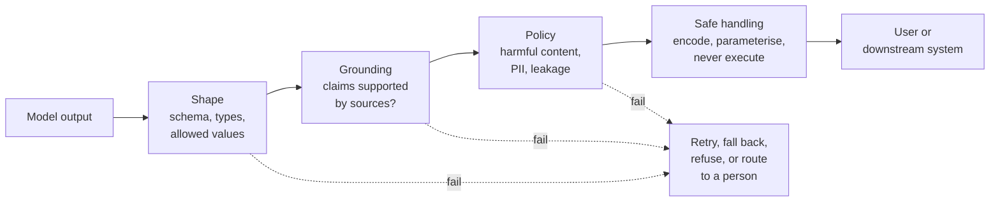

# 3.12 Output guardrails and validation: deep dive

Reference material for [3.12 Output guardrails and validation](../3-components/3.12-output-guardrails.md). Read that first.
This page keeps the full treatment: provider survey, numbers, risk and controls, cloud mapping
and the complete source list.

## What it is

Output guardrails check what a model produced before anyone or anything uses it. Input guardrails
([3.2](../3-components/3.2-input-guardrails.md)) decide what the model sees; output guardrails decide what leaves. They
answer four questions:

1. **Is it the right shape?** Valid JSON matching the schema, the right types, values from the allowed
   set.
2. **Is it supported?** For answers built on sources, does each claim follow from the sources it cites?
3. **Is it allowed?** No harmful content, no personal data that shouldn't be shown, no leaked system
   prompt or secrets.
4. **Is it safe to use?** Before output reaches a browser, a database, a shell or another system, it is
   encoded or validated like any untrusted input.

### Shape: structured outputs

The biggest change since 2024 is that providers can now *guarantee* structure. OpenAI, Anthropic and
Google all offer structured outputs: you pass a JSON Schema and the provider constrains generation so
that only tokens consistent with the schema can be produced. Anthropic's documentation describes the
result as always valid against the schema, with no retries needed for schema violations
([Anthropic](https://platform.claude.com/docs/en/build-with-claude/structured-outputs)); Google's says
the response always follows the schema ([Google Cloud](https://docs.cloud.google.com/vertex-ai/generative-ai/docs/multimodal/control-generated-output)).
Each supports only a subset of JSON Schema, so check yours compiles.

Two limits matter:

- **Structure is guaranteed; content isn't.** A schema guarantees an `amount` field that is a number,
  not that it is the right number. Validate business rules in code (ranges, totals that add up, dates in
  order, identifiers that exist).
- **Older "JSON mode"** only promises syntactically valid JSON, not your schema. Prefer schema-enforced
  outputs where available.

### Support: grounding checks

For answers built on retrieved sources ([3.4](../3-components/3.4-retrieval-pipeline.md)), the risk is a fluent claim the
sources don't support. Three layers, cheapest first:

1. **Ask for it in the prompt.** Anthropic's guidance: let the model say "I don't know", have it extract
   word-for-word quotes before answering long documents, and have it check each claim against a
   supporting quote and retract any it can't support
   ([Anthropic](https://platform.claude.com/docs/en/test-and-evaluate/strengthen-guardrails/reduce-hallucinations)).
2. **Check citations in code.** If each claim cites a source and quotes it, confirm the quote is really
   in that source. In [lab 3.12](../../labs/3.12-output-guardrails/README.md) this exact-match check
   caught every fabricated or misattributed quote, and missed both claims that quoted a real sentence but
   said something it didn't support (one said the opposite).
3. **Check meaning with a model.** Managed grounding checks compare the response with the sources:
   AWS's contextual grounding check scores grounding and relevance against thresholds
   ([AWS](https://docs.aws.amazon.com/bedrock/latest/userguide/guardrails.html)); Microsoft's
   groundedness detection flags ungrounded segments and can rewrite them to match the source
   ([Microsoft Learn](https://learn.microsoft.com/azure/ai-services/content-safety/concepts/groundedness));
   Google's check grounding API scores support and returns citations
   ([Google Cloud](https://cloud.google.com/generative-ai-app-builder/docs/builder-apis)). An LLM judge
   with a narrow rubric does the same job ([3.15](../3-components/3.15-evals.md)).

Grounding checks catch unsupported claims, not wrong sources: if retrieval returned an outdated policy,
a perfectly grounded answer is still wrong.

### Policy: content and leakage

The same classifiers used on input ([3.2](../3-components/3.2-input-guardrails.md)) run on output: harmful content,
personal data, topics the application must not discuss. Add checks for things only output can reveal:
fragments of the system prompt, secrets or internal identifiers, and links or code you don't want shown.

### Safe handling: treat output as untrusted

OWASP's LLM05 risk, Improper Output Handling, is the classic web vulnerabilities reappearing through a
model: output rendered in a browser (cross-site scripting), output used in SQL (injection), output passed
to `exec` or a shell (remote code execution). OWASP's advice is to treat the model like any other user:
validate its output before backend functions use it, encode it for the context it lands in, use
parameterised queries, and apply a strict Content Security Policy
([OWASP](https://genai.owasp.org/llmrisk/llm052025-improper-output-handling/)). Prompt injection
([3.2](../3-components/3.2-input-guardrails.md)) is often how an attacker gets malicious text into the output in the
first place.

### Streaming

Streaming shows tokens as they are generated, so a full-response check can't run before the user sees
the text. OpenAI's guardrails library notes that, when output checks run in parallel with streaming,
violating content may briefly appear before the check acts
([OpenAI](https://guardrails.openai.com/docs/quickstart)). Options: buffer and check before showing
(adds latency), check per sentence or chunk, or stream only low-risk content and hold back anything that
triggers actions or reaches other systems until it is checked.

### What to do on failure

Retry (with the validation error, for shape failures), fall back to a safe template, answer "I don't
have enough information", or route to a person. Decide per check and per use case; log every failure,
because the failures are your next eval cases.

## When to use / when to avoid

| Use | Avoid |
|---|---|
| Schema-enforced outputs whenever code consumes the output | Parsing free text with regular expressions |
| Grounding checks on answers that cite sources, especially regulated or customer-facing ones | Treating a passed grounding check as proof the answer is correct |
| Encoding and validation wherever output reaches a browser, database, shell or API | Executing model output directly |
| Buffering or chunk checks when streaming high-risk content | Full-response checks in parallel with streaming for high-risk content |

## Trade-offs

- **[2.1 Cost vs quality vs latency](../2-trade-offs/2.1-cost-quality-latency.md).** Each semantic check
  is another model call and delays the response; buffering for checks removes the benefit of streaming.
  Run cheap deterministic checks always and expensive ones by risk.
- **Strictness vs helpfulness.** Strict grounding thresholds produce more "I don't know" answers.

## Limitation → mitigating pattern

| Limitation | Mitigating pattern |
|---|---|
| Malformed or wrongly shaped output | Structured outputs; schema validation; retry with the error |
| Right shape, wrong values | Business-rule validation in code |
| Unsupported claims | Quote-and-verify prompting; citation checks; grounding service or judge |
| Output used unsafely downstream | Context-aware encoding, parameterised queries, no execution |
| Checks too slow for streaming | Chunk-level checks; hold back actions until checked |

## Numbers

| Figure | Value | As of | Source |
|---|---|---|---|
| Deterministic quote check vs human labels on 9 claims | 7 of 9 agree; misses only real-quote, wrong-claim cases | Nov 2026 | [Lab 3.12](../../labs/3.12-output-guardrails/README.md) |

Providers state structured outputs guarantee schema compliance for supported schemas; they publish no
figures for content correctness, because structure can't guarantee it.

## Failure modes and antipatterns

- **"It's valid JSON, so it's right."**
- **Rendering model output as HTML or Markdown without encoding**, including images or links that can
  carry data out ([OWASP LLM05](https://genai.owasp.org/llmrisk/llm052025-improper-output-handling/)).
- **Model-generated SQL or shell commands executed directly.**
- **Grounding against the wrong sources**, so wrong answers pass.
- **Retrying forever.** Cap retries, then fall back.
- **Silent failures.** Output checks that fail without logging teach you nothing.

## Risk and controls

| Risk | Reference | Control | Evidence an auditor would ask for |
|---|---|---|---|
| Model output exploits downstream systems | OWASP LLM05:2025 Improper Output Handling | Treat output as untrusted: validation, context-aware encoding, parameterised queries, CSP, no direct execution | Code review and security testing records; CSP configuration |
| Unsupported or false claims reach customers | OWASP LLM09:2025 Misinformation | Citations required; grounding checks with thresholds; "I don't know" path | Grounding-check configuration and failure rates; sampled reviews |
| Personal data or secrets in responses | OWASP LLM02:2025 Sensitive Information Disclosure | Output PII and secret scanning; masking | Detection configuration; incident log |
| System prompt revealed | OWASP LLM07:2025 System Prompt Leakage | Keep secrets out of prompts; detect prompt fragments in output | Prompt reviews; detection logs |
| Wrong values in structured output drive wrong actions | Model risk; operational risk | Business-rule validation; human approval for consequential actions | Validation rules; approval records |

## Cloud mapping

| | Azure | AWS | Google Cloud | OpenAI | Anthropic | Open source |
|---|---|---|---|---|---|---|
| Schema-enforced output | Structured outputs for Azure OpenAI models (not verified here) | Structured outputs for supported Claude models on Bedrock | Response schema (Gemini) | Structured outputs (`json_schema`, strict) | Structured outputs (`output_config.format`), strict tool use | Constrained-decoding libraries in serving engines (see [3.8](../3-components/3.8-serving-internals.md)) |
| Grounding check | Groundedness detection (with correction) | Contextual grounding checks | Check grounding API | Guardrails library hallucination check | Quote-and-verify prompting pattern | LLM judge ([3.15](../3-components/3.15-evals.md)) |
| Harmful content and PII on output | Azure AI Content Safety | Bedrock Guardrails (applied to responses) | Model Armor (responses) | Moderation API; output guardrails | — | — |

## Sources and further reading

- [Structured outputs](https://platform.claude.com/docs/en/build-with-claude/structured-outputs) and
  [Reduce hallucinations](https://platform.claude.com/docs/en/test-and-evaluate/strengthen-guardrails/reduce-hallucinations) (Anthropic).
- [Structured output](https://docs.cloud.google.com/vertex-ai/generative-ai/docs/multimodal/control-generated-output) (Google Cloud).
- [Guardrails](https://guardrails.openai.com/docs/quickstart) (OpenAI).
- [Groundedness detection](https://learn.microsoft.com/azure/ai-services/content-safety/concepts/groundedness) (Microsoft).
- [Amazon Bedrock Guardrails](https://docs.aws.amazon.com/bedrock/latest/userguide/guardrails.html) (AWS).
- [LLM05:2025 Improper Output Handling](https://genai.owasp.org/llmrisk/llm052025-improper-output-handling/) (OWASP).
- [Lab 3.12](../../labs/3.12-output-guardrails/README.md): what a quote check catches and misses.
