# 3.15 Evals: deep dive

Reference material for [3.15 Evals](../3-components/3.15-evals.md). Read that first.
This page keeps the full treatment: provider survey, numbers, risk and controls, cloud mapping
and the complete source list.

<!-- source: images/src/dd-3.15-evals.mmd; render with scripts/diagrams.py -->

## What it is

An eval is a test for an AI system: give it an input, apply grading logic to the output, and measure
success ([Anthropic, 2026](https://www.anthropic.com/engineering/demystifying-evals-for-ai-agents)).
Ordinary unit tests assume the same input always gives the same output. Model-backed systems don't
behave that way, so instead of asking "does it pass?" you ask "how often does it pass, on which kinds of
cases, and is that better or worse than before?"

Evals turn the quality bar from [the Method](../1-method/1-method.md) into a number. Without them,
every change is judged by trying a few examples and deciding it "seems better", which OpenAI calls
*vibe-based evals* and lists as an antipattern
([OpenAI](https://developers.openai.com/api/docs/guides/evaluation-best-practices)). The guidance from
Anthropic, OpenAI, Google, Microsoft and AWS converges on the same parts.

### The parts of an eval

- **Cases.** Inputs, plus expected outputs or grading criteria where you have them. The best cases come
  from real use: production logs, support tickets, failures you have already seen. Add edge cases and
  requests the system must refuse. Synthetic cases help you start, but a set that doesn't look like
  production traffic gives a misleading score (OpenAI).
- **Graders.** The logic that scores an output (next section).
- **Aggregation with uncertainty.** A pass rate is an estimate from a sample, so report it with an error
  bar (see [Reading the results](#reading-the-results)).
- **A decision rule.** What score, or what change in score, blocks a release.

### Three kinds of grader

Anthropic, Google and AWS describe the same three kinds:

| Grader | Examples | Strengths | Weaknesses |
|---|---|---|---|
| **Code** | Exact match, JSON schema, unit tests on generated code, recall@k for retrieval, "did it cite a source?" | Fast, cheap, repeatable | Only works when "correct" can be checked mechanically |
| **Model** (LLM-as-judge) | A second model scores the output against a rubric, or picks the better of two outputs | Handles open-ended output; scales | Costs money, varies between runs, has biases, must be calibrated against people |
| **Human** | Domain experts label a sample | The reference standard | Slow and expensive |

Use the cheapest grader that is valid for the criterion. Suites usually combine them: code for format
and facts, a model judge for tone or completeness, humans to calibrate the judge.

**Model judges need calibration.** Zheng et al. found strong judges agree with human preferences over
80% of the time, about as often as humans agree with each other, but also documented systematic
biases: favouring the first answer shown (*position bias*), longer answers (*verbosity bias*) and their
own outputs (*self-enhancement*) ([NeurIPS 2023](https://arxiv.org/abs/2306.05685)). Anthropic, OpenAI
and Google all say to check a judge against human labels before trusting it; Google's evaluation
service has a dedicated step for scoring the judge itself
([Google Cloud](https://docs.cloud.google.com/vertex-ai/generative-ai/docs/models/evaluate-judge-model)).
Habits: one judge per criterion with a specific rubric; run pairwise comparisons in both orders; pin
the judge model's version.

**Pointwise or pairwise?** Pointwise scores one output against a rubric and gives a number to track;
pairwise picks the better of two and is easier when a scoring rubric is hard to write
([Google Cloud](https://docs.cloud.google.com/vertex-ai/generative-ai/docs/models/eval-python-sdk/determine-eval)).

### What to measure

Measure each stage separately, so a failure points at its cause. For a retrieval system, providers
converge on two groups:

- **Retrieval:** did the right passages come back? (recall@k, context relevance, context coverage)
- **Generation:** is the answer supported by those passages (*faithfulness* or *groundedness*), is it
  correct and complete, and does it address the question (*relevance*)?

Microsoft calls groundedness, retrieval and relevance the "RAG triad"; AWS's RAG evaluations offer
context relevance and coverage for retrieval and correctness, completeness and faithfulness for
generation, plus citation precision and coverage
([AWS](https://aws.amazon.com/about-aws/whats-new/2025/03/amazon-bedrock-rag-evaluation-generally-available/)).
Add safety criteria (harmful content, refusals) and operational ones (latency, cost).

**Agents** add two wrinkles. Grade the **outcome** (did the task get done?) rather than requiring a
particular sequence of tool calls, because agents find valid paths you didn't anticipate, but read the
**transcripts** to find out why things fail. And because agents vary between runs, distinguish
**pass@k** (at least one of *k* attempts succeeds; fine when a retry is acceptable) from **pass^k**
(all *k* succeed; what users feel when they expect consistency) (Anthropic). More in
[3.9](../3-components/3.9-workflows-and-agents.md).

### Capability and regression evals

Anthropic separates two suites with different jobs. **Capability evals** are hard tasks the system
often fails; they show where to improve. **Regression evals** are things it already does well; they
should stay near 100% and block any change that breaks them. When a capability eval approaches 100%,
promote it to the regression suite and write harder ones.

### Reading the results

An eval score is a sample estimate. Anthropic's statistical guidance boils down to four habits
([Anthropic, 2024](https://www.anthropic.com/research/statistical-approach-to-model-evals);
[paper](https://arxiv.org/abs/2411.00640)):

1. Report a confidence interval: mean ± 1.96 × standard error.
2. If cases come in related groups (several questions about one document), use clustered standard
   errors; naive ones can be more than three times too small.
3. Reduce noise per case, for example by averaging several runs.
4. Compare versions on the **same** cases and analyse the per-case differences (*paired* analysis).

And size the set to the change you need to detect. In [lab 3.15](../../labs/3.15-evals/README.md),
100 cases caught a real drop from 80% to 75% only 8% of the time (13% with paired analysis); reliable
detection needed around 2,000.

### Offline and online

Run the regression suite on every change, the way unit tests run in CI: OpenAI's guidance is to
evaluate continuously and grow the set from logs. After launch, sample production traffic and score it
with the same graders; Microsoft's tooling does this at a sampled rate and raises alerts when a score
such as groundedness drops ([Microsoft Learn](https://learn.microsoft.com/azure/foundry/concepts/observability)).
Production failures become new cases. Expect your criteria to change as you read outputs: Shankar et
al. call this *criteria drift* and found it is impossible to fix all criteria before looking
([UIST 2024](https://arxiv.org/abs/2404.12272)).

## How it works, step by step

### pass@k and pass^k

<!-- source: images/src/dd-3.15-pass-k.mmd; render with scripts/diagrams.py -->

1. **Run every task k times** with the same inputs, because agents and sampled outputs vary.
2. **pass@k** counts a task as passed if *any* of the k runs passes. It measures whether the system
   can solve the task given retries; it suits code generation with tests, where a failed attempt is
   cheap and detectable.
3. **pass^k** counts a task as passed only if *all* k runs pass. It measures consistency: whether
   every user, each getting one run, gets the right result. τ-bench introduced it for customer-service
   agents ([Yao et al., 2024](https://arxiv.org/abs/2406.12045)).
4. **Average over tasks.** Report k, the number of tasks and an error bar.
5. **Read the gap.** A high pass@k with a low pass^k means the capability is there but unreliable.
   Fix the variance (tighter instructions, validation, workflows) before shipping to customers.

**Worked number.** If every task passes independently 90% of the time, pass@4 is 1 − 0.1⁴ = 99.99%,
but pass^4 is 0.9⁴ = 66% and pass^8 is 43%. The same 90% single-run score can hide different
systems. If 60% of tasks always pass and 40% pass three times in four, the single-run score is still
90%, yet pass^4 is 0.6 + 0.4 × 0.75⁴ = 73%. Measure pass^k directly rather than deriving it.

## When to use / when to avoid

| Use | Avoid |
|---|---|
| From the first prototype: a small set of real cases beats none, and the benefits compound over time (Anthropic) | A model judge where a code check would do |
| Before every prompt, model, retrieval or tool change, and every model upgrade | An uncalibrated model judge as a release gate |
| Continuously on sampled production traffic | Public benchmarks as a stand-in for your own task |

## Trade-offs

- **[2.1 Cost vs quality vs latency](../2-trade-offs/2.1-cost-quality-latency.md)**: evals tell you where
  on that curve you are. Human grading is the most trustworthy and the most expensive; code the reverse.
- **Size vs speed.** Large suites catch small regressions but run slowly: run a fast subset on every
  change and the full suite before release.

## Limitation → mitigating pattern

| Limitation | Mitigating pattern |
|---|---|
| Output can't be checked mechanically | Model judge with a specific rubric, calibrated against human labels |
| Judge favours position, length or its own style | Swap orders, rubric anchored on content, different judge model, calibration set |
| Score moves between runs | Several trials per case; report error bars |
| Small regressions invisible | Larger set, paired comparison, size the set to the change you care about |
| Eval set drifts from real use | Sample production traffic; turn failures into cases |
| Agent judged on a fixed path | Grade outcomes; read transcripts |

## Numbers

| Figure | Value | As of | Source |
|---|---|---|---|
| Agreement of strong LLM judges with human preferences | > 80%, similar to human–human agreement | 2023 | [Zheng et al.](https://arxiv.org/abs/2306.05685) |
| Clustered vs naive standard errors on popular evals | can be > 3× larger | Nov 2024 | [Anthropic](https://www.anthropic.com/research/statistical-approach-to-model-evals) |
| 95% CI half-width on an 80% pass rate | ±11 points at 50 cases; ±8 at 100; ±3.5 at 500 (derived: 1.96 × √(0.8 × 0.2 ÷ n)) | — | Derived |
| Cases to detect 80% → 75% with 80% power, unpaired | ≈ 1,100 (derived); simulation agrees | Nov 2026 | [Lab 3.15](../../labs/3.15-evals/README.md) |

## Failure modes and antipatterns

- **Vibe checks.** A few hand-picked examples instead of a measured suite.
- **A judge nobody validated.** The score measures the judge's taste, not yours.
- **Changing the judge silently.** A new judge model or rubric changes every score; version it like code.
- **Single numbers without error bars**, and decisions made on differences smaller than the noise.
- **Only happy-path cases.** The suite passes; production doesn't.
- **Tuning to the test.** Prompts tweaked until the eval passes, with no held-out cases to check that
  the gain is real.

## Risk and controls

| Risk | Reference | Control | Evidence an auditor would ask for |
|---|---|---|---|
| A change degrades quality and ships unnoticed | Model risk management practice; OWASP LLM09:2025 Misinformation | Regression suite as a release gate with documented thresholds and sign-off | Eval reports per release, with error bars and approvals |
| Automated grading disagrees with expert judgement | Model validation practice | Calibration set with expert labels; periodic re-calibration; judge version pinned | Judge–human agreement figures over time |
| Eval data contains personal or confidential information | Data protection | Classify and protect eval sets like production data; minimise and redact | Data classification of eval sets; access logs |
| Accuracy claims to users or regulators not backed by evidence | EU AI Act Art. 15 for high-risk systems (not verified here) | Defined metrics, test sets and reporting method for declared accuracy | Methodology document; reproducible eval runs |
| Production quality decays after launch | Operational monitoring | Continuous evaluation of sampled traffic with alerts | Dashboards, alert history, incidents raised |

## Cloud mapping

| Capability | Azure | AWS | Google Cloud | OpenAI | Anthropic | Open source |
|---|---|---|---|---|---|---|
| Built-in evaluators / judges | Foundry evaluators: groundedness, relevance, retrieval, tool-call accuracy, task adherence, safety | Bedrock Evaluations: LLM-as-a-judge (correctness, completeness, faithfulness, harmfulness, refusal) | Gen AI evaluation service: pointwise and pairwise, rubric-based, trajectory metrics | Graders; Evals platform being deprecated as of Nov 2026 | Guidance rather than a managed service (not verified) | promptfoo, ChainForge |
| RAG-specific | RAG evaluators ("RAG triad") | Knowledge Bases RAG evaluation; citation precision and coverage | Rubric metrics; check grounding API | — | — | — |
| Judge calibration | Custom evaluators | Human evaluation workflows | Evaluate the judge against human ratings | — | — | — |
| Production monitoring | Continuous evaluation to Azure Monitor | — (not verified) | — (not verified) | — | — | — |

Sources: [Azure built-in evaluators](https://learn.microsoft.com/azure/foundry/concepts/built-in-evaluators);
[Amazon Bedrock Evaluations](https://aws.amazon.com/bedrock/evaluations/);
[Vertex AI evaluation](https://docs.cloud.google.com/vertex-ai/generative-ai/docs/models/eval-python-sdk/determine-eval);
[OpenAI evaluation best practices](https://developers.openai.com/api/docs/guides/evaluation-best-practices).

## Sources and further reading

- [τ-bench: a benchmark for tool-agent-user interaction](https://arxiv.org/abs/2406.12045) (Yao et al., 2024): introduces pass^k.
- [Demystifying evals for AI agents](https://www.anthropic.com/engineering/demystifying-evals-for-ai-agents)
  (Anthropic, Jan 2026): graders, capability vs regression, pass@k and pass^k, transcripts.
- [A statistical approach to model evaluations](https://www.anthropic.com/research/statistical-approach-to-model-evals)
  (Anthropic, Nov 2024) and the [paper](https://arxiv.org/abs/2411.00640) (Miller).
- [Evaluation best practices](https://developers.openai.com/api/docs/guides/evaluation-best-practices) (OpenAI).
- [Define your evaluation metrics](https://docs.cloud.google.com/vertex-ai/generative-ai/docs/models/eval-python-sdk/determine-eval)
  and [Evaluate a judge model](https://docs.cloud.google.com/vertex-ai/generative-ai/docs/models/evaluate-judge-model) (Google Cloud).
- [Built-in evaluators](https://learn.microsoft.com/azure/foundry/concepts/built-in-evaluators) and
  [Observability](https://learn.microsoft.com/azure/foundry/concepts/observability) (Microsoft Foundry).
- [Evaluating RAG applications with Bedrock Knowledge Base evaluation](https://aws.amazon.com/blogs/machine-learning/evaluating-rag-applications-with-amazon-bedrock-knowledge-base-evaluation/) (AWS).
- [Judging LLM-as-a-Judge with MT-Bench and Chatbot Arena](https://arxiv.org/abs/2306.05685) (Zheng et al., NeurIPS 2023).
- [Who Validates the Validators?](https://arxiv.org/abs/2404.12272) (Shankar et al., UIST 2024): criteria drift.
- [Emerging patterns in building GenAI products: Evals](https://www.martinfowler.com/articles/gen-ai-patterns/) (Thoughtworks).
- [Lab 3.15](../../labs/3.15-evals/README.md): how many cases you need to catch a regression.
