# 3.18 Model adaptation: deep dive

Reference material for [3.18 Model adaptation](../3-components/3.18-model-adaptation.md). Read that
first, and [2.6](2.6-prompt-rag-finetune.md) for when to adapt at all.

## Where the providers agree

- **OpenAI** supports supervised fine-tuning, vision fine-tuning, direct preference optimisation and
  reinforcement fine-tuning, and recommends SFT before DPO so the model already prefers correct
  answers ([OpenAI cookbook](https://developers.openai.com/cookbook/examples/fine_tuning_direct_preference_optimization_guide)).
  RFT jobs take a grader: string checks, text similarity, Python code, a scoring model, or a
  combination ([API reference](https://developers.openai.com/api/reference/resources/fine_tuning/subresources/methods)).
  Its model-selection guide reached its targets with a small model fine-tuned on 1,000 labelled
  examples ([3.7](3.7-model-layer.md)). Which models are tunable changes often (secondary sources
  report recent flagship families are not; not verified here).
- **AWS** frames customisation by what you bring: labelled pairs for fine-tuning, a reward function for
  reinforcement fine-tuning, a teacher model for distillation. Bedrock distillation generates the
  teacher's responses for your prompts and fine-tunes the student; training is charged per token
  processed (tokens × epochs) plus monthly model storage
  ([AWS](https://docs.aws.amazon.com/bedrock/latest/userguide/custom-models.html)). Some customised
  models must be served on Provisioned Throughput.
- **Google** offers supervised and preference tuning for Gemini on Vertex AI, aimed at behaviour such
  as fixed labels and output conventions ([2.6](2.6-prompt-rag-finetune.md)).
- **Microsoft** offers fine-tuning in Foundry for Azure OpenAI and other models (methods not verified here).
- **Anthropic** has no fine-tuning on its own API. Claude 3 Haiku fine-tuning was offered through
  Amazon Bedrock (generally available November 2024) and required Provisioned Throughput to serve
  ([AWS](https://aws.amazon.com/blogs/aws/fine-tuning-for-anthropics-claude-3-haiku-model-in-amazon-bedrock-is-now-generally-available/)); an AWS blog notes Claude 3
  Haiku reached end of life on 10 September 2026, so current Claude fine-tuning options are unverified.
  It is a clear example of a fine-tune ending with its base model.

## Parameter-efficient methods

LoRA freezes the pre-trained weights and trains low-rank update matrices; on GPT-3 175B it cut
trainable parameters about 10,000× and GPU memory about 3× versus full fine-tuning, with no added
inference latency once merged ([Hu et al.](https://arxiv.org/abs/2106.09685)). QLoRA trains LoRA
adapters on a 4-bit quantized base, fitting a 65B model's fine-tune on a single 48 GB GPU while
preserving 16-bit fine-tuning quality on its benchmarks ([Dettmers et al.](https://arxiv.org/abs/2305.14314)).
Hosted services may use LoRA-style methods internally without saying so.

## How it works, step by step

### LoRA

<!-- source: images/src/dd-3.18-lora.mmd; render with scripts/diagrams.py -->

1. **Freeze the base model.** None of its weights change during training.
2. **Pick the matrices to adapt,** usually the attention projections and sometimes the feed-forward
   layers.
3. **Add two thin matrices beside each one.** For a weight W of size d × k, add B (d × r) and A
   (r × k), with a small rank r such as 8 or 16. B starts at zero, so training starts from the base
   model's behaviour.
4. **Train only A and B.** The layer's output becomes W·x + (α / r)·B·A·x, where α is a scaling
   setting.
5. **Serve it either way.** Merge B·A into W for no extra latency, or keep the adapter separate so one
   base model serves many adapters, swapped per request
   ([Hu et al.](https://arxiv.org/abs/2106.09685)).
6. **QLoRA** does the same over a base stored in 4 bits, so larger models fit on one accelerator.

**Worked number.** One 4,096 × 4,096 projection has 16.8 million weights. At r = 16, A and B add
16 × (4,096 + 4,096) = 131,072 trainable numbers: 0.8% of that matrix. Adapting all four attention
projections in the 32 layers of the 8-billion-parameter shape from [Lab 3.8](../../labs/3.8-serving-internals/README.md)
trains 13.6 million numbers, 0.17% of the model. Stored at 16 bits the adapter is about 27 MB, against
16 GB for the base weights.

## Numbers

| Figure | Value | As of | Source |
|---|---|---|---|
| LoRA trainable parameters vs full fine-tune (GPT-3 175B) | ≈ 10,000× fewer; ≈ 3× less GPU memory | 2021 | Hu et al. |
| QLoRA | 65B model fine-tuned on one 48 GB GPU | 2023 | Dettmers et al. |
| Bedrock reinforcement fine-tuning claim | up to 66% average accuracy improvement over base models (vendor claim) | 2026 | AWS user guide, via secondary |
| LoRA rank 16 on an 8B-shaped model | 16.8 M parameters, 0.2%, 34 MB | derived | [Lab 3.18](../../labs/3.18-model-adaptation/README.md) |
| Break-even, illustrative tuned small model | ≈ 88k requests/month pay-per-token; >380k with $5/h hosting | derived | Lab 3.18 |

## Failure modes and antipatterns

- **Fine-tuning to teach facts** ([2.6](2.6-prompt-rag-finetune.md)).
- **Training and testing on overlapping data**, so the eval flatters the tune.
- **Training on production data with personal information** without approval or minimisation.
- **Weak graders in RFT**, rewarding keyword stuffing or format over substance (reward hacking).
- **No plan for base-model retirement.**
- **Comparing the tune against an unoptimised baseline** instead of the best prompt with caching.

## Risk and controls

| Risk | Reference | Control | Evidence an auditor would ask for |
|---|---|---|---|
| Training data contains personal or confidential data the model can reveal | OWASP LLM02; data protection | Classify, minimise and approve datasets; prefer retrieval for sensitive knowledge | Dataset approval record; data lineage |
| Poisoned or low-quality training data | OWASP LLM04 Data and Model Poisoning | Dataset provenance, review and versioning | Dataset versions; review sign-off |
| A tuned model is a new model | Model risk management | Validate against the base and the previous version on a held-out set; document limits | Validation report; model card |
| Tune lost when base model retires | Operational resilience | Track base-model lifecycle; keep data and pipeline to retrain | Lifecycle register; reproducible pipeline |

## Cloud mapping

| | Azure | AWS | Google Cloud | OpenAI | Anthropic | Open source |
|---|---|---|---|---|---|---|
| Supervised fine-tuning | Foundry fine-tuning | Bedrock fine-tuning | Vertex AI supervised tuning | Fine-tuning API | Not on direct API; formerly via Bedrock (Claude 3 Haiku) | Hugging Face PEFT/TRL |
| Preference tuning | — (not verified) | — (not verified) | Vertex AI preference tuning | DPO | — | TRL (DPO) |
| Reinforcement fine-tuning | — (not verified) | Bedrock RFT | — (not verified) | RFT with graders | — | TRL (GRPO) |
| Distillation | — (not verified) | Bedrock model distillation | Tuning smaller models | Distillation via fine-tuning | — | — |

## Sources

- [Choosing between SFT, DPO and RFT](https://developers.openai.com/cookbook/examples/fine_tuning_direct_preference_optimization_guide) (OpenAI).
- [Fine-tuning methods reference](https://developers.openai.com/api/reference/resources/fine_tuning/subresources/methods) (OpenAI).
- [Customize your model](https://docs.aws.amazon.com/bedrock/latest/userguide/custom-models.html) (AWS).
- [Fine-tuning for Claude 3 Haiku in Amazon Bedrock is generally available](https://aws.amazon.com/blogs/aws/fine-tuning-for-anthropics-claude-3-haiku-model-in-amazon-bedrock-is-now-generally-available/) (AWS, 2024).
- [LoRA](https://arxiv.org/abs/2106.09685) (Hu et al.) and [QLoRA](https://arxiv.org/abs/2305.14314) (Dettmers et al.).
- [Lab 3.18](../../labs/3.18-model-adaptation/README.md).
