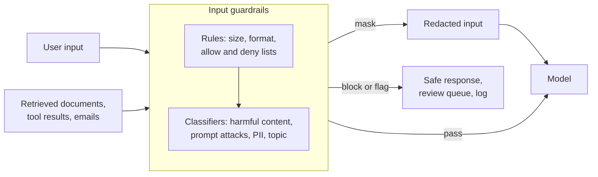

# 3.2 Input guardrails: deep dive

Reference material for [3.2 Input guardrails](../3-components/3.2-input-guardrails.md). Read that first.
This page keeps the full treatment: provider survey, numbers, risk and controls, cloud mapping
and the complete source list.

## What it is

Input guardrails are checks that run on everything going into a model, before the model acts on it.
Each check classifies the input and the application decides what to do: let it through, mask part of it,
block it with a safe response, or flag it for review.

They protect against four kinds of input:

- **Prompt attacks.** *Direct* attacks (jailbreaks) come from the user, who writes text designed to
  override the system's instructions. *Indirect* attacks hide instructions inside content the system
  reads on the user's behalf: a retrieved document, an email, a web page, a tool result. Microsoft's
  Prompt Shields treats these as separate threats with separate detectors
  ([Microsoft Learn](https://learn.microsoft.com/azure/ai-services/content-safety/concepts/jailbreak-detection)),
  and Anthropic's guidance draws the same line: in the indirect case the user is trusted but the content
  is not ([Anthropic](https://platform.claude.com/docs/en/test-and-evaluate/strengthen-guardrails/mitigate-jailbreaks)).
- **Sensitive data.** Personal or confidential data that shouldn't reach the model, a provider or the
  logs. Masking it before the call is data minimisation in practice.
- **Harmful or off-limits content.** Hate, violence and similar categories, plus topics your application
  must not engage with (for example, investment advice from a policy assistant).
- **Abuse of capacity.** Oversized or repeated inputs designed to burn tokens (see
  [3.1](../3-components/3.1-ai-gateway-and-router.md)).

Every major provider now ships a managed version, and they converge on the same categories:

| Provider | Service | Covers |
|---|---|---|
| AWS | Bedrock Guardrails | Content filters (including a *prompt attack* category), denied topics, word filters, sensitive-information masking, grounding checks; callable on its own for any model via `ApplyGuardrail` ([AWS](https://docs.aws.amazon.com/bedrock/latest/userguide/guardrails.html)) |
| Microsoft | Azure AI Content Safety, Prompt Shields | Harmful content; user-prompt attacks and document attacks |
| Google | Model Armor | Prompt injection and jailbreak detection, sensitive data protection, malicious URLs, PDF screening; model- and cloud-agnostic ([Google Cloud](https://docs.cloud.google.com/model-armor/overview)) |
| OpenAI | Agents SDK guardrails; Moderation API; Guardrails library | Input guardrails that halt a run when a *tripwire* fires; a hosted moderation classifier ([OpenAI Guardrails](https://guardrails.openai.com/docs/quickstart)) |
| Anthropic | Guidance rather than a service | A *harmlessness screen*: a small, fast model with structured output pre-screens input; also screen tool outputs |

### Three ways to check

1. **Rules.** Length and size limits, allowed formats, regular expressions for identifiers, word lists.
   Cheap, fast, predictable, and easy to evade with rephrasing.
2. **Classifiers.** Trained detectors for harmful content, prompt attacks and personal data; this is
   what the managed services provide. Each returns a category and a confidence you set thresholds on.
3. **A model as a screen.** A small model with a narrow prompt and a constrained output ("safe" or
   "unsafe", with a category). Flexible and easy to adapt to your domain; it costs a call, and it reads
   attacker-written text too, so it can be targeted like any other model.

Production systems layer them: rules first (cheapest), classifiers next, a model screen where nuance
matters.

### Where they run

- **Before the model**, so nothing unsafe is processed. Simplest, adds latency.
- **In parallel with the model**, the default in OpenAI's Agents SDK: lower latency, but the model may
  already have spent tokens, or started a side effect, by the time the tripwire fires. Run in parallel
  only when the model call has no side effects.
- **On every untrusted input, not just the user's message.** Retrieved passages and tool results are
  where indirect attacks arrive; Anthropic recommends applying the same screen to tool outputs, and
  Google and Microsoft screen documents.
- **At the gateway** ([3.1](../3-components/3.1-ai-gateway-and-router.md)) for policies that apply to every app, and in
  the application for checks that depend on context.

### What input guardrails can't do

OWASP is blunt: given how these models work, it is unclear whether any method fully prevents prompt
injection ([OWASP LLM01:2025](https://genai.owasp.org/llmrisk/llm01-prompt-injection/)). Detectors are
probabilistic: they catch known patterns and miss novel ones. Treat input guardrails as a layer that
reduces how often attacks succeed, and rely on architecture (least privilege, separating untrusted
content from actions, human approval) to limit the damage when one does
([2.4](../2-trade-offs/2.4-capability-vs-security.md), [3.17](../3-components/3.17-security.md)).

### Error rates at volume

A guardrail is a classifier, so it makes two kinds of mistake: missed attacks and false alarms. When
attacks are rare, false alarms dominate. In [lab 3.2](../../labs/3.2-input-guardrails/README.md), a
detector that catches 95% of attacks and wrongly flags 1% of legitimate requests, run on a million
requests a day with 0.1% attacks, blocks about 950 attacks and about 9,990 legitimate users: 91% of
blocks are mistakes. Lowering the false-alarm rate matters more than raising the catch rate. So:

- Measure each guardrail on a labelled set of real and attack inputs ([3.15](../3-components/3.15-evals.md)).
- Choose thresholds per category; strict for severe harms, looser where false alarms cost more.
- Design the blocked experience: a clear message, a way to rephrase, a route to a person.

## When to use / when to avoid

| Use | Avoid |
|---|---|
| Any system that takes input from people or content it doesn't control | Relying on input guardrails as the only defence against prompt injection |
| Before sending data to a provider or region where personal data must not go (mask first) | Hard-blocking borderline scores in high-volume, low-risk flows; flag or route instead |
| On retrieved documents and tool outputs in agents and RAG | Running guardrails in parallel with calls that have side effects |

## Trade-offs

- **[2.1 Cost vs quality vs latency](../2-trade-offs/2.1-cost-quality-latency.md).** Each layer adds a
  call and some latency. Order checks cheapest first, and run independent checks in parallel with each
  other.
- **[2.4 Capability vs security](../2-trade-offs/2.4-capability-vs-security.md).** Stricter thresholds
  block more attacks and more legitimate users.

## Limitation → mitigating pattern

| Limitation | Mitigating pattern |
|---|---|
| Rules are easy to evade | Classifiers and model screens on top of rules |
| Detectors miss novel attacks | Least privilege, content segregation, human approval ([3.17](../3-components/3.17-security.md)) |
| False alarms at volume | Per-category thresholds, flag-and-review, measured error rates |
| Attacks arrive through documents and tools | Screen every untrusted input, not just the user message |
| Personal data reaches the model or logs | Mask before the call; restore after if needed |

## Numbers

| Figure | Value | As of | Source |
|---|---|---|---|
| Model Armor prompt-injection filter input limit | 10,000 tokens (larger inputs return "skipped" if nothing malicious is found) | Jul 2025 | [Model Armor release notes](https://docs.cloud.google.com/model-armor/release-notes) |
| Prompt Shields input limits | 10,000 characters per prompt; up to 5 documents, 10,000 characters combined | 2024 (may have changed) | Microsoft docs (GitHub source of the page) |
| Blocks that are real attacks: 0.1% attack rate, 95% catch, 1% false alarm | ≈ 9% | — | [Lab 3.2](../../labs/3.2-input-guardrails/README.md) (derived) |

Language coverage varies: Microsoft states Prompt Shields' quality is assured for English, and Google
publishes the list of languages Model Armor's filters are tested on. Check yours.

## Failure modes and antipatterns

- **Screening only the user message** while retrieved documents and tool outputs go straight in.
- **Inputs longer than the detector's limit** passing through unscreened.
- **One threshold for every category.**
- **No measurement of false alarms**, so users are blocked and nobody knows.
- **Leaking the reason for a block** in a way that helps an attacker tune the next attempt.
- **Guardrail outage = open door.** Decide in advance whether a failed check fails open or closed, per
  category.

## Risk and controls

| Risk | Reference | Control | Evidence an auditor would ask for |
|---|---|---|---|
| Prompt injection, direct and indirect | OWASP LLM01:2025 | Prompt-attack detection on user input and on retrieved and tool content; layered with architectural controls | Guardrail configuration; detection metrics; red-team results |
| Personal or confidential data sent to models, providers or logs | OWASP LLM02:2025 Sensitive Information Disclosure | Masking before the call; data classification rules at the gateway | Masking configuration; samples of redacted logs |
| Harmful or out-of-scope use | Acceptable-use policy | Content and topic filters with per-category thresholds | Policy-to-configuration mapping; review of blocked samples |
| Oversized or abusive inputs | OWASP LLM10:2025 | Size limits, rate limits | Limits configuration; anomaly alerts |
| Guardrail silently fails or drifts | Operational resilience; model risk | Fail-closed for severe categories; monitor block rates; re-measure after updates | Monitoring dashboards; change log of guardrail versions |

## Cloud mapping

| | Azure | AWS | Google Cloud | OpenAI | Anthropic | Open source |
|---|---|---|---|---|---|---|
| Prompt-attack detection | Prompt Shields (user prompts and documents) | Bedrock Guardrails prompt-attack filter | Model Armor | Guardrails library (jailbreak check) | Model-screen pattern (docs) | Llama Prompt Guard, NeMo Guardrails (not evaluated) |
| Harmful content | Azure AI Content Safety | Bedrock Guardrails content filters | Model Armor responsible-AI filters | Moderation API | Model-screen pattern | Llama Guard (not evaluated) |
| Personal data masking | Azure AI Language PII (not verified here) | Sensitive-information filters | Sensitive Data Protection via Model Armor | Guardrails library PII check | — | Presidio (not evaluated) |
| Topic restriction | Custom categories (not verified here) | Denied topics | Topicality via templates | Custom guardrails | Model-screen pattern | — |

## Sources and further reading

- [Mitigate jailbreaks and prompt injections](https://platform.claude.com/docs/en/test-and-evaluate/strengthen-guardrails/mitigate-jailbreaks) (Anthropic).
- [Guardrails quickstart](https://guardrails.openai.com/docs/quickstart) (OpenAI).
- [Amazon Bedrock Guardrails](https://docs.aws.amazon.com/bedrock/latest/userguide/guardrails.html) (AWS).
- [Prompt Shields](https://learn.microsoft.com/azure/ai-services/content-safety/concepts/jailbreak-detection) (Microsoft).
- [Model Armor overview](https://docs.cloud.google.com/model-armor/overview) (Google Cloud).
- [LLM01:2025 Prompt Injection](https://genai.owasp.org/llmrisk/llm01-prompt-injection/) (OWASP).
- [Emerging patterns in building GenAI products: Guardrails](https://www.martinfowler.com/articles/gen-ai-patterns/) (Thoughtworks).
- [Lab 3.2](../../labs/3.2-input-guardrails/README.md): base rates and false alarms.
