# 3.4 Retrieval pipeline: deep dive

Reference material for [3.4 Retrieval pipeline](../3-components/3.4-retrieval-pipeline.md). Read that first.
This page keeps the full treatment: provider survey, numbers, risk and controls, cloud mapping
and the complete source list.

<!-- source: images/src/dd-3.4-retrieval-pipeline.mmd; render with scripts/diagrams.py -->

## What it is

A retrieval pipeline finds the passages a model needs to answer a question and puts them in its prompt.
The model then answers from those passages rather than only from what it learned in training. The
term *retrieval-augmented generation* (RAG) comes from Lewis et al. (2020), who paired a language model
(its *parametric* memory) with a searchable index of documents (*non-parametric* memory), and pointed to
two benefits that still drive adoption: answers can cite their sources, and knowledge can be updated by
re-indexing instead of retraining
([Lewis et al., NeurIPS 2020](https://papers.nips.cc/paper/2020/hash/6b493230205f780e1bc26945df7481e5-Abstract.html)).

It is two pipelines that share an index. **Indexing** runs offline whenever sources change: parse,
chunk, enrich, embed, store. **Querying** runs on every request: translate the query, search, fuse,
rerank, assemble the context, generate. Azure and Google both draw it this way: Azure's RAG guide
separates the data pipeline from the application flow
([Microsoft Learn](https://learn.microsoft.com/azure/architecture/ai-ml/guide/rag/rag-solution-design-and-evaluation-guide)),
and Google's reference architectures split a data-ingestion subsystem from a serving subsystem
([Google Cloud](https://docs.cloud.google.com/architecture/rag-reference-architectures)).

The design has moved through three stages that are worth knowing by name
([Gao et al., 2023](https://arxiv.org/abs/2312.10997)):

- **Naive RAG:** chunk, embed, retrieve the top *k* by vector similarity, generate. Simple, and it fails
  on precision and recall.
- **Advanced RAG:** adds steps before retrieval (query rewriting) and after it (reranking, compressing
  the context).
- **Modular RAG:** treats each step as a replaceable module, with routing and fusion between them.

The stable industry baseline in 2026 is advanced RAG with **hybrid search and a reranker**. Microsoft's
search team describes hybrid search plus reranking as "table stakes" for RAG
([Microsoft Tech Community, 2024](https://techcommunity.microsoft.com/blog/azure-ai-services-blog/-/4302729)),
and Anthropic, OpenAI, AWS and Google all ship or recommend the same combination (see Cloud mapping).
When the model itself decides whether, where and how often to search, the pattern becomes *agentic
retrieval*, covered in [3.5](../3-components/3.5-agentic-retrieval.md).

## Variants and stages

### Indexing

- **Parse and extract.** Turn files into clean text with structure. Layout analysis recovers headings,
  tables and figures; images and tables usually need a model to describe them as text, which costs
  money per item ([Azure chunking guide](https://learn.microsoft.com/en-us/azure/architecture/ai-ml/guide/rag/rag-chunking-phase)).
- **Chunk.** Split into passages small enough to rank precisely but large enough to make sense alone.
  Match the strategy to how structured the document is:

  | Document structure | Approach |
  |---|---|
  | Unstructured prose | Sentence-based, or fixed size with overlap |
  | Inferred structure (headings, numbered clauses) | Custom splitting on that structure |
  | Semi-structured (web pages, reports) | Layout analysis |
  | Fixed forms (invoices, ID documents) | Prebuilt or custom extraction models |
  | Long, nested documents | Hierarchical: small child chunks for matching, larger parent chunks for context |

  The first four rows summarise Azure's guidance; managed services expose the same choices (for
  example, fixed, semantic and hierarchical chunking in Bedrock Knowledge Bases
  ([AWS re:Post](https://repost.aws/knowledge-center/bedrock-knowledge-bases-accurate-results-filters))).
- **Enrich.** Add fields that help search and filtering: title, section path, dates, owner, keywords,
  a summary, and **access-control metadata**. *Contextual retrieval* goes further: a model writes 50–100
  tokens explaining where each chunk sits in its document (which company, which period, which section),
  and that text is prepended before embedding and keyword indexing
  ([Anthropic, Sep 2024](https://www.anthropic.com/news/contextual-retrieval)).
- **Embed.** Convert each chunk to a vector. Use the same embedding model and the same text cleaning
  for documents and queries
  ([Azure retrieval guide](https://learn.microsoft.com/en-us/azure/architecture/ai-ml/guide/rag/rag-information-retrieval)).
- **Index.** Store vectors, the text for keyword search, and filterable metadata together, and keep the
  index in step with the sources, including **deletions**.

### Querying

- **Translate the query (optional).** Augment a short or vague query, decompose a compound one into
  sub-queries, rewrite it into the corpus's vocabulary, or generate a hypothetical answer and search
  with that (HyDE). Classify first: simple factual questions don't need decomposition
  ([Azure retrieval guide](https://learn.microsoft.com/en-us/azure/architecture/ai-ml/guide/rag/rag-information-retrieval)).
- **Search.** Run keyword (BM25) and vector search, both filtered by the caller's permissions and any
  metadata filters. Keyword search finds exact strings that embeddings blur, such as error codes and
  policy numbers; vector search finds passages that use different words for the same idea.
- **Fuse.** Combine the ranked lists with **Reciprocal Rank Fusion**: each document scores
  Σ 1 / (c + rank) across the lists, with c commonly 60. RRF uses rank positions only, so it works even
  though BM25 scores and cosine similarities are on different scales
  ([Cormack, Clarke & Buettcher, SIGIR 2009](https://plg.uwaterloo.ca/~gvcormac/cormacksigir09-rrf.pdf)).
- **Rerank.** Score each (query, passage) pair with a model that reads both together (a cross-encoder,
  a language model, or a managed ranking service), then keep the top *N*. Retrieval is tuned for
  recall; reranking is tuned for precision. It adds latency, so measure both
  ([Azure retrieval guide](https://learn.microsoft.com/en-us/azure/architecture/ai-ml/guide/rag/rag-information-retrieval)).
- **Assemble the context.** Send the fewest passages that answer the question, each with a source
  identifier the model must cite. Models use information at the start and end of a long context
  better than information in the middle, and accuracy falls as the context grows
  ([Liu et al., TACL 2024](https://aclanthology.org/2024.tacl-1.9/)).
- **Generate and check.** Instruct the model to answer only from the passages, cite them, and say when
  they don't contain the answer. Optionally verify groundedness afterwards (see
  [3.12](../3-components/3.12-output-guardrails.md)).

## How it works, step by step

### Reciprocal Rank Fusion

<!-- source: images/src/dd-3.4-rrf.mmd; render with scripts/diagrams.py -->

1. **Run each retriever separately.** Keyword search and vector search each return a ranked list.
2. **Ignore their scores.** A keyword score and a cosine similarity are on different scales, so adding
   them is meaningless. RRF uses only each document's rank position.
3. **Score each document** as the sum, over the lists it appears in, of 1 / (c + rank). The constant c
   is usually 60 ([Cormack et al.](https://plg.uwaterloo.ca/~gvcormac/cormacksigir09-rrf.pdf)).
4. **Sort by that score** and pass the top results to the reranker or the model.
5. **What c does.** A large c flattens the difference between rank 1 and rank 5, so agreement between
   lists matters more than winning one list. A small c lets a single first place dominate.

**Worked number.** For "card blocked overseas", keyword search ranks D3, D1, D7 and vector search
ranks D1, D5, D3. D1 scores 1/62 + 1/61 = 0.03252. D3 scores 1/61 + 1/63 = 0.03227. D5 scores
1/62 = 0.01613 and D7 scores 1/63 = 0.01587. The fused order is D1, D3, D5, D7. The documents both
retrievers found come first, and D1 edges out D3 though neither list ranked it first in both.

## When to use / when to avoid

| Use when | Avoid or reconsider when |
|---|---|
| The answer depends on knowledge the model lacks: proprietary, recent, or changing | The whole corpus fits comfortably in the prompt. Anthropic suggests that under about 200,000 tokens (roughly 500 pages) you can include it all ([Anthropic](https://www.anthropic.com/news/contextual-retrieval)); with prompt caching this is often cheaper to build and run (see [2.3](../2-trade-offs/2.3-context-vs-retrieval.md)) |
| Answers must cite sources a reviewer can check | The problem is behaviour, not knowledge: format, tone, or following a procedure. OpenAI's accuracy guide separates *context* problems (fix with RAG) from *model behaviour* problems (fix with prompting or fine-tuning) ([OpenAI](https://developers.openai.com/api/docs/guides/optimizing-llm-accuracy)) |
| Different users may see different documents | The question needs several dependent searches or a choice of sources at run time: use agentic retrieval ([3.5](../3-components/3.5-agentic-retrieval.md)), as Azure recommends for multi-step queries ([Microsoft Learn](https://learn.microsoft.com/azure/architecture/ai-ml/guide/rag/rag-solution-design-and-evaluation-guide)) |
| The corpus is too large or changes too often to put in every prompt | The data is tabular and the question is an aggregate ("total exposure by desk"): query the database with a tool instead |

## Trade-offs

- **[2.1 Cost vs quality vs latency](../2-trade-offs/2.1-cost-quality-latency.md).** Each query-time
  stage (translation, a second retriever, reranking) improves quality and adds latency and cost.
  Indexing-time work (better parsing, contextual enrichment) costs once per document and adds no
  latency per query, so push quality work into indexing where you can.
- **[2.3 Context stuffing vs retrieval](../2-trade-offs/2.3-context-vs-retrieval.md).** Retrieval
  keeps prompts small but can miss things; putting everything in context misses nothing at the index
  level but costs more per call and loses accuracy as the context grows.
- **[2.6 Prompting vs RAG vs fine-tuning](../2-trade-offs/2.6-prompt-rag-finetune.md).** RAG changes
  what the model knows in this call; it does not change how the model behaves.

## Limitation → mitigating pattern

| Limitation | Mitigating pattern |
|---|---|
| A chunk loses its document's context ("revenue grew 3%": whose? when?) | Contextual enrichment of chunks |
| Embeddings miss exact identifiers and rare terms | Hybrid search: keyword + vector |
| Scores from different retrievers aren't comparable | Reciprocal Rank Fusion |
| Many candidates, low precision | Reranker after fusion |
| Vague, compound or conversational queries | Query rewriting, decomposition |
| Users phrase things differently from the documents | Vector search; query rewriting into corpus vocabulary |
| Relevant passage lost in a long context | Fewer, better passages; best passages first |
| Answer needs several dependent lookups | Agentic retrieval ([3.5](../3-components/3.5-agentic-retrieval.md)) |
| Unsupported claims in the answer | Mandatory citations, groundedness check ([3.12](../3-components/3.12-output-guardrails.md)), faithfulness evals ([3.15](../3-components/3.15-evals.md)) |
| Users retrieve documents they may not see | Permission-aware retrieval (see Risk and controls) |

## Numbers

| Figure | Value | As of | Source |
|---|---|---|---|
| Top-20 retrieval failure rate, baseline → contextual embeddings | 5.7% → 3.7% (−35%) | Sep 2024 | [Anthropic](https://www.anthropic.com/news/contextual-retrieval)¹ |
| … + contextual BM25 (hybrid) | → 2.9% (−49%) | Sep 2024 | Anthropic¹ |
| … + reranking | → 1.9% (−67%) | Sep 2024 | Anthropic¹ |
| Context generated per chunk | 50–100 tokens | Sep 2024 | Anthropic |
| One-time cost to contextualise, with prompt caching | about $1.02 per million document tokens (800-token chunks, 8k-token documents, 2024 small-model prices) | Sep 2024 | Anthropic |
| Corpus size below which "just put it all in the prompt" is reasonable | ≈ 200k tokens (≈ 500 pages) | Sep 2024 | Anthropic |
| RRF constant | c = 60 (common default) | 2009; Azure docs Jul 2026 | Cormack et al.; [Azure](https://learn.microsoft.com/en-us/azure/architecture/ai-ml/guide/rag/rag-information-retrieval) |
| Managed reranker candidate set (Azure semantic ranker) | top 50 | Jul 2026 | [Azure](https://learn.microsoft.com/en-us/azure/architecture/ai-ml/guide/rag/rag-information-retrieval) |
| OpenAI file search defaults | 800-token chunks, 400 overlap, up to 20 chunks in context | Nov 2026 | [OpenAI](https://developers.openai.com/api/docs/assistants/tools/file-search) |

¹ All four rates and reductions confirmed against Anthropic's post on 2026-11-02
([InfoQ](https://www.infoq.com/news/2024/09/anthropic-contextual-retrieval/) and others) because the
full post could not be fetched while writing; confirm against the post's charts.

Two caveats. Anthropic's figures are averaged over its own test sets (codebases, fiction, papers and
others) and measure one thing: whether the single "golden" chunk appears in the top 20. They say
nothing directly about answer quality. And the dollar figure uses 2024 prices; recompute it with
current prices from [5.1](../5-appendix/5.1-numbers.md).

## Failure modes and antipatterns

- **Evaluating only the final answer.** When an answer is wrong you can't tell whether retrieval or
  generation failed. Measure retrieval separately (recall@k, MRR) on a labelled query set, as Azure's
  guide does phase by phase ([Microsoft Learn](https://learn.microsoft.com/azure/architecture/ai-ml/guide/rag/rag-solution-design-and-evaluation-guide)).
- **Vector-only search.** Error codes, product numbers, names and acronyms get lost.
- **Fixed-size chunking of tables and structured documents.** A table split across chunks answers
  nothing.
- **Different embedding models (or text cleaning) for documents and queries.**
- **A stale index.** No incremental sync, and above all no propagation of deletions: withdrawn policies
  keep answering, and erasure requests aren't honoured.
- **Retrieving too much.** More chunks cost more, add latency and bury the answer mid-context.
- **No "I don't know" path.** If the passages don't contain the answer, the model fills the gap.
- **Permissions enforced in the prompt** ("only use documents the user may see") instead of in the
  search filter.
- **Trusting retrieved text.** A document can carry instructions; retrieved content is untrusted input
  (indirect prompt injection; see [3.17](../3-components/3.17-security.md)).
- **Assuming fusion fixes everything.** RRF only re-orders what some retriever found; if every
  retriever misses a passage, fusion can't recover it, and fusion can push a correct top result down
  ([lab 3.4](../../labs/3.4-retrieval-pipeline/README.md)).

## Risk and controls

| Risk | Reference | Control | Evidence an auditor would ask for |
|---|---|---|---|
| A user retrieves documents they are not entitled to; cross-tenant leakage | OWASP LLM08:2025 Vector and Embedding Weaknesses ([OWASP](https://genai.owasp.org/llmrisk/llm082025-vector-and-embedding-weaknesses/)) | Index permission metadata with each chunk; filter every query server-side by the caller's identity and groups; separate indexes where isolation must be absolute | Automated tests showing user A cannot retrieve user B's documents; permission-sync logs and lag |
| Poisoned or malicious content enters the corpus and steers answers | OWASP LLM08:2025; LLM01:2025 Prompt Injection (indirect) | Restrict who can write to sources; validate and record provenance at ingestion; treat retrieved text as untrusted | Ingestion allow-list; provenance fields on chunks; change history of sources |
| Sensitive text reconstructed from stored embeddings | OWASP LLM08:2025 (embedding inversion) | Classify and protect the vector store at the same level as its source documents | Data classification record for the index; encryption and access configuration |
| Confident answers not supported by sources | OWASP LLM09:2025 Misinformation | Mandatory citations; answer-only-from-context instruction; groundedness checks; faithfulness evals | Eval reports with faithfulness scores; samples of cited answers |
| Content outlives its retention period or an erasure request | Records retention and data-protection obligations | Propagate deletions from sources to the index; retention metadata on chunks | Deletion propagation test results; index-vs-source reconciliation reports |
| Document content sent to an external reranking or embedding service | Data residency and third-party risk | Use in-region services, or assess the provider before sending content (Azure's guide flags this for external rerankers) | Data-flow diagram; third-party risk assessment |

## Cloud mapping

| Stage | Azure | AWS | Google Cloud | OpenAI | Self-hosted / open source |
|---|---|---|---|---|---|
| Managed end-to-end | Azure AI Search with integrated vectorisation | Amazon Bedrock Knowledge Bases | Vertex AI RAG Engine; Agent Search | File search tool with vector stores | — |
| Parse and extract | Document Intelligence; Content Understanding | Bedrock Knowledge Bases parsing; custom Lambda transformation | Document AI Layout Parser | Automatic on upload | Unstructured, Docling and similar |
| Chunk | AI Search skills; custom code | Fixed, semantic, hierarchical, or custom | RAG Engine; custom | Auto or static (size, overlap) | Text splitters in common frameworks |
| Keyword + vector + RRF | AI Search hybrid search (RRF) | Knowledge Bases hybrid search | Vector Search (hybrid in preview, per Google's page) | Keyword + semantic search built in | OpenSearch / Elasticsearch; PostgreSQL + pgvector |
| Rerank | AI Search semantic ranker | Bedrock reranker models | Ranking API | Built-in reranking | Cross-encoders (e.g. ms-marco-MiniLM) |
| Query rewriting | AI Search query rewriting | Knowledge Bases query decomposition | — | Built in | A model call before retrieval |
| Permission-aware retrieval | AI Search document-level access control: security filters, Entra ACL/RBAC (preview), SharePoint ACLs (preview), Purview labels (preview) | Metadata filtering | — (not verified) | — (not verified) | Metadata filters enforced by the application |
| Groundedness check | — | Bedrock Guardrails (not verified here) | Check grounding API | — | A judge model; see [3.15](../3-components/3.15-evals.md) |

Sources: [Azure document-level access](https://learn.microsoft.com/azure/search/search-document-level-access-overview);
[Azure query rewriting and semantic ranker](https://techcommunity.microsoft.com/blog/azure-ai-services-blog/-/4302729);
[AWS RAG options](https://docs.aws.amazon.com/prescriptive-guidance/latest/retrieval-augmented-generation-options/introduction.html);
[Bedrock Knowledge Bases retrieval](https://repost.aws/knowledge-center/bedrock-knowledge-bases-accurate-results-filters);
[Vertex AI search and RAG APIs](https://cloud.google.com/generative-ai-app-builder/docs/builder-apis);
[OpenAI file search](https://developers.openai.com/api/docs/assistants/tools/file-search). Cells marked
"not verified" need first-party confirmation before this section is published; the full mapping is
[5.2](../5-appendix/5.2-cloud-mapping.md).

## Sources and further reading

- [Retrieval-Augmented Generation for Knowledge-Intensive NLP Tasks](https://papers.nips.cc/paper/2020/hash/6b493230205f780e1bc26945df7481e5-Abstract.html)
  (Lewis et al., NeurIPS 2020): the origin of the term and the parametric / non-parametric framing.
- [Retrieval-Augmented Generation for Large Language Models: A Survey](https://arxiv.org/abs/2312.10997)
  (Gao et al., 2023–24): the naive / advanced / modular taxonomy.
- [Introducing Contextual Retrieval](https://www.anthropic.com/news/contextual-retrieval)
  (Anthropic, Sep 2024): contextual chunks, hybrid search, reranking, with measured results.
- [Design and develop a RAG solution](https://learn.microsoft.com/azure/architecture/ai-ml/guide/rag/rag-solution-design-and-evaluation-guide)
  (Microsoft, updated Jun 2026): the most complete phase-by-phase vendor guide, including
  [chunking](https://learn.microsoft.com/en-us/azure/architecture/ai-ml/guide/rag/rag-chunking-phase)
  and [information retrieval](https://learn.microsoft.com/en-us/azure/architecture/ai-ml/guide/rag/rag-information-retrieval).
- [Retrieval Augmented Generation options and architectures on AWS](https://docs.aws.amazon.com/prescriptive-guidance/latest/retrieval-augmented-generation-options/introduction.html)
  (AWS Prescriptive Guidance, Oct 2024): fully managed vs custom, with trade-offs.
- [RAG infrastructure for generative AI applications](https://docs.cloud.google.com/architecture/rag-reference-architectures)
  (Google Cloud): reference architectures, including GraphRAG.
- [Optimizing LLM accuracy](https://developers.openai.com/api/docs/guides/optimizing-llm-accuracy)
  (OpenAI): context optimisation vs model optimisation.
- [Emerging patterns in building GenAI products](https://www.martinfowler.com/articles/gen-ai-patterns/)
  (Thoughtworks, 2025): Hybrid Retriever, Query Rewriting and Reranker as named patterns.
- [Reciprocal Rank Fusion outperforms Condorcet and individual rank learning methods](https://plg.uwaterloo.ca/~gvcormac/cormacksigir09-rrf.pdf)
  (Cormack, Clarke & Buettcher, SIGIR 2009): two pages, still the default fusion method.
- [Lost in the Middle: How Language Models Use Long Contexts](https://aclanthology.org/2024.tacl-1.9/)
  (Liu et al., TACL 2024).
- [LLM08:2025 Vector and Embedding Weaknesses](https://genai.owasp.org/llmrisk/llm082025-vector-and-embedding-weaknesses/) (OWASP).
- [Lab 3.4](../../labs/3.4-retrieval-pipeline/README.md): keyword vs dense vs hybrid on a small labelled corpus.
