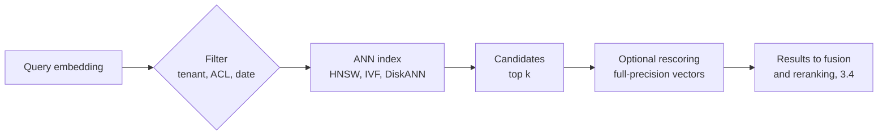

# 3.6 Vector stores: deep dive

Reference material for [3.6 Vector stores](../3-components/3.6-vector-stores.md). Read that first.
This page keeps the full treatment: provider survey, numbers, risk and controls, cloud mapping
and the complete source list.

## What it is

A vector store holds embeddings and answers one question quickly: *which stored vectors are closest to
this one?* An embedding is a list of numbers produced by a model so that texts with similar meaning end
up close together. Finding the closest vectors exactly means comparing the query with every stored
vector, which gets slow as the collection grows. So vector stores use **approximate nearest neighbour
(ANN)** indexes: they skip most of the collection and accept that they will occasionally miss a true
neighbour. The share of true neighbours they do find is called **recall**.

The concept is stable; the products are not. The real design question in 2026 is "where should the
vectors live?" Microsoft's guidance is explicit: if cost
matters or you already run a database with vector support, use it, and reach for a dedicated search
service when you need a managed index over content from many sources
([Azure Architecture Center](https://learn.microsoft.com/azure/architecture/guide/technology-choices/vector-search)).
Google makes the same bet from the other side, expecting vector search to become a standard feature of
every database it runs ([Google Cloud](https://cloud.google.com/discover/what-is-a-vector-database)).
AWS compares six of its own vector-capable services and lets Bedrock Knowledge Bases sit on top of
several of them ([AWS Prescriptive Guidance](https://docs.aws.amazon.com/prescriptive-guidance/latest/choosing-an-aws-vector-database-for-rag-use-cases/vector-db-comparison.html)).

### Where vectors can live

| Option | Strength | Weakness |
|---|---|---|
| **Your operational database** (PostgreSQL, document or SQL databases with vector support) | Vectors sit next to the data, permissions and filters you already have; one system to run | Fewer search features (keyword ranking, reranking) unless you add them |
| **A search service** | Keyword, vector and hybrid search with ranking in one place; managed indexing from many sources | A second copy of the data to keep in sync, with update lag |
| **A dedicated vector database** | Tuned for very large collections and high query rates | Another system to secure, back up and keep in sync |
| **A managed RAG service** | Chunking, embedding and storage handled for you | Less control over each stage; tied to one provider |

### How ANN indexes work

Three families, often combined:

- **Graphs.** Each vector links to its near neighbours; a search walks the graph towards the query.
  **HNSW** adds layers of increasingly sparse graphs so the walk starts with long jumps and finishes with
  short ones ([Malkov & Yashunin](https://arxiv.org/abs/1603.09320)). It is the common default: fast and
  high-recall, but memory-hungry and slow to build. **DiskANN** keeps a graph on SSD and was shown to
  serve a billion vectors from one machine with 64 GB of RAM
  ([Subramanya et al., NeurIPS 2019](https://papers.nips.cc/paper/2019/hash/09853c7fb1d3f8ee67a61b6bf4a7f8e6-Abstract.html)).
- **Partitions (IVF).** Cluster the vectors, then search only the clusters nearest the query. Faster
  to build and smaller than HNSW, with a worse speed–recall curve, and it needs data present before the
  index is built ([pgvector docs](https://github.com/pgvector/pgvector)).
- **Compression (quantization).** Store vectors in fewer bits. Scalar quantization to 8-bit integers
  shrinks the index about 4×; binary quantization up to 28×
  ([Azure AI Search](https://learn.microsoft.com/azure/search/vector-search-how-to-quantization)).
  Product quantization splits each vector into pieces and encodes each piece with a small codebook
  ([Jégou et al., 2011](https://inria.hal.science/inria-00514462v2)); Google's ScaNN refines this by
  shaping the compression error to protect the scores that matter for ranking
  ([Google Research](https://research.google/blog/announcing-scann-efficient-vector-similarity-search/)).
  Engines often keep full-precision vectors to rescore the top candidates.

Every index has a speed-for-recall knob (`ef_search` for HNSW, probed partitions for IVF). Tune it
against a labelled query set.

### Distance and embeddings

Cosine similarity, dot product and Euclidean distance are the usual metrics. If the embeddings are
normalised to length 1, all three rank results identically and the dot product is fastest; OpenAI's
embeddings are normalised by default ([OpenAI](https://help.openai.com/en/articles/6824809-embeddings-faq)).
Use the metric the embedding model was trained for.

The store is only as good as the embedding model. Providers differ here: OpenAI and Google offer their
own embedding models, and OpenAI's can be shortened to fewer dimensions at some cost in accuracy;
Anthropic offers no embedding model and points to Voyage AI
([Anthropic](https://docs.anthropic.com/en/docs/build-with-claude/embeddings)). Fewer dimensions mean
smaller, faster indexes; choose by measuring retrieval quality on your own queries.

### Filtering

Most real queries carry a filter: tenant, permissions, document type, date. There are two ways to apply
it, and they fail differently:

- **Post-filtering** finds the top *k* vectors, then drops those that fail the filter. With a selective
  filter it returns fewer than *k* results, sometimes none, and nothing reports an error. In
  [lab 3.6](../../labs/3.6-vector-stores/README.md), a filter matching 1% of vectors returned 0.1 of 10
  requested results on average.
- **Pre-filtering** restricts the search to vectors that pass the filter. It keeps recall but can
  cost more for very selective filters, because the search must traverse further to find enough matches
  ([Azure AI Search filters](https://learn.microsoft.com/azure/search/vector-search-filters)).

Engines have converged on filtering *during* the index search: Azure AI Search makes pre-filtering
the default, pgvector added iterative index scans that keep searching until enough rows pass the filter,
and AlloyDB evaluates filters inline with its ScaNN index. For highly selective filters, exact search
over the filtered subset is often the fastest correct answer.

## When to use / when to avoid

| Use when | Avoid or reconsider when |
|---|---|
| Similarity search over more than a few thousand items, as part of retrieval (3.4), recommendations or deduplication | The whole corpus fits in the prompt ([2.3](../2-trade-offs/2.3-context-vs-retrieval.md)) |
| You already run a database with vector support: start there | Queries are exact lookups or aggregates: use the database's ordinary indexes or SQL |
| You need hybrid search, ranking and managed indexing across sources: use a search service | A dedicated vector database would only duplicate data that already lives, permissioned, elsewhere |

## Trade-offs

- **[2.1 Cost vs quality vs latency](../2-trade-offs/2.1-cost-quality-latency.md).** Recall, latency,
  memory and build time pull against each other through index type, quantization and search width.
- **Operational simplicity vs search features.** Keeping vectors in the operational database removes a
  sync job and reuses its permissions; a search service adds keyword ranking and reranking at the cost
  of a second copy.

## Limitation → mitigating pattern

| Limitation | Mitigating pattern |
|---|---|
| Exact search too slow at scale | ANN index (HNSW, IVF, DiskANN) |
| Index too large for memory | Quantization with rescoring; disk-based graphs (DiskANN) |
| Selective filters return too few results | Filtering during the search, or exact search over the filtered subset |
| Vectors miss exact terms | Hybrid search with a keyword index ([3.4](../3-components/3.4-retrieval-pipeline.md)) |
| Embedding model replaced | Re-embed everything into a new index, then switch over |

## Numbers

| Figure | Value | As of | Source |
|---|---|---|---|
| Index size reduction from int8 scalar / binary quantization | ≈ 4× / up to 28× | Nov 2026 | [Azure AI Search](https://learn.microsoft.com/azure/search/vector-search-how-to-quantization) |
| DiskANN on 1 billion vectors, one 16-core machine, 64 GB RAM | > 5,000 queries/s, < 3 ms mean latency, ≥ 95% 1-recall@1 | 2019 | [Subramanya et al.](https://papers.nips.cc/paper/2019/hash/09853c7fb1d3f8ee67a61b6bf4a7f8e6-Abstract.html) |
| ScaNN vs next-fastest library on glove-100 at equal accuracy | ≈ 2× queries per second | Jul 2020 | [Google Research](https://research.google/blog/announcing-scann-efficient-vector-similarity-search/) |
| pgvector HNSW defaults | m = 16, ef_construction = 64, ef_search = 40 | Nov 2026 | [pgvector](https://github.com/pgvector/pgvector) (not verified against the repository; seen via a documentation mirror) |
| Recall@10 on clustered synthetic data, IVF scoring 4% of vectors | 0.998 | Nov 2026 | [Lab 3.6](../../labs/3.6-vector-stores/README.md) |

Benchmarks depend on data, hardware and recall target: use them for the shape of a trade-off, never for sizing.

## Failure modes and antipatterns

- **Post-filtering with selective filters.** Short or empty result sets, no error.
- **Mixing embedding models in one index.** Vectors from different models aren't comparable. A model
  change means re-embedding everything, which is a planned migration, not a config change.
- **Treating embeddings as anonymous.** Text can be partly reconstructed from embeddings; protect the
  store like the source documents ([OWASP LLM08](https://genai.owasp.org/llmrisk/llm082025-vector-and-embedding-weaknesses/)).
- **Tuning by feel.** Recall changes with index settings, quantization and data; measure it.
- **Forgetting the sync lag.** With a separate index, content isn't searchable until it is
  re-indexed, and deletions aren't honoured until they propagate.

## Risk and controls

| Risk | Reference | Control | Evidence an auditor would ask for |
|---|---|---|---|
| Cross-tenant or cross-permission leakage through similarity search | OWASP LLM08:2025 | Mandatory server-side filter on tenant and permission fields, applied during the search; separate collections or indexes where isolation must be absolute | Isolation tests per tenant; query templates showing the enforced filter |
| Sensitive text recovered from vectors | OWASP LLM08:2025 (embedding inversion) | Same classification, encryption, access control and residency as the source data | Data classification record; encryption and network configuration |
| Deleted or expired content still retrievable | Records retention and data-protection obligations | Propagate deletes; reconcile the index against the source on a schedule | Reconciliation reports; deletion test results |
| Silent quality loss after an index, quantization or model change | Model risk management practice | Treat index and embedding-model changes as releases gated by retrieval evals ([3.15](../3-components/3.15-evals.md)) | Before/after recall on a fixed query set, with approval |
| Index unavailable in a regional outage | Operational resilience | Replicas; for regional services, a second region and a rebuild or replication plan | Recovery tests; documented recovery time |

## Cloud mapping

| Option | Azure | AWS | Google Cloud | OpenAI | Self-hosted / open source |
|---|---|---|---|---|---|
| Operational database | Azure Database for PostgreSQL (pgvector, pg_diskann); Cosmos DB for NoSQL (DiskANN); Azure SQL Database (DiskANN, preview) | Aurora / RDS for PostgreSQL (pgvector) | AlloyDB (pgvector, ScaNN index, inline filtering); Cloud SQL; Spanner; BigQuery `VECTOR_SEARCH` | — | PostgreSQL + pgvector |
| Search service | Azure AI Search (HNSW, exhaustive KNN, scalar and binary quantization, pre/post filter modes) | OpenSearch Service and Serverless; Amazon Kendra | Agent Search | — | OpenSearch, Elasticsearch |
| Dedicated / in-memory | Azure Managed Redis | Neptune Analytics (graph + vector); Amazon S3 Vectors and MemoryDB (not verified here) | Vertex AI Vector Search (ScaNN) | — | FAISS, hnswlib; Qdrant, Weaviate, Milvus |
| Managed RAG storage | AI Search integrated vectorisation | Bedrock Knowledge Bases (Aurora, OpenSearch Serverless, Neptune Analytics, Pinecone, Redis Enterprise Cloud) | Vertex AI RAG Engine | Vector stores for file search | — |
| Embedding models | Azure OpenAI embeddings | Bedrock embedding models | Vertex AI embeddings | OpenAI embeddings (shortenable dimensions) | Open-weight models. Anthropic offers none and recommends Voyage AI |

Sources: [Azure vector search choices](https://learn.microsoft.com/azure/architecture/guide/technology-choices/vector-search)
(updated Sep 2026); [AWS vector database comparison](https://docs.aws.amazon.com/prescriptive-guidance/latest/choosing-an-aws-vector-database-for-rag-use-cases/vector-db-comparison.html);
[Google Cloud vector databases](https://cloud.google.com/discover/what-is-a-vector-database) and
[AlloyDB vector search](https://docs.cloud.google.com/alloydb/docs/ai/perform-vector-search);
[OpenAI retrieval](https://developers.openai.com/api/docs/guides/retrieval);
[Anthropic embeddings](https://docs.anthropic.com/en/docs/build-with-claude/embeddings).

## Sources and further reading

- [Choose an Azure service for vector search](https://learn.microsoft.com/azure/architecture/guide/technology-choices/vector-search)
  (Microsoft, Sep 2026): the clearest decision flow of any vendor, and a capability matrix.
- [Choosing an AWS vector database for RAG use cases](https://docs.aws.amazon.com/prescriptive-guidance/latest/choosing-an-aws-vector-database-for-rag-use-cases/introduction.html)
  (AWS Prescriptive Guidance).
- [What is a vector database?](https://cloud.google.com/discover/what-is-a-vector-database) (Google Cloud).
- [Efficient and robust approximate nearest neighbor search using HNSW graphs](https://arxiv.org/abs/1603.09320)
  (Malkov & Yashunin, TPAMI 2018).
- [DiskANN: Fast accurate billion-point nearest neighbor search on a single node](https://papers.nips.cc/paper/2019/hash/09853c7fb1d3f8ee67a61b6bf4a7f8e6-Abstract.html)
  (Microsoft Research, NeurIPS 2019).
- [Product quantization for nearest neighbor search](https://inria.hal.science/inria-00514462v2) (Jégou, Douze & Schmid, TPAMI 2011).
- [Announcing ScaNN](https://research.google/blog/announcing-scann-efficient-vector-similarity-search/) (Google Research, 2020).
- [Add a filter to a vector query](https://learn.microsoft.com/azure/search/vector-search-filters) (Azure AI Search).
- [pgvector](https://github.com/pgvector/pgvector): index types, filtering and iterative scans in one README.
- [Embeddings FAQ](https://help.openai.com/en/articles/6824809-embeddings-faq) (OpenAI) and
  [Embeddings](https://docs.anthropic.com/en/docs/build-with-claude/embeddings) (Anthropic).
- [Lab 3.6](../../labs/3.6-vector-stores/README.md): recall vs search width, and post- vs pre-filtering.
