# 3.8 Serving internals: deep dive

Reference material for [3.8 Serving internals](../3-components/3.8-serving-internals.md). Read that first.

## Where the sources agree

The technique lineage is unusually clear, because each idea came from a paper and was absorbed by
every open engine within months.

- **Iteration-level scheduling** (continuous batching): Orca, OSDI 2022. Now universal; see
  [2.7](2.7-throughput-vs-latency.md).
- **Paged KV cache:** vLLM's authors found existing systems wasted 60–80% of KV-cache memory to
  fragmentation and over-reservation; storing the cache in fixed blocks cut waste to under 4% and
  improved throughput 2–4× over FasterTransformer and Orca at the same latency
  ([Kwon et al., SOSP 2023](https://arxiv.org/abs/2309.06180); [vLLM blog](https://vllm.ai/blog/vllm)).
  The blog also reports up to 24× the throughput of Hugging Face Transformers and up to 3.5× that of
  Text Generation Inference (figures checked against both sources 2026-11-02).
- **Prefix reuse:** SGLang's RadixAttention indexes cached prefixes in a radix tree so requests that
  share a prefix reuse its cache ([Zheng et al.](https://arxiv.org/abs/2312.07104)); vLLM offers
  automatic prefix caching. Gains depend entirely on how much prefix your traffic shares.
- **Chunked prefill:** Sarathi-Serve splits prefills into chunks scheduled alongside decodes
  ("stall-free batching") ([Agrawal et al., OSDI 2024](https://arxiv.org/abs/2403.02310)). vLLM V1
  enables chunked prefill by default whenever possible and prioritises decodes; `max_num_batched_tokens`
  trades time to first token against inter-token latency
  ([vLLM docs](https://docs.vllm.ai/en/latest/configuration/optimization.html)). SGLang sets the
  chunk size with `--chunked-prefill-size`, where -1 turns it off
  ([SGLang docs](https://docs.sglang.io/docs/advanced_features/server_arguments.md)).
- **Disaggregation:** DistServe runs prefill and decode on separate GPUs to remove interference and
  tune each phase separately, reporting 7.4× more requests or 12.6× tighter latency targets, and
  showing the cache transfer overhead is small on modern clusters
  ([Zhong et al., OSDI 2024](https://arxiv.org/abs/2401.09670)). NVIDIA's open-source Dynamo
  orchestrates disaggregated serving and cache-aware routing over vLLM, SGLang and TensorRT-LLM;
  llm-d builds on vLLM and the Kubernetes Gateway API Inference Extension
  ([Dynamo](https://github.com/ai-dynamo/dynamo); [NVIDIA](https://developer.nvidia.com/blog/nvidia-dynamo-accelerates-llm-d-community-initiatives-for-advancing-large-scale-distributed-inference)).
- **Speculative decoding:** Leviathan et al. (Google) showed 2–3× faster T5-XXL inference with
  identical outputs and no retraining ([ICML 2023](https://arxiv.org/abs/2211.17192)); Chen et al.
  (DeepMind) reported 2–2.5× on Chinchilla 70B ([2023](https://arxiv.org/abs/2302.01318)). Later
  variants (Medusa, EAGLE) draft from extra heads on the target model instead of a separate model.
- **Quantization:** a study of over 500,000 evaluations across the Llama 3.1 family found 8-bit
  floating-point weights and activations effectively lossless, well-tuned 8-bit integer at 1–3%
  degradation, and 4-bit integer weights competitive with 8-bit integer; a tuned GPTQ beat AWQ on
  real-world tasks. 4-bit weights gave the best cost-efficiency for low-concurrency serving and 8-bit
  formats won for high-concurrency continuous batching on high-end GPUs
  ([Kurtic et al., ACL 2025](https://arxiv.org/abs/2411.02355)).

**Clouds converge on "bring an open engine".** Google's GKE tutorials serve open models with vLLM
and route with the GKE Inference Gateway, autoscaling on KV-cache utilisation rather than CPU
([Google Cloud](https://cloud.google.com/blog/topics/developers-practitioners/implementing-high-performance-llm-serving-on-gke-an-inference-gateway-walkthrough/)).
Dynamo publishes recipes for AWS EKS, GKE and Azure AKS. Anthropic and OpenAI don't sell self-hosting;
their tiers (fast mode, priority) expose these internals as prices ([2.7](2.7-throughput-vs-latency.md)).

## How it works, step by step

The worked numbers use the 8-billion-parameter model shape from
[Lab 3.8](../../labs/3.8-serving-internals/README.md): 32 layers, 8 key-value heads of size 128,
16-bit values. That is 128 KiB of KV cache per token.

### KV cache and paged attention

<!-- source: images/src/dd-3.8-paged-kv-cache.mmd; render with scripts/diagrams.py -->

1. **Prefill writes the cache.** For every prompt token, each layer computes a key and a value vector
   and stores them. Decode reads all of them at every step and appends one more pair per new token.
2. **The naive way reserves the worst case.** Older servers gave each request one contiguous region
   sized for the longest possible answer, because they couldn't know how long it would be.
3. **Paged attention splits the cache into fixed blocks**, typically 16 tokens each, placed anywhere
   in memory. Each request keeps a block table mapping its token positions to blocks, like an
   operating system's page table.
4. **Blocks are taken only when needed.** A request holds at most one partly filled block, so waste is
   under 16 tokens per request.
5. **Identical prefixes can share blocks.** Requests with the same system prompt point at the same
   blocks; a block is copied only if one request needs to change it.
6. **When memory runs out,** the scheduler pauses a request and frees its blocks, then recomputes or
   reloads them later.

**Worked number.** Suppose 64 GiB of accelerator memory is free for the cache, requests may reach
8,192 tokens, and the average request uses 1,500. Reserving the maximum costs 1 GiB per request, so
64 requests fit and 82% of each reservation sits empty. Paging allocates 94 blocks of 2 MiB (188 MiB),
wasting 4 tokens, so about 348 requests fit: 5.4 times as many. If ten of them share a
4,000-token system prompt, sharing stores it once (0.49 GiB) instead of ten times (4.9 GiB).

### Continuous batching

<!-- source: images/src/dd-3.8-continuous-batching.mmd; render with scripts/diagrams.py -->

1. **Decode runs in steps.** Each step produces one token for every request in the batch, for the cost
   of reading the weights once.
2. **Static batching fixes the batch.** It starts a set of requests together and waits until the
   longest finishes before starting new ones.
3. **Continuous batching rebuilds the batch every step.** After each step the scheduler removes
   finished requests, frees their KV blocks, and admits waiting requests.
4. **New requests need prefill.** A long prefill would stall everyone's next token, so engines split it
   into chunks and run one chunk alongside each decode step (chunked prefill).
5. **The limit is memory or the latency target.** The scheduler admits requests while KV blocks are
   free and step time stays within the per-token target ([2.7](2.7-throughput-vs-latency.md)).

**Worked number.** Four requests need 50, 100, 200 and 1,000 output tokens. A static batch occupies
four slots for 1,000 steps but produces only 1,350 tokens: 34% of the slot-steps do useful work. A new
request arriving at step 60 waits about 940 steps, around 9 seconds at 10 ms per step. With continuous
batching it joins at the next step, and the slots stay full while requests are waiting.

### Speculative decoding

<!-- source: images/src/dd-3.8-speculative-decoding.mmd; render with scripts/diagrams.py -->

1. **A cheap drafter guesses ahead.** A small model, or extra heads on the main model, proposes the
   next few tokens, say four.
2. **The target model checks them in one pass.** Checking four tokens costs about the same as writing
   one, because decode is limited by reading the weights, not by arithmetic.
3. **Guesses are accepted from left to right.** Each is kept if it passes a probability test against
   the target model's own distribution. The first rejected guess is replaced by a token drawn from a
   corrected distribution, and the rest are discarded.
4. **The output is unchanged.** The acceptance rule makes the result follow exactly the target model's
   distribution ([Leviathan et al.](https://arxiv.org/abs/2211.17192)). Only speed changes.
5. **The gain depends on the acceptance rate.** Predictable text such as code, boilerplate and quoted
   context is accepted often; creative text less so.

**Worked number.** With acceptance rate a and g drafted tokens, each target pass yields on average
(1 − a^(g+1)) / (1 − a) tokens. At a = 0.8 and g = 4 that is 3.36 tokens per pass. If each draft
token costs 5% of a target pass, one round costs 1.2 passes, so the speed-up is 3.36 / 1.2 = 2.8×. At
a = 0.5 it falls to 1.6×, which is why speculation pays on predictable workloads and little elsewhere.

## Numbers

| Figure | Value | As of | Source |
|---|---|---|---|
| KV-cache memory wasted before paging | 60–80% → under 4% with PagedAttention | 2023 | Kwon et al. |
| PagedAttention throughput vs FasterTransformer and Orca | 2–4× at the same latency | 2023 | Kwon et al. |
| Speculative decoding speed-up | 2–3× (T5-XXL); 2–2.5× (Chinchilla 70B); outputs unchanged | 2023 | Leviathan et al.; Chen et al. |
| Disaggregated prefill/decode | 7.4× more requests or 12.6× tighter SLO | 2024 | DistServe |
| Quantization accuracy | FP8 W8A8 ≈ lossless; INT8 W8A8 −1 to −3%; INT4 weights ≈ INT8 | 2025 | Kurtic et al. |
| KV cache, 8B model, 128k tokens | 69 GB (full MHA, 16-bit) → 17 GB (GQA) → 8.6 GB (GQA, 8-bit) | derived | [Lab 3.8](../../labs/3.8-serving-internals/README.md) |

Engine benchmarks compare against specific baselines on specific hardware and change with every
release. Benchmark your own model, hardware and traffic before choosing.

## Failure modes and antipatterns

- **Sizing memory for weights only**, then discovering long contexts fit only a handful of requests.
- **Autoscaling on CPU or request count.** Scale on queue depth, KV-cache utilisation or latency.
- **Round-robin load balancing** across replicas, which defeats prefix caching. Route by prefix.
- **Speculation under load.** The spare compute it relies on disappears when the server is busy.
- **Quantizing without evaluating** your own task, especially for code and long reasoning.
- **Pinning an engine version forever.** Performance and defaults change monthly; re-benchmark on
  upgrade.

## Risk and controls

| Risk | Reference | Control | Evidence an auditor would ask for |
|---|---|---|---|
| Quantized or reconfigured model behaves differently from the evaluated one | Model risk management | Treat precision and engine changes as model changes: re-run evals | Eval results per configuration; change log |
| Compromised model weights or engine image | OWASP LLM03 Supply Chain | Signed weights in safe formats; pinned, scanned images ([3.17](../3-components/3.17-security.md)) | Signature checks; image scan reports |
| Cross-tenant data via shared prefix cache | Data protection | Scope prefix caches per tenant where prompts contain tenant data | Cache configuration; tenancy design |
| Capacity exhaustion at peak | Operational resilience | Load tests at target percentiles; autoscaling on serving metrics | Load-test reports; scaling policy |

## Cloud mapping

| | Azure | AWS | Google Cloud | Open source |
|---|---|---|---|---|
| Self-host open models on Kubernetes | AKS (Dynamo recipe) | EKS (Dynamo recipe) | GKE with vLLM; GKE Inference Gateway | vLLM, SGLang, TensorRT-LLM; Dynamo; llm-d |
| Managed endpoints for open models | Foundry managed compute (preview) | SageMaker AI endpoints (LMI or vLLM containers) | Vertex AI model deployment | — |
| Cache-aware routing | — | — | GKE Inference Gateway | Gateway API Inference Extension; Dynamo router |

## Sources

- [Orca](https://www.usenix.org/conference/osdi22/presentation/yu) (Yu et al., OSDI 2022).
- [PagedAttention](https://arxiv.org/abs/2309.06180) (Kwon et al., SOSP 2023) and the [vLLM blog](https://vllm.ai/blog/vllm).
- [SGLang](https://arxiv.org/abs/2312.07104) (Zheng et al.).
- [DistServe](https://arxiv.org/abs/2401.09670) (Zhong et al., OSDI 2024).
- [Speculative decoding](https://arxiv.org/abs/2211.17192) (Leviathan et al., ICML 2023) and [speculative sampling](https://arxiv.org/abs/2302.01318) (Chen et al., 2023).
- [Accuracy-performance trade-offs in LLM quantization](https://arxiv.org/abs/2411.02355) (Kurtic et al., ACL 2025).
- [Sarathi-Serve](https://arxiv.org/abs/2403.02310) (Agrawal et al., OSDI 2024); [vLLM optimization and tuning](https://docs.vllm.ai/en/latest/configuration/optimization.html); [SGLang server arguments](https://docs.sglang.io/docs/advanced_features/server_arguments.md).
- [Managed compute in Foundry](https://learn.microsoft.com/en-gb/azure/foundry/how-to/deploy-models-managed) (Microsoft, preview) and [LMI containers](https://docs.aws.amazon.com/sagemaker/latest/dg/large-model-inference-tutorials.html) (AWS).
- [NVIDIA Dynamo](https://github.com/ai-dynamo/dynamo).
- [GKE Inference Gateway walkthrough](https://cloud.google.com/blog/topics/developers-practitioners/implementing-high-performance-llm-serving-on-gke-an-inference-gateway-walkthrough/) (Google Cloud).
- [Lab 3.8](../../labs/3.8-serving-internals/README.md).
