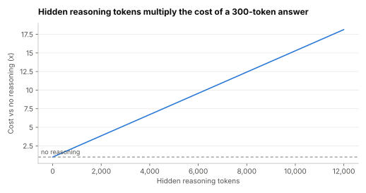

# Lab 0.2: Prefill, decode, the KV cache and reasoning tokens

Supports section [0.2 Inside a model call](../../docs/0-orientation/0.2-inside-a-model-call.md).

**Question:** on one accelerator serving an 8-billion-parameter model, how much faster is reading a
prompt than writing an answer? How much work does the KV cache save? And what do hidden reasoning
tokens do to one call's cost and wait?

```sh
python3 model_call.py
```

Standard library only. It is a roofline estimate with the same round, illustrative hardware figures as
[Lab 2.7](../2.7-throughput-vs-latency/README.md): 2 TB/s of memory bandwidth and 400 trillion usable
operations per second. Real engines differ in detail; the ratios are the point. Prices in Part 3 are
relative, with output at five times input.

## Prediction (before running)

Decode will be at least 50 times slower per token than prefill for one user, and batching will narrow
that to under 10 times. The KV cache will save at least 100 times the work. Reasoning tokens will
raise cost roughly in proportion to their number.

## Result (run 2026-11-01)



| Work | Time | Tokens per second | Accelerator-seconds per 1,000 tokens |
|---|---|---|---|
| Prefill a 500-token prompt | 20 ms | 25,000 | 0.040 |
| Prefill a 2,000-token prompt | 80 ms | 25,000 | 0.040 |
| Prefill a 8,000-token prompt | 320 ms | 25,000 | 0.040 |
| Decode, batch 1, 2,000 tokens of context | 8.1 ms per step | 123 | 8.131 |
| Decode, batch 16, 2,000 tokens of context | 10.1 ms per step | 1,585 | 0.631 |
| Decode, batch 64, 2,000 tokens of context | 16.4 ms per step | 3,905 | 0.256 |

Generating 500 tokens after a 2,000-token prompt took 40 trillion operations with a KV cache and
18,004 trillion without (450 times more). The cache held 328 MB for that one request.

| Hidden reasoning tokens | Output tokens billed | Relative cost of the call | Time to finish at batch 16 |
|---|---|---|---|
| 0 | 300 | 1.0x | 3.7 s |
| 1,000 | 1,300 | 2.4x | 15.9 s |
| 4,000 | 4,300 | 6.7x | 52.5 s |
| 12,000 | 12,300 | 18.1x | 150.1 s |

The prediction held.

## What it shows

- **Output tokens are the expensive ones.** For one user, decode needed about 200 times more
  accelerator time per token than prefill. At batch 64 it was still about 6 times more, close to the
  ratio providers charge.
- **Long prompts are cheap in time, long answers are not.** An 8,000-token prompt was read in a third
  of a second; a 300-token answer took several seconds.
- **The KV cache trades memory for work.** It cut the arithmetic 450-fold, but each request holds
  hundreds of megabytes, which is what limits how many users one accelerator can serve.
- **Reasoning tokens are output tokens.** 4,000 of them made a call 6.7 times as expensive and 14
  times as slow, before the user saw a word.
- **So:** cap output, stream answers, and turn reasoning on only where the task needs it.

## Exercises

1. Change `PARAMS` to 70e9 (and `WEIGHTS` follows). How do the prefill and decode rates change?
2. Halve `BW`. Which rows change, and which don't? What does that tell you about each phase?
3. At what number of reasoning tokens does a call cost more than ten calls without reasoning?
