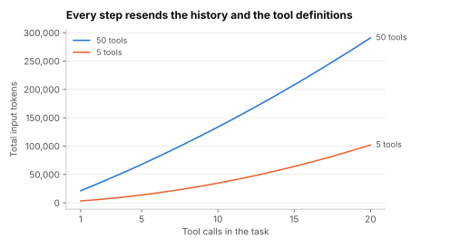

# Lab 0.3: The tool-calling loop, its token bill, and what checks catch

Supports section [0.3 Tool calling and structured output](../../docs/0-orientation/0.3-tool-calling.md).

**Question:** how do input tokens grow as an agent loop makes more tool calls, and how much do the
tool definitions add? Separately, if a model proposes some malformed or forbidden calls, what does
schema validation catch, and what needs a permission check?

```sh
python3 tool_loop.py
```

Standard library only; seeded. Token sizes are round illustrative numbers: a 400-token system prompt,
40 tokens per call, 300 per result and 200 for the final answer. Part 2 uses a scripted stand-in for a
model that proposes 2,000 calls, 3% with malformed arguments and 1% to a tool the session may not use.

## Prediction (before running)

Total input tokens will grow faster than the number of calls, and 50 tool definitions will dominate
short tasks. Schema validation will catch the malformed calls but not the forbidden ones.

## Result (run 2026-11-01)



| Tool calls | Tool definitions | Input tokens on the last call | Total input tokens | Total output tokens |
|---|---|---|---|---|
| 1 | 5 tools (1,000 tokens) | 1,800 | 3,260 | 240 |
| 1 | 50 tools (10,000 tokens) | 10,800 | 21,260 | 240 |
| 5 | 5 tools (1,000 tokens) | 3,160 | 13,860 | 400 |
| 5 | 50 tools (10,000 tokens) | 12,160 | 67,860 | 400 |
| 20 | 5 tools (1,000 tokens) | 8,260 | 102,060 | 1,000 |
| 20 | 50 tools (10,000 tokens) | 17,260 | 291,060 | 1,000 |

| Policy | Calls executed | Malformed calls reaching the system | Forbidden calls executed | Calls returned to the model as errors |
|---|---|---|---|---|
| run as proposed | 2,000 | 60 | 19 | 0 |
| schema validation | 1,940 | 0 | 19 | 60 |
| validation + permission check | 1,921 | 0 | 0 | 79 |

The prediction held.

## What it shows

- **The loop resends everything.** A 20-step task read 102,060 input tokens to write 1,000 output
  tokens, because each call resends the whole history. Input grows with the square of the step count.
- **Tool definitions are a fixed tax per call.** With 50 tools, a one-step task cost 21,260 input
  tokens instead of 3,260. Over 20 steps the definitions alone added about 189,000 tokens.
- **Validation and authorisation do different jobs.** Validation stopped all 60 malformed calls. All
  19 transfers were well formed, so only the permission check stopped them.
- **So:** keep tool sets small or searchable, clear old results, cache the fixed prefix, and check
  permissions in code for every call.

## Exercises

1. Raise `RESULT` to 3,000 tokens (a long document per call). How does the 20-step total change?
2. Change the forbidden rate from 1% to 0.1%. Is the permission check still worth it? Why?
3. Add a step limit of 10. What should your code return to the user when the limit is reached?
