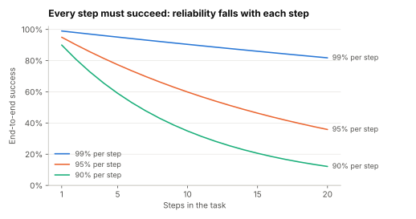

# Lab 2.2: What autonomy costs in reliability and predictability

Supports section [2.2 Determinism vs autonomy](../../docs/2-trade-offs/2.2-determinism-vs-autonomy.md).

**Question:** if a model step is right 95% of the time, how reliable is a ten-step chain? Why does an
agent that solves 60% of tasks fail repeat customers more often than that suggests? And how much does
the number of model calls vary when the model decides when to stop?

```sh
python3 reliability.py
```

numpy only, seeded. Pure simulation: the distributions are assumptions, the shapes are the point.

## Prediction (before running)

Ten 95% steps will land near 60%. Pass^8 will be far below pass@1 for the noisy population and equal
to it for the all-or-nothing one. The agent's p95 call count will be at least double the workflow's.

## Result (run 2026-11-01)



End-to-end success when every step must succeed (p^n):

| Per-step success | 3 steps | 5 steps | 10 steps | 20 steps |
|---|---|---|---|---|
| 99% | 97% | 95% | 90% | 82% |
| 95% | 86% | 77% | 60% | 36% |
| 90% | 73% | 59% | 35% | 12% |

Same average success, different consistency (1,000 tasks):

| Population | pass@1 | pass^2 | pass^4 | pass^8 |
|---|---|---|---|---|
| every task 60% (pure noise) | 60% | 36% | 13% | 2% |
| 60% of tasks always, 40% never | 60% | 60% | 60% | 60% |
| mixed difficulty | 58% | 41% | 25% | 14% |

Model calls per request (100,000 requests):

| Design | Mean | p50 | p95 | p99 | Max |
|---|---|---|---|---|---|
| Workflow (4 fixed calls) | 4.0 | 4 | 4 | 4 | 4 |
| Agent loop (cap 25) | 6.0 | 5 | 13 | 18 | 25 |

Prediction held. 0.17% of agent requests hit the step cap.

## What it shows

- **Reliability compounds.** Long chains need either very reliable steps or checks between them. A
  validator that catches a bad step and retries it raises that step's effective success rate; this is
  what workflows make easy and agents make hard.
- **Averages hide inconsistency.** Two systems with 60% pass@1 behave completely differently for a
  customer who comes back eight times. Measure pass^k, not just pass@1
  ([3.15](../../docs/3-components/3.15-evals.md)). The mixed-difficulty row is closest to what
  τ-bench reported for real agents.
- **Autonomy widens the tail.** The mean cost rose 50%, but p95 more than tripled. Capacity, latency
  budgets and quotas are set by the tail, so agents need step caps and budgets
  ([3.1](../../docs/3-components/3.1-ai-gateway-and-router.md)).
- **What this simulation leaves out.** It assumes independent steps with no recovery. Real agents can
  notice an error and fix it, which is their main advantage; real workflows can't handle inputs their
  designer didn't foresee. Measure your own system before trusting either story.

## Exercises

1. Add a validator to Part 1: a failed step is caught 80% of the time and retried once. What does
   ten-step success become at 95% per step?
2. Change the agent's stopping probability from 0.25 to 0.1. What happens to p99 and the cap rate?
3. Which population in Part 2 does your current system resemble? How would you find out?
