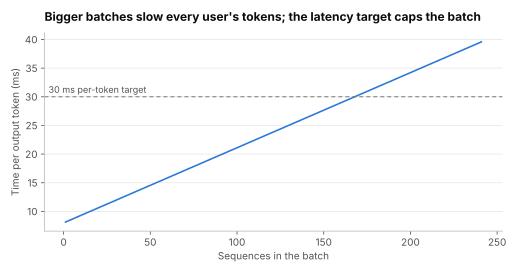

# Lab 2.7: Batching, per-user speed, and why you can't run at 100%

Supports section [2.7 Throughput vs per-request latency](../../docs/2-trade-offs/2.7-throughput-vs-latency.md).

**Question:** if one accelerator serves an 8B-parameter model, how do total throughput and each
user's token rate change as the batch grows? And how long do requests queue as the server gets busier?

```sh
python3 batching.py
```

numpy only. The hardware figures are round illustrative numbers (80 GB memory, 2 TB/s bandwidth),
and the model is a simple roofline: each decode step must read every weight once plus each sequence's
attention cache. Real engines differ in detail; the shape is the point.

## Prediction (before running)

Total throughput will rise many times over with batch size while each user's speed falls more slowly.
A per-token latency target, not memory, will cap the batch. Queueing delay will grow sharply above
about 80% utilisation.

## Result (run 2026-11-01)



Weights 16 GB; attention cache 262 MB per 2,000-token sequence; memory fits 244 sequences.

| Batch | Step time (ms) | Tokens/s per user | Tokens/s total | Meets 30 ms per-token SLO? |
|---|---|---|---|---|
| 1 | 8.1 | 123 | 123 | yes |
| 8 | 9.0 | 111 | 884 | yes |
| 32 | 12.2 | 82 | 2,624 | yes |
| 64 | 16.4 | 61 | 3,905 | yes |
| 128 | 24.8 | 40 | 5,166 | yes |
| 192 | 33.2 | 30 | 5,789 | no |
| 244 | 40.0 | 25 | 6,103 | no |

Queueing delay for 200 ms requests with random arrivals:

| Utilisation | Mean wait (ms) | p95 wait (ms) | p99 wait (ms) |
|---|---|---|---|
| 50% | 100 | 410 | 669 |
| 70% | 232 | 818 | 1,268 |
| 85% | 550 | 1,777 | 2,666 |
| 95% | 1,963 | 5,699 | 8,981 |

Prediction held. With a looser 50 ms target, memory (244 sequences) would have been the cap instead.

## What it shows

- **Batching is nearly free throughput, at first.** Decode is limited by reading the weights from
  memory, and one read serves every sequence in the batch. Going from 1 to 32 sequences gave 21× the
  throughput while each user slowed by only a third.
- **Then each user pays.** From 128 to 244 sequences, throughput rose 18% but each user's speed fell
  38%. The cache that grows with every sequence is what eventually dominates.
- **Goodput, not throughput.** The useful number is the most work you can do while meeting the
  latency target. Here a 30 ms per-token target caps the batch near 128–190, below what memory allows.
- **Headroom is not waste.** Mean queueing delay rose more than fivefold from 50% to 85% utilisation, and p99
  passed 2.6 s. Size capacity for the tail you promise, not the average.

## Exercises

1. Halve the bytes per parameter (8-bit weights). What happens to batch-1 speed and to memory capacity?
2. Raise `CONTEXT` to 32,000 tokens. How many sequences fit now?
3. At what utilisation does p95 wait exceed one second?
