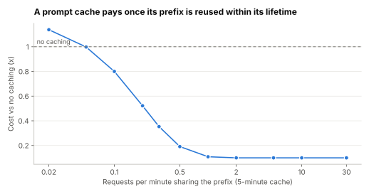

# Lab 3.13: When a prompt cache pays, and what a semantic cache gets wrong

Supports section [3.13 Caching](../../docs/3-components/3.13-caching.md).

**Question:** a provider charges 1.25× to write a prefix to its cache, 0.1× to read it, and drops it
five minutes after its last use. How much traffic must share a prefix before caching pays? Separately,
can a similarity threshold let a response cache reuse answers to paraphrased questions without serving
wrong answers?

```sh
python3 caching.py
```

Standard library only. Part 1 simulates random arrivals. Part 2 uses character-trigram similarity, a
crude stand-in for embeddings, on 12 hand-written bank questions; read it as an illustration, not a
benchmark.

## Prediction (before running)

Caching will pay once requests for a prefix arrive more often than every few minutes. For the
semantic cache, some threshold will serve most paraphrases while rejecting questions that differ in
one important word.

## Result (run 2026-11-01)



| Requests per minute sharing the prefix | Hit rate | Prefix cost vs no caching |
|---|---|---|
| 0.05 | 22% | 1.00x |
| 0.1 | 39% | 0.80x |
| 0.2 | 64% | 0.52x |
| 0.5 | 92% | 0.19x |
| 1 | 99% | 0.11x |
| 5 | 100% | 0.10x |
| 30 | 100% | 0.10x |

| Similarity threshold | Served from cache | Correct hits | Wrong answers served | Missed reuse |
|---|---|---|---|---|
| 0.5 | 12 of 12 | 6 | 6 | 0 |
| 0.6 | 10 of 12 | 6 | 4 | 0 |
| 0.7 | 8 of 12 | 4 | 4 | 2 |
| 0.8 | 4 of 12 | 1 | 3 | 5 |
| 0.9 | 1 of 12 | 0 | 1 | 6 |

Prediction held for Part 1 and failed for Part 2: no threshold worked.

## What it shows

- **Prompt caching needs traffic, not just a long prefix.** At one request every 20 minutes the cache
  expires between uses and you pay the write premium for nothing (1.00×). At one request every five
  minutes cost falls to about half, at one every two minutes to a fifth, and at one a minute it
  reaches the 0.1× floor. Hit rate depends on
  how often a prefix recurs within the cache's lifetime.
- **A semantic cache can't tell paraphrase from a one-word change.** "Daily transfer limit for a
  cheque account" is closer, by surface similarity, to the cached savings-account question than many
  genuine paraphrases are. Raising the threshold removed correct hits faster than wrong ones. Real
  embedding models handle paraphrase better than trigrams, but the failure is the same in kind: a
  wrong number served confidently, with no model call to catch it.
- **So:** use provider prompt caching freely, because it reuses computation, not answers, and can't
  change what the model says. Treat response caching by similarity as a risk decision, limited to
  low-stakes content and partitioned by user.

## Exercises

1. Change `TTL` to 3,600 (a one-hour cache) and `WRITE` to 2.0. Where is the break-even now?
2. Add three paraphrases and three one-word changes of your own to `pairs.json`. Does any threshold work?
3. What would you add to a semantic cache's key so that a cached answer can never cross users?
