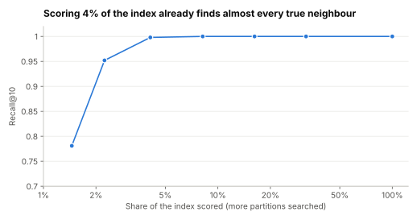

# Lab 3.6: Approximate search and filtering

Supports section [3.6 Vector stores](../../docs/3-components/3.6-vector-stores.md).

**Questions:** how much recall does an approximate index give up for speed, and what happens when a
filter is applied after the vector search instead of before it?

```sh
python3 ann_and_filters.py
```

Needs Python 3.9+ and numpy. Synthetic data (20,000 normalised 64-dimensional vectors in 50 clusters,
200 queries); runs in about a second.

## Predictions (made before the first run)

1. Recall rises with the number of partitions searched (`nprobe`), and the share of vectors scored is
   roughly `nprobe` %.
2. With a filter matching 1% of vectors, taking the top 10 approximate results and then filtering
   returns about 0.1 results on average; over-fetching 100 candidates returns about 1.
3. Filtering first returns the full 10.

## Result (run 2026-11-01)



| nprobe | recall@10 | vectors scored |
|---|---|---|
| 1 | 0.781 | 1.5% |
| 2 | 0.952 | 2.2% |
| 4 | 0.998 | 4.1% |
| 8 | 1.000 | 8.2% |
| 100 (exact) | 1.000 | 100% |

| Filter strategy (filter matches 0.9%) | results returned (of 10) | recall |
|---|---|---|
| Post-filter top-10 approximate results | 0.1 | 0.008 |
| Post-filter top-100 approximate results | 1.0 | 0.096 |
| Pre-filter (exact search over the tenant's vectors) | 10.0 | 1.000 |

All three predictions held.

## What it shows

- **Approximate search is a dial, not a switch.** Scoring 4% of the index found 99.8% of the true top
  10 here. Real embeddings are less neatly clustered than this synthetic set, so expect to need more
  probes (or a larger `ef_search` in HNSW) for the same recall; measure on your own data.
- **Post-filtering silently drops results.** The query asked for 10 results and got 0.1 on average.
  Nothing errors; the user just gets a poor answer. Over-fetching helps only in proportion to how many
  extra candidates you take.
- **Selective filters belong inside the search.** Pre-filtering (or an engine that filters during
  graph traversal) returns the full result set. The pre-filter here is exact search over the subset,
  which is cheap when the subset is small; that is why several engines fall back to exact search for
  highly selective filters.

## Exercises

1. Change the tenant share to 10% and 50%. When does post-filtering become acceptable?
2. Add product quantization or int8 scalar quantization to Part A and measure recall again.
3. Replace the synthetic data with real embeddings of the lab 3.4 corpus.
