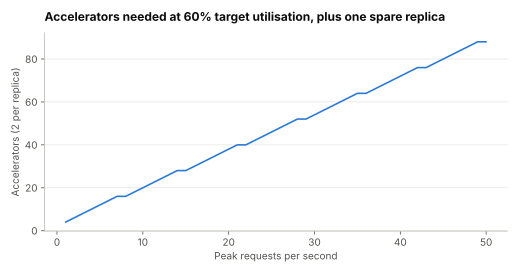

# Lab 4.1: How many accelerators does a self-hosted inference API need?

Supports section [4.1 Design an LLM inference API](../../docs/4-solved-designs/4.1-llm-inference-api.md).

**Question:** a team wants to self-host a 70B-parameter open model in 8-bit weights, on pairs of 80 GB
accelerators, for requests of 3,000 input and 300 output tokens with a 50 ms per-token target. How
many requests per second does one replica sustain, what limits it, and how many accelerators does a
given peak need?

```sh
python3 capacity.py
```

Standard library only. A roofline estimate with a 50% efficiency factor; hardware figures are round
numbers. Use it to size a load test, not to sign a purchase order.

## Prediction (before running)

Decode will be the bottleneck and the 50 ms target will cap the batch. A replica will manage around
5–10 requests per second.

## Result (run 2026-11-01)



- Weights 70 GB over 2 accelerators; cache 541 MB per request; memory fits 136 concurrent requests.
- Largest batch within 50 ms per token: 136 (memory, not latency, set the cap); decode ≈ 3,174
  tokens/s per replica.
- Prefill of 3,000 tokens ≈ 420 ms; sustainable ≈ 1.9 requests/s per replica.

| Peak requests/s | Replicas at 100% | Replicas at 60% target utilisation | Accelerators (+1 replica spare) |
|---|---|---|---|
| 1 | 0.5 | 1 | 4 |
| 5 | 2.6 | 5 | 12 |
| 10 | 5.1 | 9 | 20 |
| 25 | 12.9 | 22 | 46 |
| 50 | 25.7 | 43 | 88 |

Prediction wrong on both counts: memory capped the batch, and *prefill* was the bottleneck.

## What it shows

- **Long prompts make prefill the cost.** Each request's 3,000-token prefill used about 82% of the
  replica's time; its 300 output tokens, shared across a large batch, used the rest. For RAG-style
  traffic, prefix caching, shorter context and disaggregated prefill matter more than faster decode
  ([3.8](../../docs/3-components/3.8-serving-internals.md)).
- **Memory sets concurrency.** A 70B model leaves room for 136 requests' caches on two 80 GB
  accelerators; longer contexts shrink that quickly.
- **Headroom costs accelerators.** Running at a 60% target (for tail latency, see
  [Lab 2.7](../2.7-throughput-vs-latency/README.md)) plus one spare replica roughly doubles the count
  at low volume. Self-hosting is cheap per token only at steady, high utilisation.

## Exercises

1. Halve `IN_TOK` (better retrieval). How many accelerators does 25 requests/s need now?
2. Switch to 16-bit weights (`BYTES = 2`). What happens to concurrency?
3. Assume 60% of each prompt is a cached shared prefix. Reduce prefill time accordingly and re-run.
