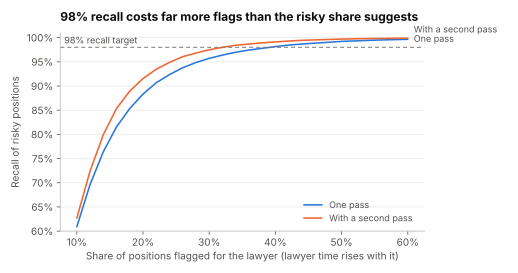

# Lab 4.4: What 98% recall costs in lawyer time

Supports section [4.4 Design a regulated document-review assistant](../../docs/4-solved-designs/4.4-regulated-document-review.md).

**Question:** the quality bar asks for 98% recall on risky positions, and the business case assumes a
first review drops from 90 to 30 minutes. If the lawyer reads only what the assistant flags, how many
flags does 98% recall take, and how many minutes is that? Does a second pass help?

```sh
python3 recall_vs_time.py
```

numpy only; seeded. Each of 4,000 synthetic contracts has 60 playbook positions, 15% of them risky. The
review model's risk scores separate risky from safe positions only moderately well. The lawyer spends
10 minutes on the summary plus 2.5 minutes per flagged position and trusts the rest. The second pass
is a partly independent check (its errors correlate 0.5 with the first). The scores are synthetic, so
read the shape, not the exact minutes.

## Prediction (before running)

Flagging about a quarter of positions will reach 98% recall, about 48 minutes per contract. A second
pass will add a point or two of recall.

## Result (run 2026-11-02)



| Positions flagged | Lawyer minutes per contract | Recall, one pass | Recall, with a second pass |
|---|---|---|---|
| 15% | 32 | 79.2% | 82.8% |
| 20% | 40 | 88.3% | 91.5% |
| 25% | 48 | 93.2% | 95.5% |
| 30% | 55 | 95.7% | 97.5% |
| 40% | 70 | 98.1% | 99.1% |
| 50% | 85 | 99.2% | 99.7% |

To reach 98% recall, one pass needs 39% of positions flagged (69 minutes, 24% saved against manual
review). With a second pass it needs 32% (58 minutes, 36% saved).

The prediction failed: 98% recall took far more flags than the 15% risky share suggests.

## What it shows

- **The last few points of recall are expensive.** Going from 93% to 98% recall raised the flags from
  a quarter to about two-fifths of all positions. The hard cases are risky positions that look safe,
  and only flagging more reaches them.
- **The 30-minute review depends on the model, not the workflow.** At 30 minutes this model catches
  under 80% of risky positions. The business case holds only if the gold set shows the model separates
  risky from safe positions much better than this one does. Measure that before promising the saving.
- **A second pass buys time, not just recall.** At the same recall it saved 11 minutes per contract,
  about 73 lawyer-hours a week at 400 contracts a week.
- **So:** set the threshold from the recall target on the gold set, then report the lawyer time that
  threshold costs. Don't set the threshold from the time you hoped to save.

## Exercises

1. Raise the risky positions' score shift from 1.6 to 2.5 (a better model). How many minutes does 98%
   recall take now?
2. Set the second pass's error correlation to 0.9. Is it still worth running? Why?
3. Lawyers skim unflagged positions at 0.2 minutes each and catch half the risky ones they skim. Add
   that. Is skimming a better use of the time than more flags?
