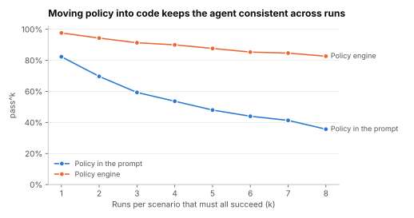

# Lab 4.5: Consistency with policy in the prompt or in a policy engine

Supports section [4.5 Design a customer-support agent](../../docs/4-solved-designs/4.5-customer-support-agent.md).

**Question:** a support agent applies a refund policy. If the model applies the rules itself, how does
its consistency over repeated runs (pass^k) compare with a design where a deterministic policy engine
applies them and the model only picks and fills the tool?

```sh
python3 policy_passk.py
```

Standard library only; seeded. A toy policy has four rules; each of 300 scenarios needs one to four of
them. With the policy in the prompt, the model gets most rules right 98% of the time, but a quarter of
rule uses are "tricky" and right only 75% of the time. With a policy engine, the model only has to
choose and fill the right tool (97–99.5% per scenario). Every scenario runs 8 times. The rates are
illustrative.

## Prediction (before running)

Both designs will look similar on a single run, within 10 points. Over 8 runs, the prompt-only design
will fall below half while the engine stays above 80%.

## Result (run 2026-11-02)



| Design | pass@1 (one run) | pass^2 | pass^4 | pass^8 | pass@8 (any of 8) |
|---|---|---|---|---|---|
| Policy in the prompt | 82% | 70% | 54% | 36% | 100% |
| Policy engine | 98% | 94% | 90% | 83% | 100% |

193 of 300 scenarios with the policy in the prompt passed some runs and failed others.

The prediction held for 8 runs and failed for one: the single-run gap was already 16 points.

## What it shows

- **pass@k hides the problem; pass^k shows it.** Both designs solved every scenario at least once in 8
  tries. Only pass^k shows that the prompt-only agent got a scenario right on all 8 runs in only about a
  third of scenarios.
- **Inconsistency comes from the steps the model decides.** Each rule the model applies is another
  chance to differ between runs. Moving eligibility into code removes those chances, leaving only tool
  choice and wording.
- **One run per scenario can't find flaky cases.** Two-thirds of the prompt-only scenarios were flaky.
  An eval that runs each scenario once reports them as simply passed or failed.
- **So:** keep policy decisions in a deterministic engine, and gate releases on pass^k over simulated
  scenarios ([4.7](../../docs/4-solved-designs/4.7-eval-and-release-pipeline.md)).

## Exercises

1. Lower the tricky-rule share from 25% to 5%. How close does the prompt-only design get to the engine?
2. How many scenarios do you need before the pass^8 estimate is within ±5 points? Use the confidence
   interval from [Lab 3.15](../3.15-evals/README.md).
3. Add a fifth rule that only the model can judge (for example, "the customer sounds distressed").
   Where should it live, and how would you test it?
