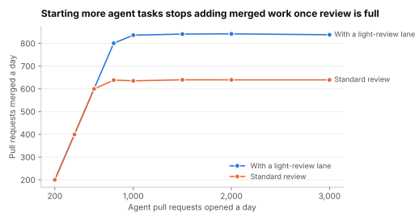

# Lab 4.6: Review capacity caps merged work

Supports section [4.6 Design a coding agent platform](../../docs/4-solved-designs/4.6-coding-agent.md).

**Question:** the design says human review, not compute, is the bottleneck. With a fixed budget of
reviewer-hours, what happens to merged pull requests, stale ones and cost per merged change as agents
open more pull requests a day? How much does a light-review lane for low-risk changes help?

```sh
python3 review_capacity.py
```

Standard library only; seeded. Reviewers have 250 hours a day for agent pull requests. A review round
takes 15 minutes, and a pull request needs 1–4 rounds (mean about 1.6), with each revision ready the
next day. Reviewers take the oldest waiting pull request first. One untouched for 5 working days is
closed as stale. In the light lane, 30% of pull requests are low-risk and take 3-minute reviews. Token
cost is $1.21 per task, from Step 2 of 4.6.

## Prediction (before running)

Merged work will level off near 250 hours × 4 rounds an hour ÷ 1.6 rounds ≈ 625 a day. Above that,
extra tasks will mostly go stale, and cost per merged change will rise in proportion.

## Result (run 2026-11-02)



| Agent pull requests a day | Merged a day | Closed as stale | Token cost per merged PR | Merged a day, with light lane |
|---|---|---|---|---|
| 200 | 200 | 0% | $1.21 | 200 |
| 400 | 399 | 0% | $1.21 | 400 |
| 600 | 600 | 0% | $1.21 | 600 |
| 800 | 638 | 19% | $1.52 | 801 |
| 1,000 | 636 | 36% | $1.90 | 836 |
| 1,500 | 640 | 57% | $2.84 | 841 |
| 2,000 | 640 | 68% | $3.78 | 842 |
| 3,000 | 640 | 79% | $5.68 | 838 |

The prediction held.

## What it shows

- **Merged work stops at review capacity.** Past about 640 a day, every extra task went stale. At 3,000
  a day, the volume in 4.6's estimate, 79% of the work was thrown away.
- **Waste raises the real unit cost.** Token cost per *merged* change rose from $1.21 to $5.68, before
  counting the review time spent on pull requests that later went stale.
- **Cheaper review raises the ceiling.** Sending 30% of pull requests through a 3-minute lane lifted
  merged work by about 30%. Better pull requests that need fewer rounds would do the same.
- **So:** cap background tasks per team to what reviewers can absorb, and invest in review lanes,
  evidence in the pull request and first-time-right changes before buying more agent capacity.

## Exercises

1. Cut the mean review rounds from 1.6 to 1.2 (better first attempts). Where is the plateau now?
2. Change the queue to newest-first. What happens to stale pull requests, and why?
3. Find the cap on tasks a day that keeps stale pull requests under 5%.
