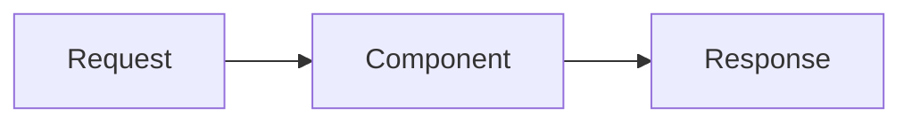

# 3.x Pattern name

One to three short paragraphs: the problem, then the mechanism. Vendor-neutral.

## How it works

- **Part or type A.** One or two sentences.
- **Part or type B.** One or two sentences.

## When to use

- ...

## When to avoid

- ...

## Disadvantages

- **Disadvantage.** What goes wrong and what it costs.

## Go deeper

[Deep dive](../deep-dives/3.x-pattern-name.md): provider survey, numbers, risk and controls, cloud
mapping. [Lab 3.x](../../labs/3.x-pattern-name/README.md): one line on what it shows.

## Flashcards

Q: Question one?
A: Answer one.

Q: Question two?
A: Answer two.

## Sources and further reading

- [Title](https://...): one line on why it is worth reading.
