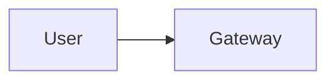

# 4.x Design X

Follows the method in [Part 1](../1-method/1-method.md).

## Step 1: Use cases, constraints and the quality bar

### Use cases
- ...

### Out of scope
- ...

### Constraints and assumptions
- Users, requests per day, peak factor
- Latency budget (time to first token, end-to-end)
- Monthly spend ceiling
- Data classification and residency

### Quality bar and eval criteria
What "good" means, and how it will be measured before launch.

## Step 2: Back-of-the-envelope

Tokens per request (input split by system / retrieved / history; output), requests/s average and peak,
tokens/day, cost/day at stated prices (dated), latency = TTFT + output tokens ÷ tokens/s.

## Step 3: High-level design

Start at the lowest rung of the complexity ladder that can meet the bar
(single call → workflow → single agent → multi-agent). Justify any climb.

## Step 4: Core components

One subsection per component, linking to its Part 3 section.

## Step 5: Harden

Guardrails, prompt-injection exposure (which legs of the lethal trifecta are present?), access control,
human review points, governance controls and audit evidence.

## Step 6: Scale and optimise

Bottlenecks in order, and the pattern that addresses each. Cost levers.

## Trade-offs made

| Decision | Alternative | Why |
|---|---|---|

## Flashcards

Q: ...
A: ...

## Sources and further reading

- ...
